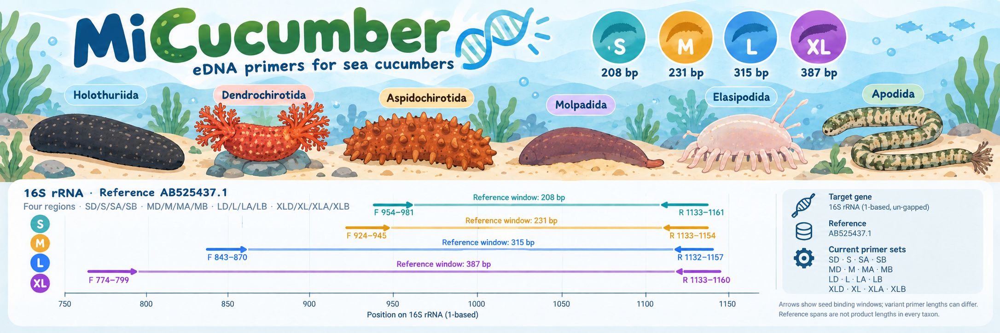
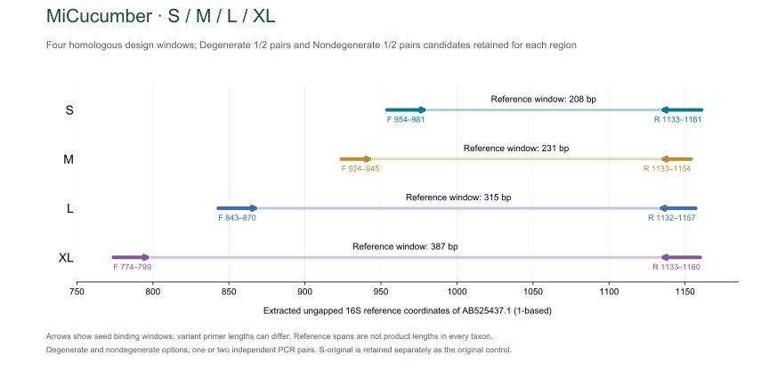
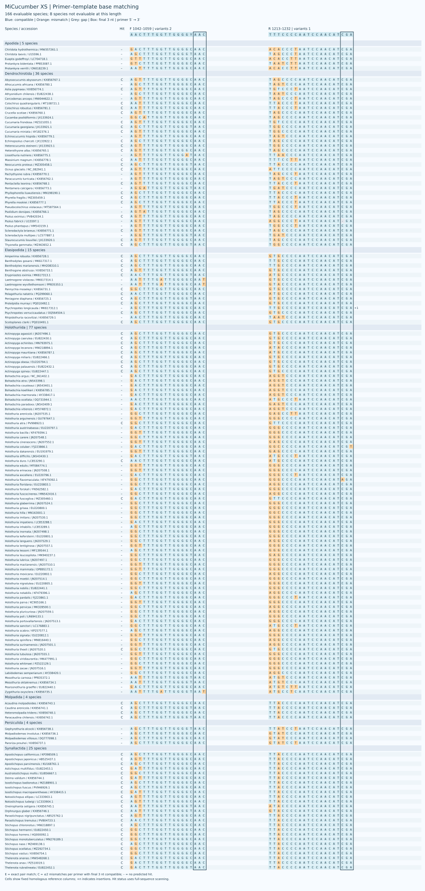
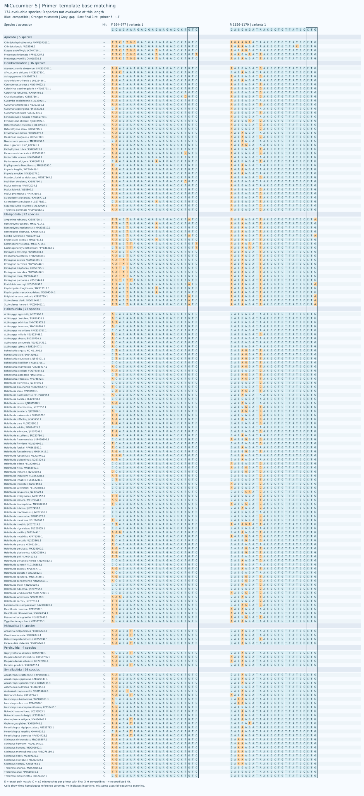
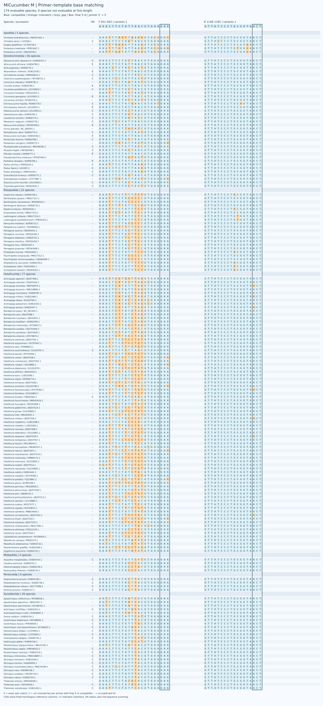
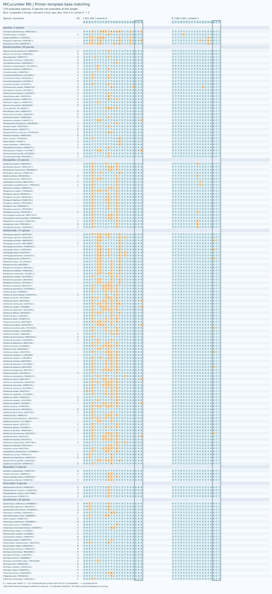
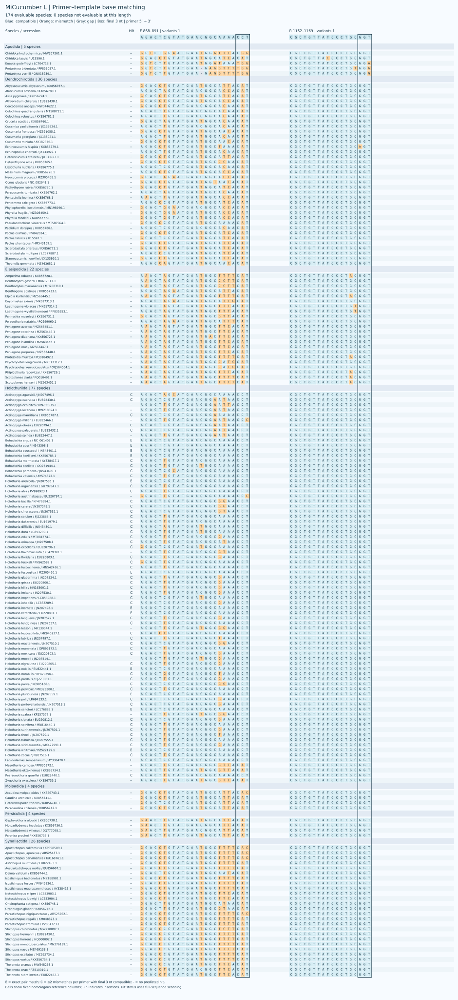
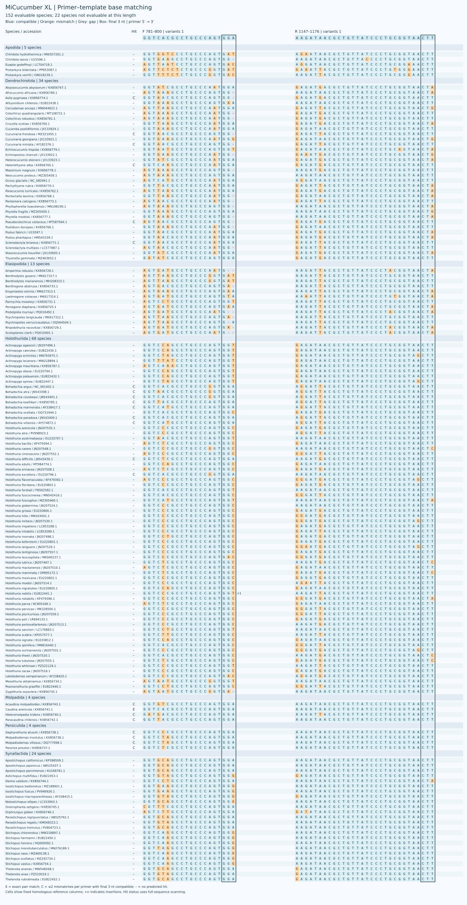
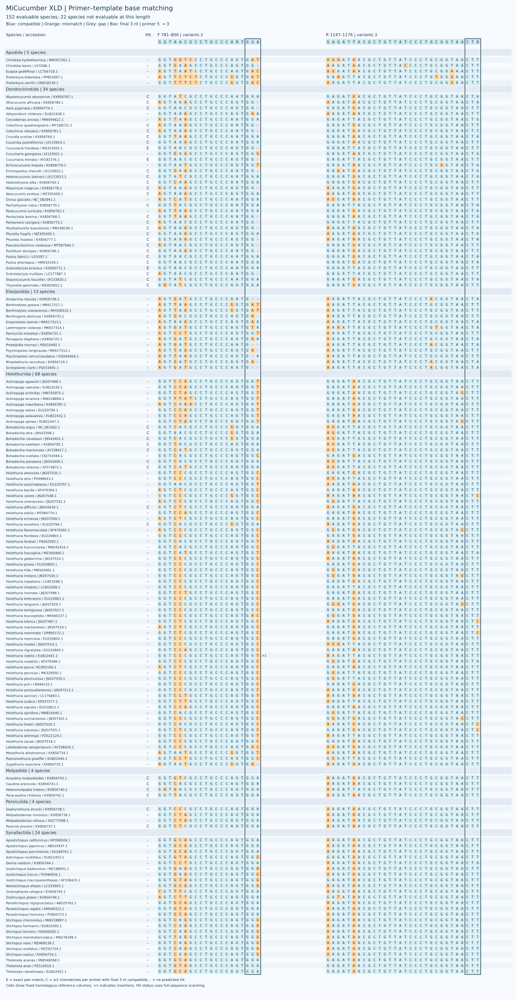

# MiCucumber

[中文](README.zh-CN.md)

## Abstract

Candidate mitochondrial 16S rRNA primers for environmental DNA across XS, S, M, L and XL. Each S–XL window retains an ordinary pair and a degenerate D pair at shared reference coordinates; XS is a single retained pair.
One reference per species is retained. Primary metrics weight evaluable species equally, with order-level results reported separately.
The sea-cucumber panel contains 174 species; XS, S–L and XL have 166, 174 and 152 evaluable species, respectively.

On the curated panel, SD covers 130/174 evaluable species and LD covers 82/174; the corresponding exact matches are 0 and 29. These are in-silico estimates for subsequent experimental testing.

## Introduction

Environmental DNA metabarcoding requires primers that amplify informative regions across target taxa. MiCucumber compares alternative mitochondrial 16S windows and paired ordinary and degenerate primers for sea cucumbers, with attention to reference representation, primer–template matching and non-target sequences. Marine eDNA metabarcoding studies demonstrate the importance of marker and reference-library choice (Gold et al., 2022); MiFish provides an example of sequence-alignment-based primer design for fishes (Miya et al., 2015). Mitochondrial 16S has also been used to examine genetic variation in sea-cucumber tissue samples (Hamamoto et al., 2021).

[参考面板 / Reference panel](results/species_qc/panel.csv) · [参考序列审核 / Reference curation](results/species_qc/README.md)

## Methods

### Reference datasets and alignment

The target library comprised 1,848 mitochondrial sequence records from sea cucumbers; the non-target library comprised 5,600 reference records. Target records were reviewed for sequence quality and taxonomy, and one representative was retained per identifiable species (174 species). Representatives were selected using binding-window completeness, ambiguous bases and reference-site coverage, without using primer-match outcomes. The retained sequences were realigned with MAFFT 7.526 (Katoh & Standley, 2013) using the ungapped mitochondrial 16S rRNA reference AB525437.1; positions are reported as 1-based coordinates. For the curated species panels, each binding window had to span the reference region, contain at least 90% of its reference-site count as A/C/G/T, and contain no ambiguous nucleotide; alignment gaps were permitted. The numbers of evaluable species were 166 for XS, 174 for S–L and 152 for XL; missing windows were excluded from the corresponding denominator. The [reference audit](results/species_qc/README.md) provides the selection criteria and accession-level records.

### Primer design and screening

Ordinary and degenerate candidates were compared within fixed forward and reverse reference windows. For S–XL, the ordinary and D pairs at each length share the same reference endpoints. D oligonucleotides were limited to eight concrete variants per primer, with IUPAC ambiguity confined to the 3′ half. Terminal screening excluded homotriplet ends and homopolymers longer than four bases and required a G or C in the final three positions. Primer3 (Untergasser et al., 2012) evaluations used 50 mM monovalent salt, 1.5 mM Mg²⁺ and 0.6 mM dNTP, under 50 nM per variant and 200 nM total per direction. The S–XL structural gate required a maximum predicted structure Tm below 55 °C and a forward–reverse duplex-Tm midpoint difference of at most 5 °C. XS was screened separately in the homologous short-fragment region and retained as a single pair. Its target scan used products of 70–500 bp and an internal distance of at least 20 bp.

### In-silico evaluation

Target coverage required at most two mismatches per primer and IUPAC-compatible final 3 nt; exact matching required zero mismatches at both sites. For S–XL, paired target scans required an amplicon of 150–500 bp and an internal distance of at least 50 bp. Background searches allowed an internal distance of 0–1,000 bp. Strict Watson–Crick (WC) and G–T models retained the terminal constraint; WC≤3 and GT≤2 were additional permissive screens without that constraint. Coverage and exact-match percentages weighted evaluable species equally, with results also summarized by order; non-target counts represent reference records. C++ and Python scans were compared on the same sequence data to verify target and strict background hit sets. These are computational predictions and require experimental validation.

[Detailed methods](docs/METHODS.md) · [Validation](docs/VALIDATION.md)

## Results

### Predicted performance

| Name | Coverage | Exact | Strict WC / GT | WC≤3 / GT≤2 |
|---|---:|---:|---:|---:|
| XS | 75/166 (45.18%) | 0/166 (0.00%) | 0 / 0 | 33 / 2 |
| S | 110/174 (63.22%) | 5/174 (2.87%) | 1 / 3 | 4 / 3 |
| SD | 130/174 (74.71%) | 0/174 (0.00%) | 0 / 5 | 58 / 6 |
| M | 55/174 (31.61%) | 9/174 (5.17%) | 0 / 2 | 1 / 2 |
| MD | 89/174 (51.15%) | 24/174 (13.79%) | 0 / 15 | 3 / 15 |
| L | 65/174 (37.36%) | 13/174 (7.47%) | 0 / 0 | 0 / 0 |
| LD | 82/174 (47.13%) | 29/174 (16.67%) | 0 / 0 | 0 / 0 |
| XL | 23/152 (15.13%) | 1/152 (0.66%) | 0 / 0 | 1 / 1 |
| XLD | 43/152 (28.29%) | 3/152 (1.97%) | 0 / 10 | 1 / 13 |

Coverage allows at most two mismatches per primer with compatible terminal 3 nt; exact matching requires zero mismatches in both primers. Strict WC/GT retain the terminal constraint; WC≤3 / GT≤2 are permissive background screens.

Each D primer has at most eight variants, with ambiguity confined to its 3′ half. XS is a single pair with a fixed name. Computational predictions require experimental validation.

SD has no exact paired matches in the current panel. LD primarily covers Holothuriida (71/77), with 8/36 Dendrochirotida and 0/22 Elasipodida.

### XS

| Name | F (5′→3′) | R (5′→3′) |
|---|---|---|
| XS | `AACTTTGGTTGGGGYAAC` | `TTTCCCCAATCCAACATCGA` |

[XS · Orders](results/current_primers/XS/XS_by_order.csv) · [Species](results/current_primers/XS/XS_by_taxon.csv)

### S

| Name | F (5′→3′) | R (5′→3′) |
|---|---|---|
| S | `CCAGAAAGACGAGAAGACCCTGTC` | `GAGGAGATAACGCTGTTATCCCTG` |
| SD | `TAAGAAAGACGARAAGACCCTRTC` | `GAGAAGATGACGCTGTTATCCCTR` |

[S · Orders](results/current_primers/S/S_by_order.csv) · [Species](results/current_primers/S/S_by_taxon.csv)

[SD · Orders](results/current_primers/S/SD_by_order.csv) · [Species](results/current_primers/S/SD_by_taxon.csv)

### M

| Name | F (5′→3′) | R (5′→3′) |
|---|---|---|
| M | `AAACTTCTATTAACGTGAAGAA` | `GTTATCCCTGCGGTAACT` |
| MD | `AAACTTCTATTHAYGTGAAGAA` | `GTTATCCCTGCGGTAACT` |

[M · Orders](results/current_primers/M/M_by_order.csv) · [Species](results/current_primers/M/M_by_taxon.csv)

[MD · Orders](results/current_primers/M/MD_by_order.csv) · [Species](results/current_primers/M/MD_by_taxon.csv)

### L

| Name | F (5′→3′) | R (5′→3′) |
|---|---|---|
| L | `AGACTCGTATGAACGGCAAAACCT` | `CGCTGTTATCCCTGCGGT` |
| LD | `AGACTTGTATGAAYGGCRAAACMT` | `CGCTGTTATCCCTGCRGT` |

[L · Orders](results/current_primers/L/L_by_order.csv) · [Species](results/current_primers/L/L_by_taxon.csv)

[LD · Orders](results/current_primers/L/LD_by_order.csv) · [Species](results/current_primers/L/LD_by_taxon.csv)

### XL

| Name | F (5′→3′) | R (5′→3′) |
|---|---|---|
| XL | `GGTCACGCCTGCCCAGTGGA` | `AAGATAACGCTGTTATCCCTGCGGTAACTT` |
| XLD | `GGTAACGCCTGCCCARTGGA` | `GAGATTACGCTGTTATCCCTGCGGTAACTD` |

[XL · Orders](results/current_primers/XL/XL_by_order.csv) · [Species](results/current_primers/XL/XL_by_taxon.csv)

[XLD · Orders](results/current_primers/XL/XLD_by_order.csv) · [Species](results/current_primers/XL/XLD_by_taxon.csv)

## Discussion

Performance varies among windows and taxa. In the current reference panel, SD covers 130/174 evaluable species but has no exact paired matches, while LD covers 82/174 and has 29 exact matches. XS covers 75/166, so its short reference span should be considered alongside its match profile. These comparisons are based on one retained sequence per species and cannot establish amplification efficiency or species detection in environmental samples.

[Copyright / 著作权](COPYRIGHT.md)

## References

1. Gold, Z., Wall, A. R., Schweizer, T. M., et al. (2022). A manager’s guide to using eDNA metabarcoding in marine ecosystems. *PeerJ*, 10, e14071. https://doi.org/10.7717/peerj.14071

2. Miya, M., Sato, Y., Fukunaga, T., et al. (2015). MiFish, a set of universal PCR primers for metabarcoding environmental DNA from fishes: detection of more than 230 subtropical marine species. *Royal Society Open Science*, 2, 150088. https://doi.org/10.1098/rsos.150088

3. Hamamoto, K., Soliman, T., Poliseno, A., Fernandez-Silva, I., & Reimer, J. D. (2021). Higher genetic diversity of the common sea cucumber *Holothuria (Halodeima) atra* in marine protected areas of the central and southern Ryukyu Islands. *Frontiers in Conservation Science*, 2, 736633. https://doi.org/10.3389/fcosc.2021.736633

4. Katoh, K., & Standley, D. M. (2013). MAFFT multiple sequence alignment software version 7: improvements in performance and usability. *Molecular Biology and Evolution*, 30, 772–780. https://doi.org/10.1093/molbev/mst010

5. Untergasser, A., Cutcutache, I., Koressaar, T., et al. (2012). Primer3—new capabilities and interfaces. *Nucleic Acids Research*, 40, e115. https://doi.org/10.1093/nar/gks596
