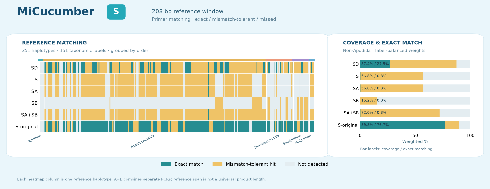
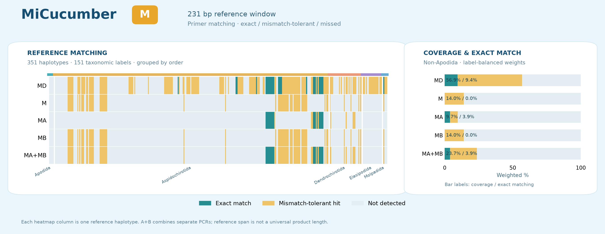
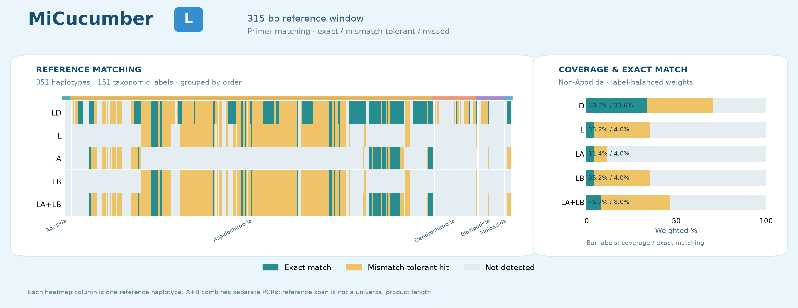
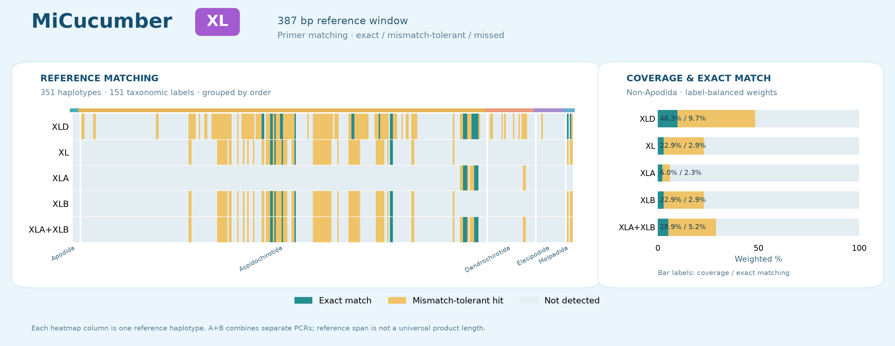

# MiCucumber

Computational mitochondrial 16S primer candidates for sea cucumbers. The four regions are **S, M, L and XL**, each with one degenerate pair and one-/two-pair nondegenerate options. **S-original** preserves the original control: 13 portfolios in total. [中文](README.zh-CN.md)

## Portfolio selection

| Region | Degenerate pair | Single nondegenerate pair | Two nondegenerate pairs |
|---|---|---|---|
| S | SD | S | SA / SB |
| M | MD | M | MA / MB |
| L | LD | L | LA / LB |
| XL | XLD | XL | XLA / XLB |

- Two pairs mean two independent PCRs. Regions are alternative comparisons; no requirement to run all portfolios on every sample.
- **Prioritize SD for experimental evaluation.** Nondegenerate sets lose substantial coverage and exact matching and remain comparators. S-original has extensive background hits.
- No portfolio has wet-lab validation or a validated single-tube multiplex recipe.

Names: SD is degenerate; S is a single nondegenerate pair; SA/SB are the two component pairs. The same rule applies to M, L and XL.

## Downloads and documentation

- **[All primer pairs, CSV](sequences/primer_pairs.csv)** · [FASTA](sequences/primers.fasta) · [S-original](sequences/MiCucumber-S-original.fasta)
- By region: [S](sequences/MiCucumber-S.csv) · [M](sequences/MiCucumber-M.csv) · [L](sequences/MiCucumber-L.csv) · [XL](sequences/MiCucumber-XL.csv)
- [Bilingual report](report.html) (download to view) · [Full common/own-region comparison](results/comparison.csv)
- [Methods](docs/METHODS.md) · [Reproduction](docs/REPRODUCIBILITY.md) · [File index](docs/FILES.md)

## Degenerate portfolios

The tables below report **non-Apodida common-panel** metrics. The full common panel has 151 taxonomic name labels and 351 within-label haplotypes, including 145 non-Apodida labels. Equal label and within-label haplotype weights; synonyms are not reconciled. All-target metrics including Apodida and own-region metrics are in the full comparison file.

| Portfolio | Non-Apodida coverage | Exact matching | WC≤3 | GT≤2 | WC≤4 |
|---|---:|---:|---:|---:|---:|
| SD | 87.45% | 27.48% | 2 | 0 | 742 |
| MD | 56.90% | 9.43% | 0 | 0 | 130 |
| LD | 70.26% | 33.63% | 4 | 0 | 109 |
| XLD | 48.34% | 9.71% | 0 | 0 | 486 |

## Nondegenerate comparators

| Portfolio | Non-Apodida coverage | Exact matching | WC≤3 | GT≤2 | WC≤4 |
|---|---:|---:|---:|---:|---:|
| S | 56.78% | 0.34% | 0 | 0 | 2 |
| SA+SB | 71.96% | 0.34% | 0 | 0 | 2 |
| M | 14.05% | 0.00% | 0 | 0 | 0 |
| MA+MB | 23.70% | 3.91% | 0 | 0 | 0 |
| L | 35.24% | 3.97% | 0 | 0 | 0 |
| LA+LB | 46.68% | 8.00% | 0 | 0 | 0 |
| XL | 22.88% | 2.93% | 0 | 0 | 0 |
| XLA+XLB | 28.86% | 5.23% | 0 | 0 | 1 |

## Original control

| Portfolio | Non-Apodida coverage | Exact matching | WC≤3 | GT≤2 | WC≤4 |
|---|---:|---:|---:|---:|---:|
| MiCucumber-S-original | 89.84% | 76.75% | 3248 | 3401 | 3923 |

Coverage permits ≤2 mismatches per primer with the terminal 3 nt exact; exact matching requires zero mismatches in both primers. Background hits are accession unions among 5,600 records, not species counts or read fractions. WC≤3 and GT≤2 are screening models; WC≤4 exposes relaxed residual risk. These counts do not directly predict experimental amplification fractions.

## Amplicon regions

## Data and reproduction

- Nondegenerate sets: 2,644 concrete candidate pairs enumerated; 31,428 agreement checks for the selected portfolios and original control, with complete reproduction tested.
- Current references: 1,848 target and 5,600 background records. Apodida is excluded from optimization but retained in all-target reporting. Two added loci are direction-corrected homology inferences; six UNVERIFIED records were excluded.
- Design and evaluation reuse frozen references; no independent holdout validation. Exhaustive optimality is conditional on the candidate pool and objective.
- Run `python scripts/check_release.py` to check current exports, mappings and hashes. Computational entry points are documented under [Reproduction](docs/REPRODUCIBILITY.md).

## Copyright

Copyright © 2026 Fei Xia (GUIBA-EX). All rights reserved. Public access is not an open-source license. Unauthorized republication and redistribution of protected original materials are prohibited, subject to statutory exceptions, GitHub platform rights and third-party data rights. [Full notice](COPYRIGHT.md)
## 匹配可视化 / Matching profiles

每列为共同面板中的一个单倍型，按目与物种排列。蓝绿色为完全匹配，金黄色为允许错配命中，浅灰色为未命中。柱图采用标签及标签内单倍型等权。A+B为独立PCR结果并集。

Each column is one common-panel haplotype, ordered by order and species. Teal: exact; gold: mismatch-tolerant hit; light gray: missed. Bars use equal label and within-label haplotype weights. A+B is the union of separate PCRs.

[逐条匹配数据 / Per-reference results](results/matching/detection.csv) · [汇总 / Summary](results/matching/summary.csv)
