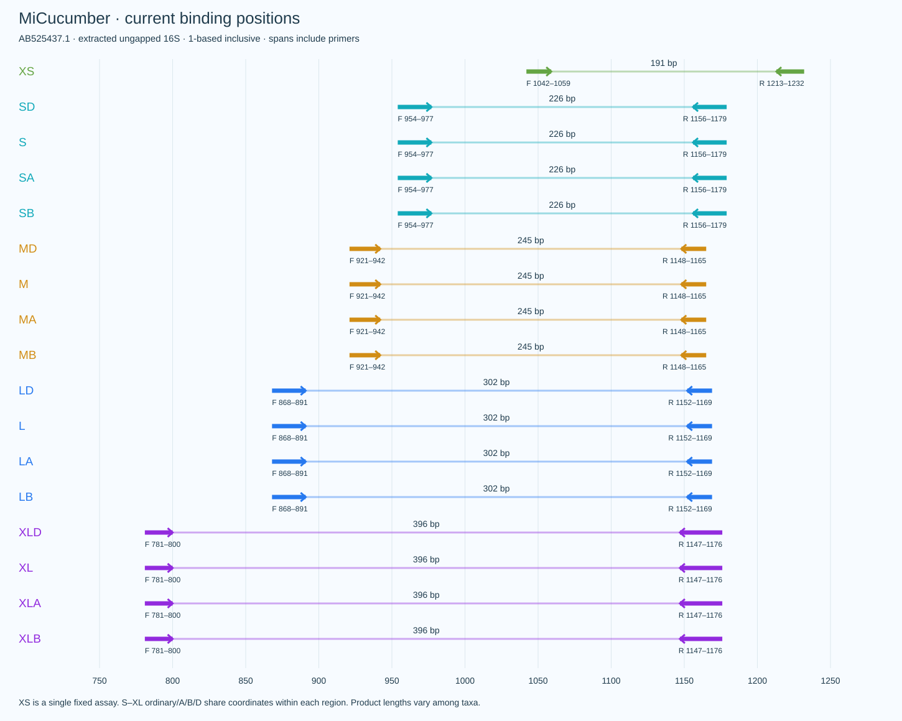
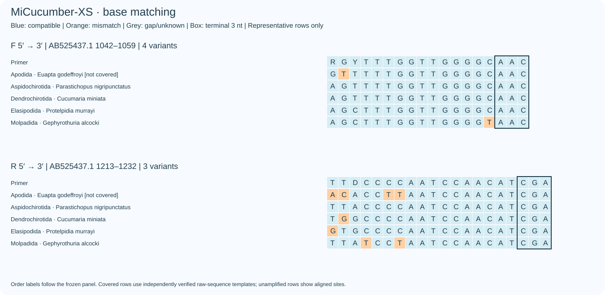
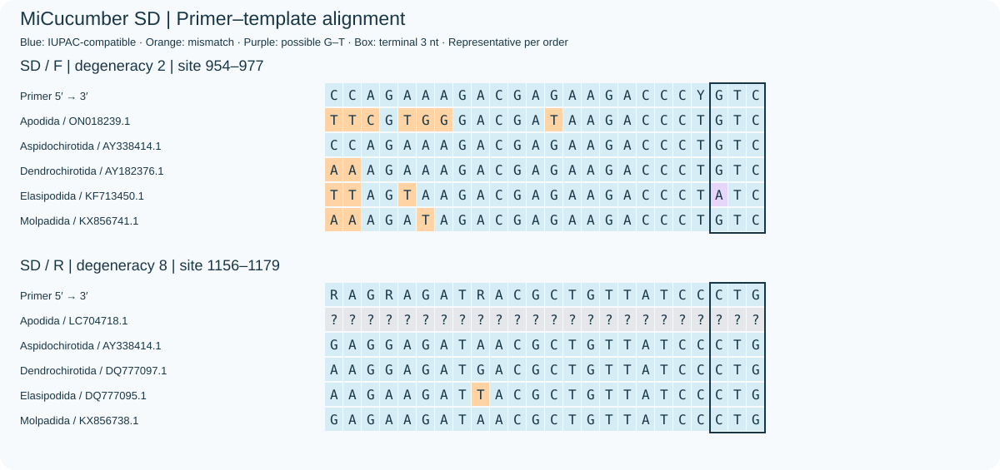
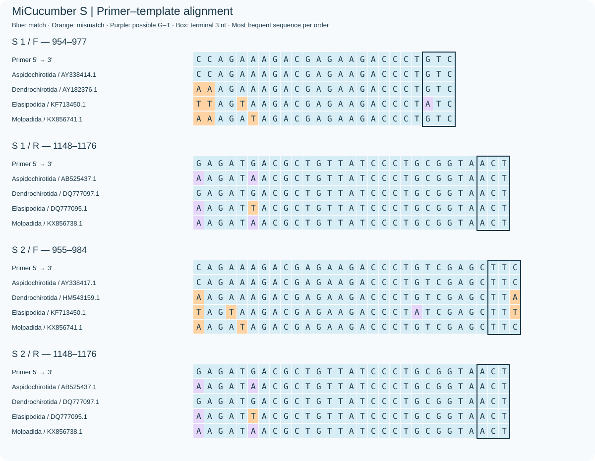
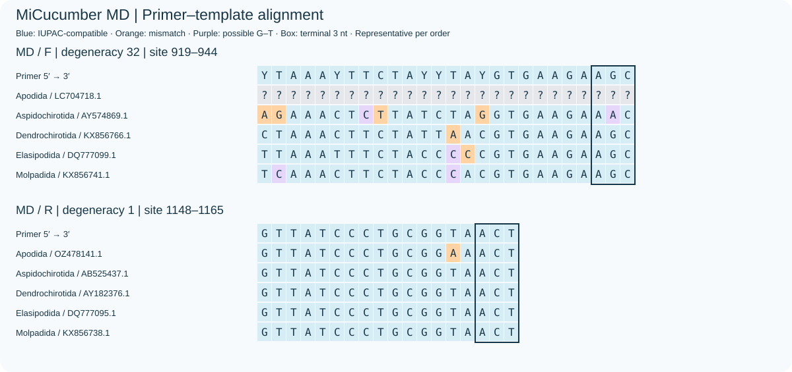
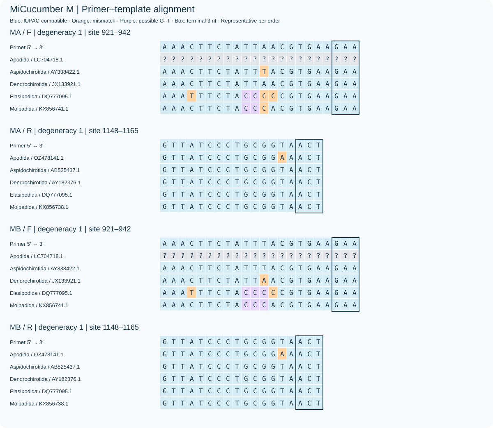
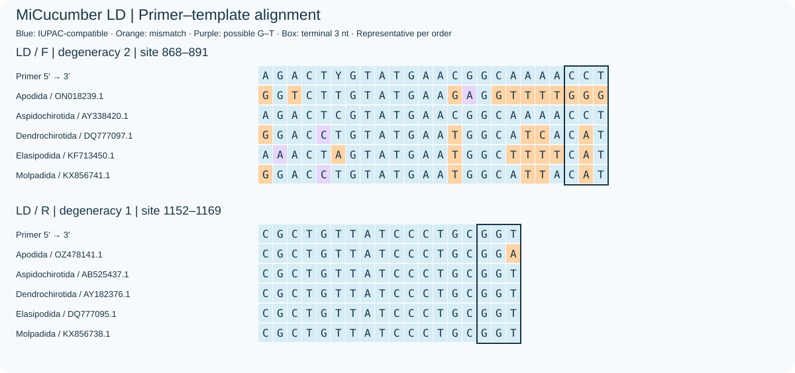
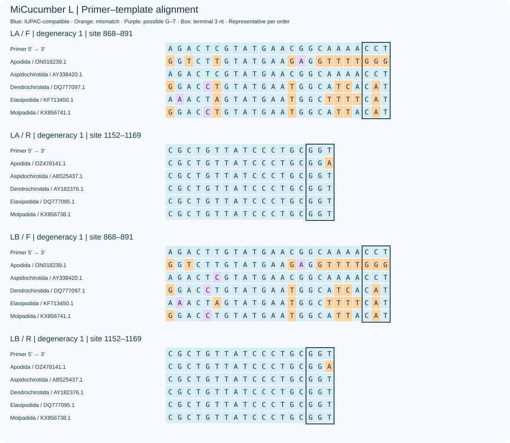
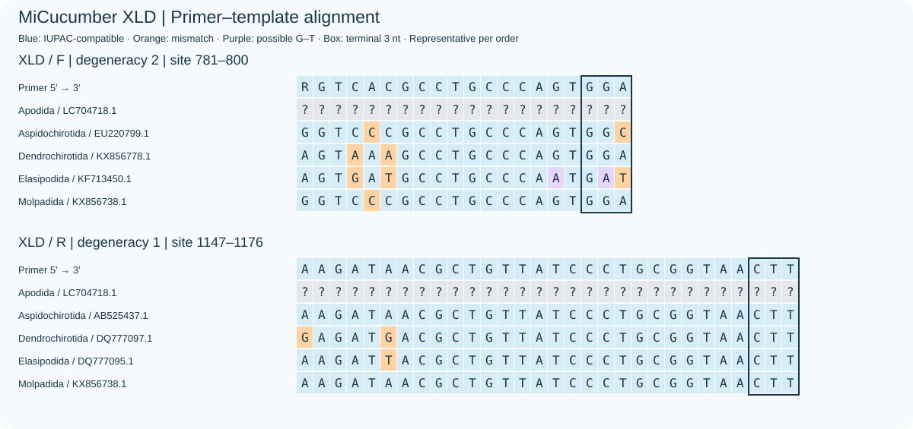
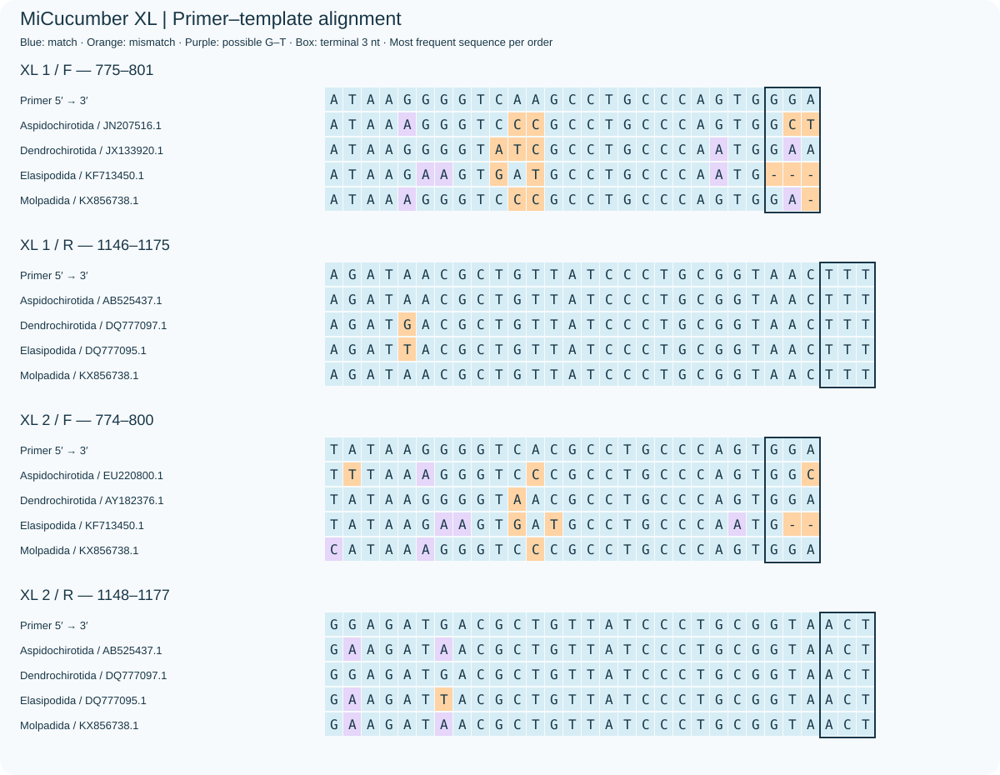

The header illustrates seven extant sea-cucumber orders. Badges show extracted ungapped AB525437.1 16S reference spans: XS 191, S 226, M 245, L 302 and XL 396 bp. Actual products vary among taxa. [Illustration notes](figures/overview_design.md)

# MiCucumber

Sea-cucumber mitochondrial 16S primers, taxonomic coverage and reproducible evidence. [中文](README.zh-CN.md)

## Latest species-based screening

The latest candidates and their comparison with the existing assays use one reference per identified species and weight evaluable species equally. See the [latest screening and base-matching figures](results/species_refine/README.md), [sequences](results/species_refine/sequences.csv), [per-order results](results/species_refine/by_order.csv), and [reference curation](results/species_qc/README.md). Existing assay sequences remain available for comparison; the legacy statistics below use the earlier reference panel.

## Current degenerate assays

One degenerate pair is retained per length. XS keeps its fixed assay name; S–XL D pairs are newly selected for taxonomic breadth. Ordinary/A/B/D share identical F/R endpoints within each length.

The primary **order-balanced coverage** averages within-order proportions of name labels with at least one paired reference hit. Exact matching uses the same hierarchy. Apodida is included. The panel has 351 haplotypes and 151 name labels in five frozen order groups, including the legacy Aspidochirotida; it is not a complete assessment of all seven extant orders.

| Assay | Order coverage | Order exact | Detected labels | F/R degeneracy | Strict WC/GT background |
|---|---:|---:|---:|---:|---:|
| XS | 75.52% | 15.42% | 131/151 | 4/3 | 20 / 20 |
| SD | 66.03% | 4.95% | 133/151 | 4/12 | 3 / 6 |
| MD | 73.18% | 29.72% | 124/151 | 128/2 | 2 / 9 |
| LD | 61.63% | 15.99% | 111/151 | 128/8 | 0 / 0 |
| XLD | 35.95% | 4.00% | 37/151 | 2/24 | 0 / 7 |

S, M, L and XL are selected from SD-T10, MD-T4, LD-T7 and XLD-T8. S uses an IUPAC union. M avoids a rise in broad WC≤3 hits from 58 to 252 for 2.15 additional coverage points; XL favors lower degeneracy at equal coverage. Selection requires terminal/thermal passes, ≤128 variants per direction, broad WC≤3/GT≤2 counts each ≤100 and strict WC/GT counts each ≤20. XS retains its separately documented background relaxation. These are preferred candidates within this verified search, not proven global optima.

[Selection and sequences](docs/D_OPTIMIZATION.md) · [Metrics and order details](docs/TAXONOMIC_COVERAGE.md) · [Selection policy](results/current/D_selection_policy.json)

## Primer sequences (5′→3′)

| Assay | F | R |
|---|---|---|
| XS | `RGYTTTGGTTGGGGCAAC` | `TTDCCCCAATCCAACATCGA` |
| SD | `CMAGAAAGACGAGAAGACCCYGTC` | `RAGRAGATDACGCTGTTATCCCTG` |
| MD | `AAAYTYCTAYYNRCGTGAAGAA` | `GTTATCCCTGCGGTARCT` |
| LD | `RRACYWGTATGAAYGGCATWACMT` | `CGCTGTTATCCCTRCRGW` |
| XLD | `RGTCACGCCTGCCCAGTGGA` | `RAGATDACGCTGTTATCCCTGCGGTAACTN` |

## Ordinary assays and names

S–XL also retain ordinary single pairs and ordinary A/B pairs. A/B use separate PCRs and union metrics, not a multiplex experiment. D denotes a degenerate pair; XS has no extra D suffix. S-original is the original control. Total: 14 portfolios, 18 paired rows and 36 FASTA records.

| Region | Degenerate | Ordinary | Ordinary A/B |
|---|---|---|---|
| XS | XS | — | — |
| S | SD | S | SA / SB |
| M | MD | M | MA / MB |
| L | LD | L | LA / LB |
| XL | XLD | XL | XLA / XLB |

<details>
<summary>Secondary within-label matching and background metrics</summary>

Matching percentages exclude Apodida and average within-label reference matching equally, rather than measuring taxon detection. Broad WC≤3, GT≤2 and WC≤4 omit terminal compatibility; strict background uses ≤2 mismatches per primer and compatible terminal 3 nt. Background has 5,600 records; counts are not experimental amplification fractions.

| Scheme | Mean within-label match | Mean within-label exact | WC≤3 | GT≤2 | WC≤4 |
|---|---:|---:|---:|---:|---:|
| XS | 88.85% | 13.32% | 1396 | 26 | 2609 |
| SD | 90.73% | 11.06% | 71 | 7 | 475 |
| S | 66.85% | 3.35% | 4 | 3 | 331 |
| SA+SB | 73.49% | 5.53% | 4 | 3 | 378 |
| MD | 83.92% | 26.90% | 58 | 9 | 536 |
| M | 33.56% | 5.52% | 1 | 2 | 13 |
| MA+MB | 36.36% | 10.80% | 1 | 3 | 39 |
| LD | 74.80% | 7.59% | 21 | 21 | 485 |
| L | 41.03% | 7.87% | 0 | 0 | 46 |
| LA+LB | 43.33% | 15.00% | 0 | 0 | 46 |
| XLD | 24.78% | 0.69% | 13 | 10 | 1392 |
| XL | 15.81% | 0.69% | 1 | 1 | 756 |
| XLA+XLB | 24.29% | 0.69% | 1 | 1 | 756 |
| S-original | 89.84% | 76.75% | 3248 | 3401 | 3923 |

</details>

## Coordinates and base matching



Blue denotes IUPAC compatibility, orange mismatch, and boxes mark terminal 3 nt. Current D plots use independently verified raw binding templates. Grey blanks indicate no paired hit in that order, not absent reference data. Ordinary plots additionally show potential G–T pairing. Representative rows do not replace panel-wide statistics.



















## Verification and scope

Terminal degeneracy is allowed. Every concrete variant is checked for no terminal homotriplet, ≥1 G/C in the final 3 nt, 1–4 G/C in the final 5 nt and no homopolymer longer than four. Both concentration scenarios require maximum structure Tm<55°C and F/R range-midpoint difference≤5°C.

For ten searched candidates, independent scans and frozen-input reproduction agree on 7,020 target decisions and 40 strict/exact background sets; the four current D assays come from these candidates. XS and ordinary/A/B retain their frozen evidence. Apodida remains 0/6. Highly degenerate assays dilute each variant; references are reused for design and evaluation, and all assays await wet-lab validation.

```bash
python scripts/check_release.py
python scripts/check_ab.py
python scripts/check_taxon_optimization.py
python scripts/taxon_coverage.py
```

## Data and methods

[Primer pairs](sequences/primer_pairs.csv) · [FASTA](sequences/primers.fasta) · [Taxonomic comparison](results/current/taxonomic_comparison.csv) · [Coordinates](results/current/binding_positions.csv)

[Methods](docs/METHODS.md) · [中文方法](docs/METHODS.zh-CN.md) · [Reproduction](docs/REPRODUCIBILITY.md) · [File index](docs/FILES.md) · [Report](report.html)

## Copyright

Copyright © 2026 Fei Xia (GUIBA-EX). All rights reserved. [Terms / 使用声明](COPYRIGHT.md).
