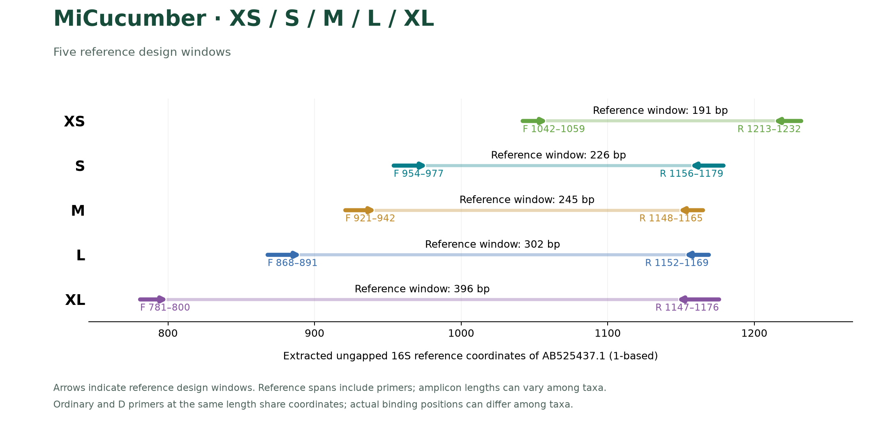

# MiCucumber

Computational design and matching assessment of mitochondrial 16S primers for sea cucumbers. [中文](README.zh-CN.md)

## Portfolios and names

Each region has a degenerate single pair, a nondegenerate single pair and a nondegenerate A/B option. Including S-original, there are **13 portfolios and 17 paired-reaction entries**.

| Region | Degenerate pair | Nondegenerate single pair | Nondegenerate A/B pairs |
|---|---|---|---|
| S | SD | S | SA / SB |
| M | MD | M | MA / MB |
| L | LD | L | LA / LB |
| XL | XLD | XL | XLA / XLB |

D denotes degeneracy. A and B identify component pairs; SA+SB denotes the union of two separate PCRs. S-original is the original control. All sequences are written 5′→3′.

**Prioritize SD for experimental evaluation.** Nondegenerate sets are retained for comparison; S-original has extensive background hits. Wet-lab validation is pending.

## Sequences and documentation

- [All primer pairs, CSV](sequences/primer_pairs.csv) · [All sequences, FASTA](sequences/primers.fasta) · [S-original](sequences/MiCucumber-S-original.fasta)
- [S](sequences/MiCucumber-S.csv) · [M](sequences/MiCucumber-M.csv) · [L](sequences/MiCucumber-L.csv) · [XL](sequences/MiCucumber-XL.csv)
- [Naming](docs/NAMING.md) · [Methods](docs/METHODS.md) · [Reproduction](docs/REPRODUCIBILITY.md) · [File index](docs/FILES.md)
- [Bilingual report](report.html) (download to view) · [Full comparison table](results/comparison.csv)

## Common-panel results

Coverage and exact matching below both refer to **non-Apodida**. The common panel contains 151 taxonomic name labels and 351 within-label haplotypes, including 145 non-Apodida labels. Labels and haplotypes within each label receive equal weights. All-target results including Apodida and own-region denominators are in the full comparison table.

| Portfolio | Coverage | Exact matching | WC≤3 | GT≤2 | WC≤4 |
|---|---:|---:|---:|---:|---:|
| SD | 87.45% | 27.48% | 2 | 0 | 742 |
| MD | 56.90% | 9.43% | 0 | 0 | 130 |
| LD | 70.26% | 33.63% | 4 | 0 | 109 |
| XLD | 48.34% | 9.71% | 0 | 0 | 486 |
| S | 56.78% | 0.34% | 0 | 0 | 2 |
| SA+SB | 71.96% | 0.34% | 0 | 0 | 2 |
| M | 14.05% | 0.00% | 0 | 0 | 0 |
| MA+MB | 23.70% | 3.91% | 0 | 0 | 0 |
| L | 35.24% | 3.97% | 0 | 0 | 0 |
| LA+LB | 46.68% | 8.00% | 0 | 0 | 0 |
| XL | 22.88% | 2.93% | 0 | 0 | 0 |
| XLA+XLB | 28.86% | 5.23% | 0 | 0 | 1 |
| S-original | 89.84% | 76.75% | 3248 | 3401 | 3923 |

Coverage permits ≤2 mismatches per primer with the terminal 3 nt exactly compatible; exact matching requires zero mismatches in both primers. Background columns count hit accessions among 5,600 reference records. WC denotes Watson–Crick matching; GT permits G–T pairing as a sensitivity model. The numbers specify the maximum mismatches per primer; see [model definitions](docs/METHODS.md#background-screening).

## Base matching and new candidates

The MiFish-inspired trial adjusts nearby binding windows and primer lengths, with terminal matching, background and thermodynamic constraints. New S and M candidates improve nondegenerate coverage; current L and XL remain preferred. The trial is retained separately from the released primers. Metrics below use the common non-Apodida panel.

| Option | Current coverage | Trial coverage | Trial exact | WC≤3 / GT≤2 |
|---|---:|---:|---:|---:|
| S single | 56.78% | 68.67% | 2.93% | 4 / 3 |
| S A+B | 71.96% | 74.02% | 2.93% | 4 / 4 |
| M single | 14.05% | 29.77% | 5.52% | 1 / 3 |
| M A+B | 23.70% | 40.60% | 9.70% | 1 / 3 |

Trial S single/two-pair options hit 451/485 background accessions under WC≤4, showing increased risk under relaxed matching. Two-pair options represent separate PCR unions.

Letters show actual bases: blue = match, orange = mismatch, purple = possible G–T pairing; boxes mark the terminal three bases. Primers and same-sense references are shown 5′→3′, with reverse-reference sites reverse-complemented. Each order is represented by its most frequent weighted binding sequence. S/M show trial two-pair candidates, L the retained current single pair, and XL the trial candidates that did not outperform the current version.


[Sequences](results/mifish_trial/specific_candidates.csv) · [Verified comparison](results/mifish_trial/verified_comparison.csv) · [Full alignment HTML](results/mifish_trial/base_matching.html) · [Reproduction](results/mifish_trial/REPRODUCE.md)

## Reference windows



Homologous seed windows on AB525437.1 span 208, 231, 315 and 387 bp. Actual product lengths can differ among taxa.

## Data and reproduction

The reference database contains 1,848 target and 5,600 background records. Apodida is excluded from the selection objective but retained in all-target reporting. Design and evaluation share the frozen reference set.

```bash
python scripts/check_release.py
```

For computational workflows, dependencies and plotting commands, see [Reproduction](docs/REPRODUCIBILITY.md).

## Copyright

Copyright © 2026 Fei Xia (GUIBA-EX). All rights reserved. See the [full notice](COPYRIGHT.md) for use and redistribution terms.
