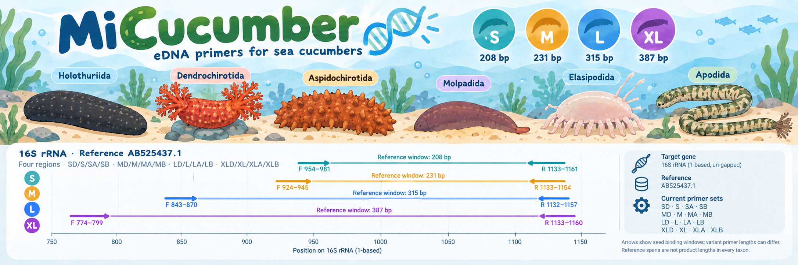
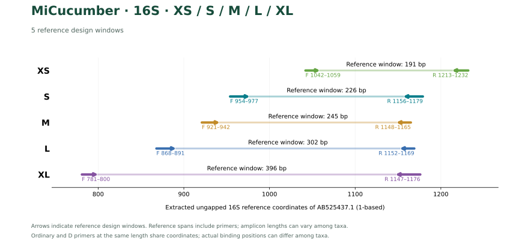
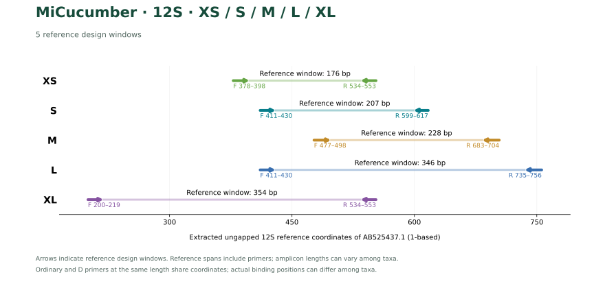
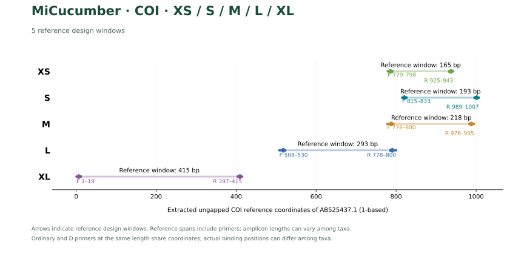

# MiCucumber

[中文](README.zh-CN.md)

MiCucumber contains 29 mitochondrial primer pairs for sea-cucumber eDNA. 16S, 12S and COI each have their own gene-relative coordinates and species panels.

[All primer sequences](sequences/all_markers.fasta) · [Preprint PDF](publications/MiCucumber_preprint.pdf) · [Manuscript](publications/MiCucumber_preprint.md)

## Choosing a window

On the common 151-species 16S panel, SD covers 115 species with no exact paired matches. LD has 23 exact matches and covers 73 species. The two measures describe different binding properties.

**12S.** Among retained D pairs, XLD covers 33/53 evaluable species, including 7 exact matches (reference span 354 bp).

**COI.** Among retained D pairs, LD covers 103/283 evaluable species, including 11 exact matches (reference span 293 bp).

## Primer sequences and predicted performance

Sequences read 5′ to 3′. Each window pairs an ordinary oligonucleotide set with its D alternative at identical endpoints, except for the single retained 16S XS pair. Coverage and exact counts use the evaluable species for that window. Strict off-target hits give two counts in this order: **Watson–Crick pairing alone / also allowing guanine–thymine pairing**.

### 16S

Background: 5,600 reference records.

| Assay | F (5′–3′) | R (5′–3′) | Span (bp) | Covered | Exact | Strict off-target hits | Base matching |
|---|---|---|---:|---:|---:|---:|---|
| XS | `AACTTTGGTTGGGGYAAC` | `TTTCCCCAATCCAACATCGA` | 191 | 75/166 | 0/166 | 0 / 0 | [View](results/current_primers/XS/base_matching_XS.svg) |
| S | `CCAGAAAGACGAGAAGACCCTGTC` | `GAGGAGATAACGCTGTTATCCCTG` | 226 | 110/174 | 5/174 | 1 / 3 | [View](results/current_primers/S/base_matching_S.svg) |
| SD | `TAAGAAAGACGARAAGACCCTRTC` | `GAGAAGATGACGCTGTTATCCCTR` | 226 | 130/174 | 0/174 | 0 / 5 | [View](results/current_primers/S/base_matching_SD.svg) |
| M | `AAACTTCTATTAACGTGAAGAA` | `GTTATCCCTGCGGTAACT` | 245 | 55/174 | 9/174 | 0 / 2 | [View](results/current_primers/M/base_matching_M.svg) |
| MD | `AAACTTCTATTHAYGTGAAGAA` | `GTTATCCCTGCGGTAACT` | 245 | 89/174 | 24/174 | 0 / 15 | [View](results/current_primers/M/base_matching_MD.svg) |
| L | `AGACTCGTATGAACGGCAAAACCT` | `CGCTGTTATCCCTGCGGT` | 302 | 65/174 | 13/174 | 0 / 0 | [View](results/current_primers/L/base_matching_L.svg) |
| LD | `AGACTTGTATGAAYGGCRAAACMT` | `CGCTGTTATCCCTGCRGT` | 302 | 82/174 | 29/174 | 0 / 0 | [View](results/current_primers/L/base_matching_LD.svg) |
| XL | `GGTCACGCCTGCCCAGTGGA` | `AAGATAACGCTGTTATCCCTGCGGTAACTT` | 396 | 23/152 | 1/152 | 0 / 0 | [View](results/current_primers/XL/base_matching_XL.svg) |
| XLD | `GGTAACGCCTGCCCARTGGA` | `GAGATTACGCTGTTATCCCTGCGGTAACTD` | 396 | 43/152 | 3/152 | 0 / 10 | [View](results/current_primers/XL/base_matching_XLD.svg) |

### 12S

Background: 438 non-target echinoderm species.

| Assay | F (5′–3′) | R (5′–3′) | Span (bp) | Covered | Exact | Strict off-target hits | Base matching |
|---|---|---|---:|---:|---:|---:|---|
| XS | `AGATACCCTACTATACCCTTC` | `CGACGATGGTATACAAACTG` | 176 | 15/74 | 0/74 | 0 / 0 | [View](markers/12S_COI/figures/12S_XS.svg) |
| XSD | `AGATACCCTACTATACYYTTC` | `CGACGATGGTATACWRRCTG` | 176 | 21/74 | 9/74 | 0 / 0 | [View](markers/12S_COI/figures/12S_XSD.svg) |
| S | `AACACCAGAGCAGTACAGCT` | `CTGCACCTTGATCTGACGT` | 207 | 13/88 | 2/88 | 0 / 0 | [View](markers/12S_COI/figures/12S_S.svg) |
| SD | `AACACCAGAGYAGTACARCY` | `CTGCACCTTGATCTGRHGT` | 207 | 27/88 | 7/88 | 0 / 0 | [View](markers/12S_COI/figures/12S_SD.svg) |
| M | `AGGAGCTTGTCATTAAATTGAT` | `TTACTATCGAATCCTCTTTCAT` | 228 | 8/90 | 0/90 | 0 / 0 | [View](markers/12S_COI/figures/12S_M.svg) |
| MD | `AGGAGCTTGTCATYRAATYGAT` | `TTACTATCGAATCCTCTTTCWD` | 228 | 28/90 | 4/90 | 0 / 5 | [View](markers/12S_COI/figures/12S_MD.svg) |
| L | `AACACCAGAGCAGTACGGCT` | `GCGATGTGTGCGCATTCTAGAG` | 346 | 14/83 | 1/83 | 0 / 0 | [View](markers/12S_COI/figures/12S_L.svg) |
| LD | `AACACCAGAGYAGTACRGYT` | `GCGATGTGTGCRYATTYTAGAG` | 346 | 19/83 | 12/83 | 0 / 0 | [View](markers/12S_COI/figures/12S_LD.svg) |
| XL | `GGTGGTTAATAACGTGCCAG` | `CGACGATGGTATACAGGCTG` | 354 | 31/53 | 5/53 | 0 / 1 | [View](markers/12S_COI/figures/12S_XL.svg) |
| XLD | `GGTGGTTAATAACGTGCCAG` | `CGACGATGGTATACWRRCTG` | 354 | 33/53 | 7/53 | 0 / 1 | [View](markers/12S_COI/figures/12S_XLD.svg) |

### COI

Background: 1,675 non-target echinoderm species.

| Assay | F (5′–3′) | R (5′–3′) | Span (bp) | Covered | Exact | Strict off-target hits | Base matching |
|---|---|---|---:|---:|---:|---:|---|
| XS | `ACTATAGAGGAAAGCAAGAA` | `GTACTGCTATAATCATTGT` | 165 | 11/57 | 1/57 | 0 / 0 | [View](markers/12S_COI/figures/COI_XS.svg) |
| XSD | `ACTATAGAGGWAAGMAAGAR` | `GTACTGCTATWATCATDGT` | 165 | 41/57 | 1/57 | 2 / 4 | [View](markers/12S_COI/figures/COI_XSD.svg) |
| S | `GAATGGTATACGCTATGGT` | `GTTTCTCAGACTAGCTTTG` | 193 | 10/55 | 0/55 | 0 / 0 | [View](markers/12S_COI/figures/COI_S.svg) |
| SD | `GAATGGTATAYGCWATGRT` | `GTTTCTCAGAYTARCTTKG` | 193 | 30/55 | 0/55 | 0 / 0 | [View](markers/12S_COI/figures/COI_SD.svg) |
| M | `CACTATAGAGGAAAGCAAGAACC` | `AACTTTGATCCTTGTAGGGT` | 218 | 9/55 | 0/55 | 0 / 0 | [View](markers/12S_COI/figures/COI_M.svg) |
| MD | `CACTATAGAGGWAAGMAAGARCC` | `AACTTTGATCCTTGTARNGT` | 218 | 25/55 | 3/55 | 0 / 0 | [View](markers/12S_COI/figures/COI_MD.svg) |
| L | `AAAATGCGAACCCCAGGAGTAAC` | `GGTTCTTGCTTTCCTCTGTAGTG` | 293 | 30/283 | 0/283 | 0 / 0 | [View](markers/12S_COI/figures/COI_L.svg) |
| LD | `AAAATGCGAACYCCAGGARTWAC` | `GGTTCTTGCTTWCCTCTRTARTG` | 293 | 103/283 | 11/283 | 0 / 2 | [View](markers/12S_COI/figures/COI_LD.svg) |
| XL | `ATGAACCTAAACCGCTGAT` | `CGTGGGCTATATTTCTTGA` | 415 | 11/62 | 0/62 | 0 / 0 | [View](markers/12S_COI/figures/COI_XL.svg) |
| XLD | `ATGAACCTAAAMCGYTGAY` | `CGTGGGCTATRTTTCTNGA` | 415 | 37/62 | 1/62 | 0 / 2 | [View](markers/12S_COI/figures/COI_XLD.svg) |

## Reference binding positions

Arrows show primer-binding windows on separate gene axes. In the linked 12S and COI base diagrams, rows show one representative per source order. Reverse sites are displayed in primer orientation and the box marks the terminal three bases.

## Reference panels and evaluation

16S uses 174 curated species. The NCBI 12S/COI search returned 6,168 distinct accessions. Gene extraction and quality review retained 344 eligible 12S records (90 named species) and 5,681 COI records (357 named species). Missing binding windows are excluded. Both new genes use the same thermal and paired-scan rules, with at most eight concrete variants per primer. Strict target coverage allows two mismatches per primer and requires compatible terminal three bases. Exact requires both binding sites to match without mismatch.

The 16S common-panel comparison, barcode identity analysis and genus-blocked holdout use the frozen 16S collection. The 12S and COI results are independent candidate screens on their respective reference libraries.

[16S methods](docs/METHODS.md) · [16S curation](results/species_qc/README.md) · [16S computational evaluation](results/computational_evaluation/README.md) · [12S and COI data](markers/12S_COI/README.md) · [Independent checks](markers/12S_COI/final_check.json)

## Citation and permissions

Xia, F. (2026). *MiCucumber, a set of universal PCR primers for metabarcoding environmental DNA from sea cucumber*. GitHub.

[CITATION.cff](CITATION.cff) · [BibTeX](CITATION.bib) · [Copyright](COPYRIGHT.md)

## References

1. Gold, Z., Wall, A. R., Schweizer, T. M., et al. (2022). A manager’s guide to using eDNA metabarcoding in marine ecosystems. *PeerJ*, 10, e14071. https://doi.org/10.7717/peerj.14071

2. Miya, M., Sato, Y., Fukunaga, T., et al. (2015). MiFish, a set of universal PCR primers for metabarcoding environmental DNA from fishes: detection of more than 230 subtropical marine species. *Royal Society Open Science*, 2, 150088. https://doi.org/10.1098/rsos.150088

3. Hamamoto, K., Soliman, T., Poliseno, A., Fernandez-Silva, I., & Reimer, J. D. (2021). Higher genetic diversity of the common sea cucumber *Holothuria (Halodeima) atra* in marine protected areas of the central and southern Ryukyu Islands. *Frontiers in Conservation Science*, 2, 736633. https://doi.org/10.3389/fcosc.2021.736633

4. Katoh, K., & Standley, D. M. (2013). MAFFT multiple sequence alignment software version 7: improvements in performance and usability. *Molecular Biology and Evolution*, 30, 772–780. https://doi.org/10.1093/molbev/mst010

5. Untergasser, A., Cutcutache, I., Koressaar, T., et al. (2012). Primer3—new capabilities and interfaces. *Nucleic Acids Research*, 40, e115. https://doi.org/10.1093/nar/gks596

6. Riaz, T., Shehzad, W., Viari, A., et al. (2011). ecoPrimers: inference of new DNA barcode markers from whole genome sequence analysis. *Nucleic Acids Research*, 39, e145. https://doi.org/10.1093/nar/gkr732
