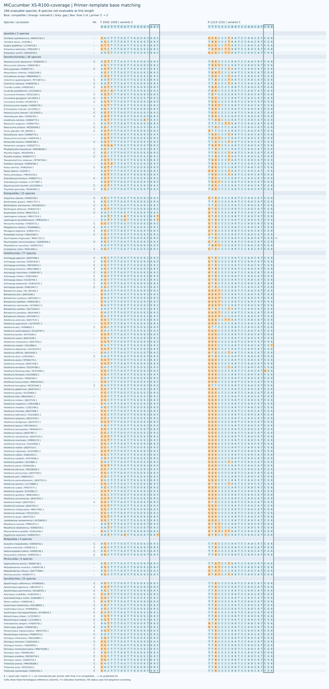
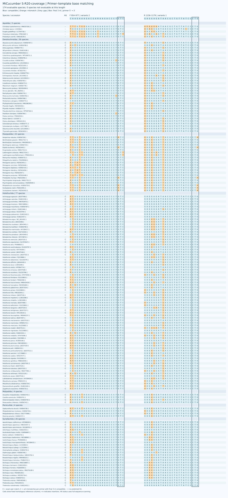
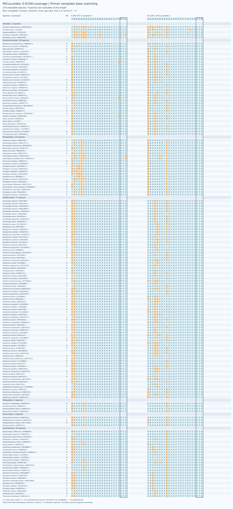
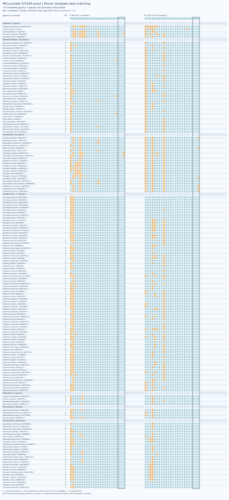
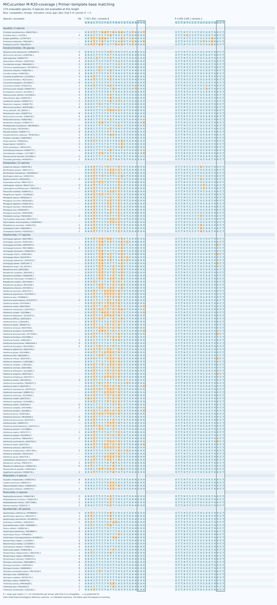
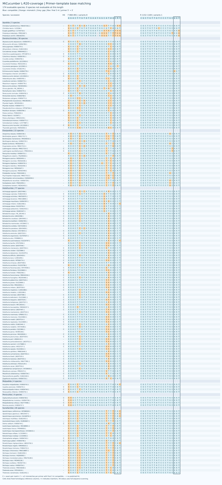
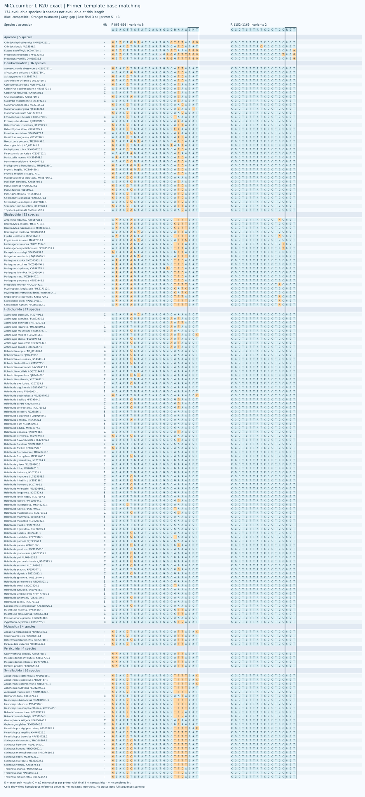
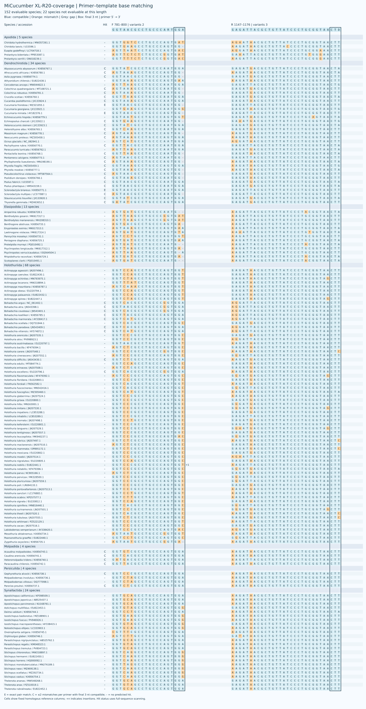
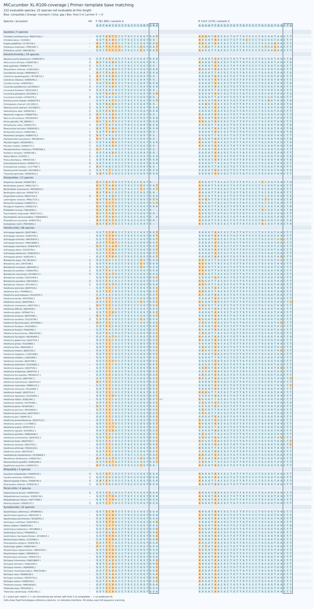

# MiCucumber

[中文](README.zh-CN.md)

MiCucumber comprises candidate mitochondrial 16S rRNA primers for sea-cucumber environmental DNA in five windows: XS, S, M, L and XL. All newly screened single-pair candidates are retained; candidates within each window share reference endpoints.
The primary metrics **weight evaluable species equally**, using one representative sequence per species. The reference panel contains 174 named species; reference representation does not measure global order richness.
XS, S–L and XL have 166, 174 and 152 evaluable species, respectively; missing binding windows are not counted as failures.

[参考面板 / Reference panel](results/species_qc/panel.csv) · [分类与覆盖 / Coverage by order](results/species_refine/by_order.csv) · [参考序列审核 / Reference curation](results/species_qc/README.md)

## Current performance

| Candidate | Species coverage | Exact | Strict WC / GT | WC≤3 / GT≤2 |
|---|---:|---:|---:|---:|
| XS-R100-coverage | 75/166 (45.18%) | 0/166 (0.00%) | 0 / 0 | 33 / 2 |
| S-R20-coverage | 124/174 (71.26%) | 0/174 (0.00%) | 0 / 3 | 4 / 4 |
| S-R100-coverage | 130/174 (74.71%) | 0/174 (0.00%) | 0 / 5 | 58 / 6 |
| S-R100-exact | 124/174 (71.26%) | 1/174 (0.57%) | 0 / 5 | 54 / 6 |
| M-R20-coverage | 89/174 (51.15%) | 24/174 (13.79%) | 0 / 15 | 3 / 15 |
| L-R20-coverage | 85/174 (48.85%) | 1/174 (0.57%) | 0 / 0 | 15 / 19 |
| L-R20-exact | 82/174 (47.13%) | 29/174 (16.67%) | 0 / 0 | 0 / 0 |
| XL-R20-coverage | 43/152 (28.29%) | 3/152 (1.97%) | 0 / 10 | 1 / 13 |
| XL-R100-coverage | 45/152 (29.61%) | 3/152 (1.97%) | 0 / 10 | 48 / 13 |

Coverage requires at most two mismatches per primer with compatible terminal 3 nt; exact matching requires zero mismatches in both primers. Strict WC/GT count non-target records under the terminal constraint; WC≤3 and GT≤2 are permissive screens without it.

## Selection and tradeoffs

New candidate oligos have at most eight variants, with ambiguity confined to the 3′ half. Coverage-prioritised and exact-match-prioritised candidates are retained separately. These are computational predictions requiring experimental validation.

[筛选结果与复核 / Screening and verification](results/species_refine/README.md) · [引物序列 / Primer sequences](sequences/primer_pairs.csv)

## XS

| Name | F (5′→3′) | R (5′→3′) |
|---|---|---|
| XS-R100-coverage | `AACTTTGGTTGGGGYAAC` | `TTTCCCCAATCCAACATCGA` |

## S

| Name | F (5′→3′) | R (5′→3′) |
|---|---|---|
| S-R20-coverage | `CAAGAAAGACGARAAGACCCTGTC` | `GAGGAGATAACGCTGTTATCCCTG` |
| S-R100-coverage | `TAAGAAAGACGARAAGACCCTRTC` | `GAGAAGATGACGCTGTTATCCCTR` |
| S-R100-exact | `TAAGAAAGACGAGAAGACCCTRTC` | `GAGGAGATAACGCTGTTATCCCTG` |

## M

| Name | F (5′→3′) | R (5′→3′) |
|---|---|---|
| M-R20-coverage | `AAACTTCTATTHAYGTGAAGAA` | `GTTATCCCTGCGGTAACT` |

## L

| Name | F (5′→3′) | R (5′→3′) |
|---|---|---|
| L-R20-coverage | `AGACTTGTATGAAYGGCATWACMT` | `CGCTGTTATCCCTGCGGT` |
| L-R20-exact | `AGACTTGTATGAAYGGCRAAACMT` | `CGCTGTTATCCCTGCRGT` |

## XL

| Name | F (5′→3′) | R (5′→3′) |
|---|---|---|
| XL-R20-coverage | `GGTAACGCCTGCCCARTGGA` | `GAGATTACGCTGTTATCCCTGCGGTAACTD` |
| XL-R100-coverage | `GGTAACGCCTGCCCARTGRA` | `GAGATTACGCTGTTATCCCTGCGGTAACTD` |

## Methods and data

[Reference curation](results/species_qc/README.md) · [Screening comparison](results/species_refine/comparison.csv) · [Copyright](COPYRIGHT.md)
