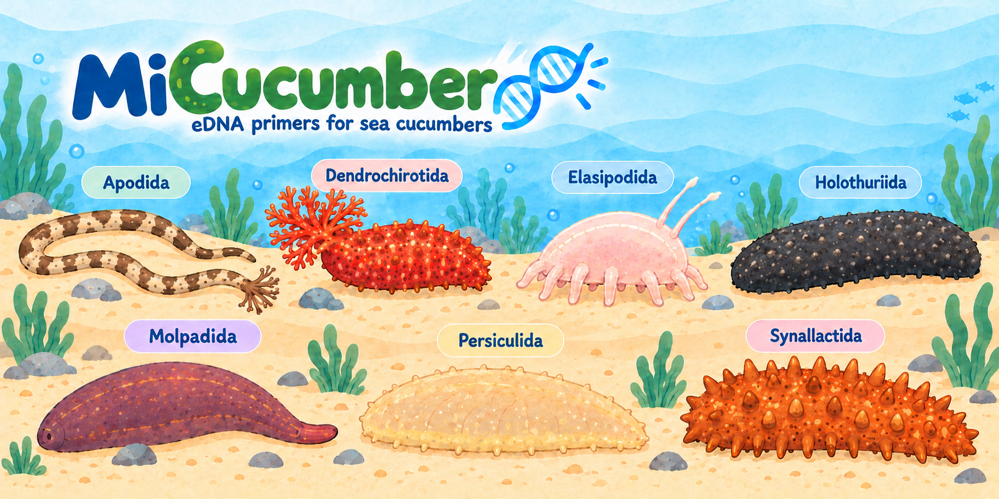
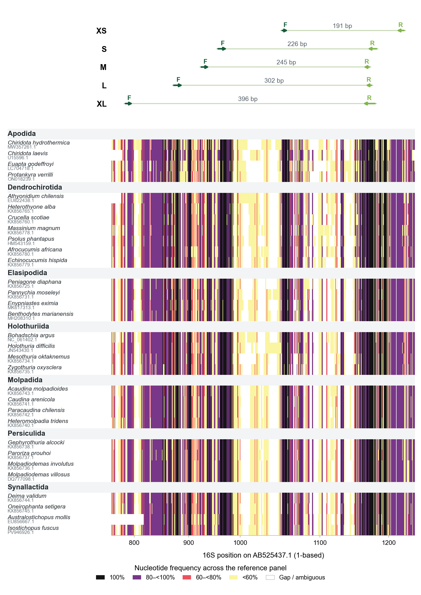

# MiCucumber：海参环境 DNA 线粒体引物的计算设计与评估

**Fei Xia** · The University of Tokyo · xf@g.ecc.u-tokyo.ac.jp · [English](README.md) · [简体中文](README.zh-CN.md)

[修订论文工作稿 PDF](publications/submission/MiCucumber_revision.pdf) · [论文源稿](publications/submission/MiCucumber_revision.md) · [全部引物 FASTA](sequences/all_testing_primers.fasta) · [全部寡核苷酸 CSV](sequences/all_testing_primers.csv) · [补充引物表](publications/submission/supplementary_primers.csv)

[Word 稿件](publications/submission/MiCucumber_revision.docx) · [补充材料 PDF](publications/submission/Supplementary.pdf) · [引物对表](publications/submission/ESM_1.xlsx) · [完整序列表](publications/submission/ESM_2.xlsx) · [Fig. 1 A4](publications/submission/figures/Fig1_A4.pdf)

## 全部引物

项目提供靶向 16S、12S 和 COI 的 29 对基础引物，以及 3 条 16S 谱系补充寡核苷酸。上方完整 FASTA 和序列表可用于测试不同基因和长度的方案。XS、S、M、L、XL 表示长度等级，D 表示简并引物对。 [16S 引物对表](sequences/primer_pairs.csv) · [12S 与 COI 引物对表](markers/12S_COI/candidates.csv) · [谱系补充组合](results/lineage_evaluation/README.md)

## 详细计算比较

| 方案 | 参考跨度 | 每条引物 0 / ≤1 / ≤2 个错配时匹配物种 | MIDORI2 非目标物种，≤2 个错配 |
|---|---:|---:|---:|
| 16S SD | 226 bp | 1 / 46 / 155，分母 174 | 7 |
| 16S LD | 302 bp | 29 / 66 / 99，分母 174 | 45 |
| COI LD | 293 bp | 10 / 58 / 118，分母 274 | 0 |

此处详细比较的两套 16S 方案各含一条补充寡核苷酸。表中列出采用更新后 MIDORI2 面板评估的方案。COI 分母为经 WoRMS 统一物种名、在既有比对中窗口可评价的面板，四个未能精确匹配的物种名列在审核记录中。两套 16S 方案均未匹配 5 个无足目代表，COI LD 匹配 19 个代表中的 1 个。同一套最多两个错配规则下，文献引物 hol.11 匹配 163/174 个海参代表物种，并匹配 49,352 个 MIDORI2 非目标物种。MIDORI2 收录真核生物线粒体参考，结果均为计算预测。 [分目匹配](results/complementarity/) · [MIDORI2 命中物种](results/specificity/) · [参考片段分辨率](results/resolution/)

[各目匹配情况](publications/submission/figures/figure2_coverage.png) · [参考片段一致度](publications/submission/figures/figure3_identity.png) · [复现说明](scripts/review/README.md)

普通 16S S 在同一批 174 个物种中，0、≤1、≤2 个错配时分别匹配 5、26、110 个物种，新增比较包括目标匹配与片段相似度。Fig. 1 展示七个目、21 个科的 31 条代表序列及五档结合位置；Fig. 3 按目展示 16S SD，其他引物矩阵见补充 Fig. S5。

## 三套详细比较方案的序列

序列方向为 5′→3′。每套 16S 方案使用所列主引物对及对应的补充寡核苷酸。

| 方案 | 寡核苷酸 | 序列 |
|---|---|---|
| 16S SD | F | `TAAGAAAGACGARAAGACCCTRTC` |
| 16S SD | R | `GAGAAGATGACGCTGTTATCCCTR` |
| 16S SD | R-Dendrochirotida | `AAGGAGATTACGCTGTTATCCCTG` |
| 16S LD | F | `AGACTTGTATGAAYGGCRAAACMT` |
| 16S LD | F-Elasipodida | `AAACTAGTATGAATGGCTTTTCAT` |
| 16S LD | R | `CGCTGTTATCCCTGCRGT` |
| COI LD | F | `AAAATGCGAACYCCAGGARTWAC` |
| COI LD | R | `GGTTCTTGCTTWCCTCTRTARTG` |

## 参考片段分辨率

在可评价参考记录中，16S SD 的 483 种不同片段有 473 种仅对应一个物种，16S LD 为 338/346，COI LD 为 666/683。物种、属、科各层级结果和共享序列见分辨率表。

先前比较与补充材料

[全部基础引物序列及先前错配梯度](publications/submission/supplementary_primers.csv) · [补充材料](publications/submission/Supplementary.pdf)

[旧版方法（v1.8）](docs/METHODS.zh-CN.md) · [著作权](COPYRIGHT.md) · [v1.8 引用信息](CITATION.cff) · [项目文件索引](PROJECT_FILES.md)
