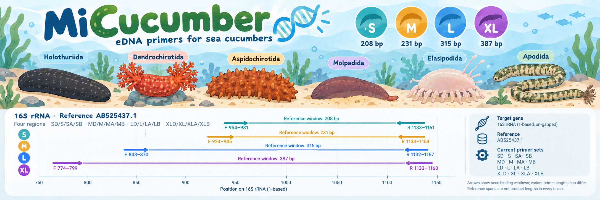
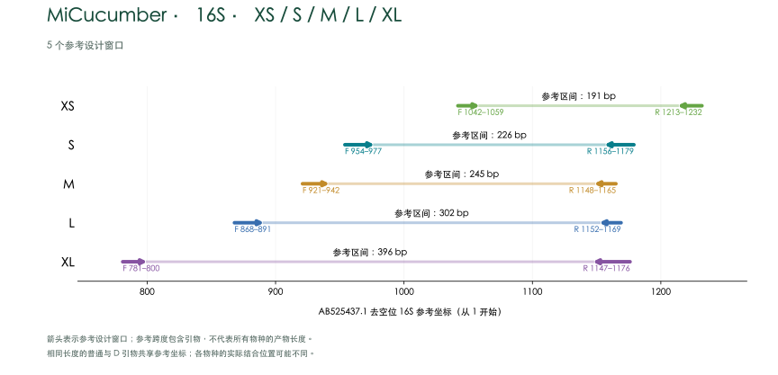
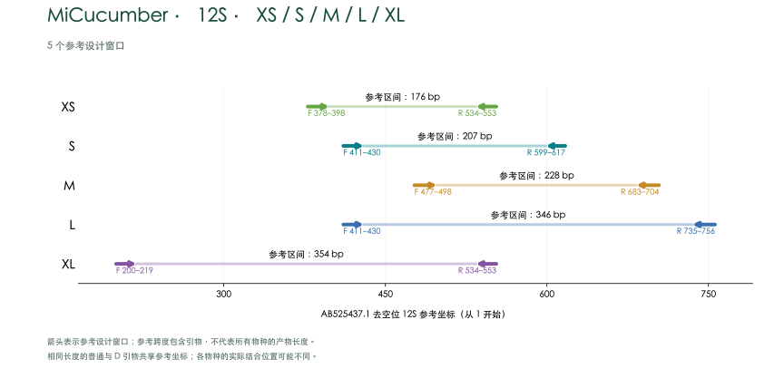
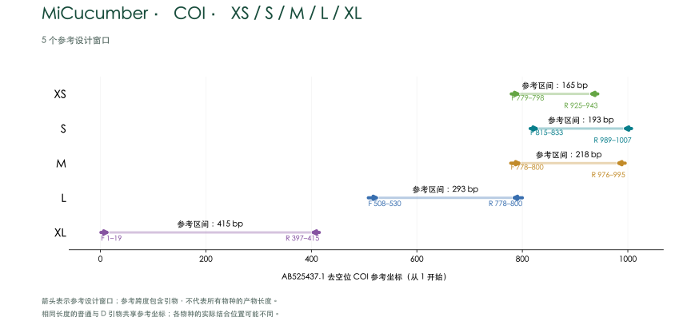
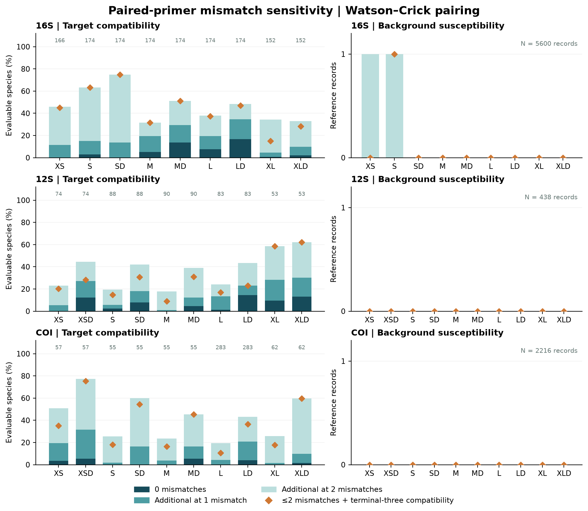
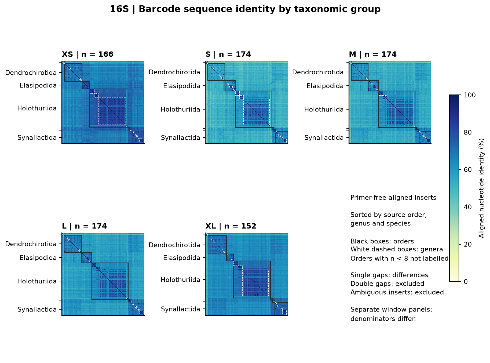

# MiCucumber: in silico design and evaluation of mitochondrial primers for sea cucumber (Holothuroidea) eDNA metabarcoding

**Fei Xia**

[English](README.md) · [简体中文](README.zh-CN.md)

<!-- publication:start -->
**预印本 v1.5 · 2026 年 11 月 9 日 · 未经同行评审。**

[PDF](publications/MiCucumber_preprint.pdf) · [论文 Markdown](publications/MiCucumber_preprint.md) · [固定版本](https://github.com/GUIBA-EX/MiCucumber/releases/tag/preprint-v1.5) · [CITATION.cff](CITATION.cff) · [BibTeX](CITATION.bib) · [构建与更新](publications/README.md)
<!-- publication:end -->

预印本采用与 MiAnemone、MiUrchin 一致的论文格式，包含方法、结果、讨论、评估重点、参考文献及文末完整数据表。

MiCucumber 收录 29 对海参环境 DNA 候选引物，涵盖线粒体 16S、12S 和 COI。各基因独立建库，坐标均相对于 AB525437.1 中相应基因的第一个碱基。

## 如何选择窗口

在 16S 共同面板的 151 种中，SD 覆盖 115 种，双端完全匹配为零；LD 覆盖 73 种，其中 23 种完全匹配。长度选择取决于研究更重视容许错配的覆盖还是完全匹配。

**12S** 的 XLD 在保留的 D 方案中覆盖物种数最多，预测覆盖 33/53 种，其中 7 种双端完全匹配，参考跨度 354 bp。

**COI。** XS 与 XSD 共用 AB525437.1 的 779–798 / 907–923 结合坐标，参考跨度为 145 bp。在相同的 57 物种面板上，XS 覆盖 20 种、双端完全匹配 2 种，XSD 覆盖 43 种、完全匹配 3 种；两者在 2,216 条背景记录中均无严格命中。较长窗口中，LD 的覆盖数最多，为 103/283。

## 引物序列与预测表现

序列均按 5′→3′ 书写。普通与 D 引物在同一窗口共享起止坐标；16S XS 单独保留一对。覆盖与完全匹配都以该窗口可评价物种数为分母。“严格非目标”列依次记录 **仅沃森–克里克配对 / 另允许鸟嘌呤–胸腺嘧啶配对** 的命中数。

### 16S

非目标背景为 5,600 条参考记录。

| 方案 | F（5′–3′） | R（5′–3′） | 跨度（bp） | 覆盖 | 完全匹配 | 严格非目标 | 碱基图 |
|---|---|---|---:|---:|---:|---:|---|
| XS | `AACTTTGGTTGGGGYAAC` | `TTTCCCCAATCCAACATCGA` | 191 | 75/166 | 0/166 | 0 / 0 | [查看](results/current_primers/XS/base_matching_XS.svg) |
| S | `CCAGAAAGACGAGAAGACCCTGTC` | `GAGGAGATAACGCTGTTATCCCTG` | 226 | 110/174 | 5/174 | 1 / 3 | [查看](results/current_primers/S/base_matching_S.svg) |
| SD | `TAAGAAAGACGARAAGACCCTRTC` | `GAGAAGATGACGCTGTTATCCCTR` | 226 | 130/174 | 0/174 | 0 / 5 | [查看](results/current_primers/S/base_matching_SD.svg) |
| M | `AAACTTCTATTAACGTGAAGAA` | `GTTATCCCTGCGGTAACT` | 245 | 55/174 | 9/174 | 0 / 2 | [查看](results/current_primers/M/base_matching_M.svg) |
| MD | `AAACTTCTATTHAYGTGAAGAA` | `GTTATCCCTGCGGTAACT` | 245 | 89/174 | 24/174 | 0 / 15 | [查看](results/current_primers/M/base_matching_MD.svg) |
| L | `AGACTCGTATGAACGGCAAAACCT` | `CGCTGTTATCCCTGCGGT` | 302 | 65/174 | 13/174 | 0 / 0 | [查看](results/current_primers/L/base_matching_L.svg) |
| LD | `AGACTTGTATGAAYGGCRAAACMT` | `CGCTGTTATCCCTGCRGT` | 302 | 82/174 | 29/174 | 0 / 0 | [查看](results/current_primers/L/base_matching_LD.svg) |
| XL | `GGTCACGCCTGCCCAGTGGA` | `AAGATAACGCTGTTATCCCTGCGGTAACTT` | 396 | 23/152 | 1/152 | 0 / 0 | [查看](results/current_primers/XL/base_matching_XL.svg) |
| XLD | `GGTAACGCCTGCCCARTGGA` | `GAGATTACGCTGTTATCCCTGCGGTAACTD` | 396 | 43/152 | 3/152 | 0 / 10 | [查看](results/current_primers/XL/base_matching_XLD.svg) |

### 12S

非目标背景为 438 种其他棘皮动物的代表序列。

| 方案 | F（5′–3′） | R（5′–3′） | 跨度（bp） | 覆盖 | 完全匹配 | 严格非目标 | 碱基图 |
|---|---|---|---:|---:|---:|---:|---|
| XS | `AGATACCCTACTATACCCTTC` | `CGACGATGGTATACAAACTG` | 176 | 15/74 | 0/74 | 0 / 0 | [查看](markers/12S_COI/figures/12S_XS.svg) |
| XSD | `AGATACCCTACTATACYYTTC` | `CGACGATGGTATACWRRCTG` | 176 | 21/74 | 9/74 | 0 / 0 | [查看](markers/12S_COI/figures/12S_XSD.svg) |
| S | `AACACCAGAGCAGTACAGCT` | `CTGCACCTTGATCTGACGT` | 207 | 13/88 | 2/88 | 0 / 0 | [查看](markers/12S_COI/figures/12S_S.svg) |
| SD | `AACACCAGAGYAGTACARCY` | `CTGCACCTTGATCTGRHGT` | 207 | 27/88 | 7/88 | 0 / 0 | [查看](markers/12S_COI/figures/12S_SD.svg) |
| M | `AGGAGCTTGTCATTAAATTGAT` | `TTACTATCGAATCCTCTTTCAT` | 228 | 8/90 | 0/90 | 0 / 0 | [查看](markers/12S_COI/figures/12S_M.svg) |
| MD | `AGGAGCTTGTCATYRAATYGAT` | `TTACTATCGAATCCTCTTTCWD` | 228 | 28/90 | 4/90 | 0 / 5 | [查看](markers/12S_COI/figures/12S_MD.svg) |
| L | `AACACCAGAGCAGTACGGCT` | `GCGATGTGTGCGCATTCTAGAG` | 346 | 14/83 | 1/83 | 0 / 0 | [查看](markers/12S_COI/figures/12S_L.svg) |
| LD | `AACACCAGAGYAGTACRGYT` | `GCGATGTGTGCRYATTYTAGAG` | 346 | 19/83 | 12/83 | 0 / 0 | [查看](markers/12S_COI/figures/12S_LD.svg) |
| XL | `GGTGGTTAATAACGTGCCAG` | `CGACGATGGTATACAGGCTG` | 354 | 31/53 | 5/53 | 0 / 1 | [查看](markers/12S_COI/figures/12S_XL.svg) |
| XLD | `GGTGGTTAATAACGTGCCAG` | `CGACGATGGTATACWRRCTG` | 354 | 33/53 | 7/53 | 0 / 1 | [查看](markers/12S_COI/figures/12S_XLD.svg) |

### COI

非目标背景包含 2,216 条参考序列。

| 方案 | F（5′–3′） | R（5′–3′） | 跨度（bp） | 覆盖 | 完全匹配 | 严格非目标 | 碱基图 |
|---|---|---|---:|---:|---:|---:|---|
| XS | `ACTATAGAGGAAAGCAAGAA` | `GCTGCTGTGAAGTAGGC` | 145 | 20/57 | 2/57 | 0 / 0 | [查看](markers/12S_COI/figures/COI_XS.svg) |
| XSD | `ACTATAGAGGRAAGCMAGAR` | `GCTGCTGTRAAGTADGC` | 145 | 43/57 | 3/57 | 0 / 0 | [查看](markers/12S_COI/figures/COI_XSD.svg) |
| S | `GAATGGTATACGCTATGGT` | `GTTTCTCAGACTAGCTTTG` | 193 | 10/55 | 0/55 | 0 / 0 | [查看](markers/12S_COI/figures/COI_S.svg) |
| SD | `GAATGGTATAYGCWATGRT` | `GTTTCTCAGAYTARCTTKG` | 193 | 30/55 | 0/55 | 0 / 0 | [查看](markers/12S_COI/figures/COI_SD.svg) |
| M | `CACTATAGAGGAAAGCAAGAACC` | `AACTTTGATCCTTGTAGGGT` | 218 | 9/55 | 0/55 | 0 / 0 | [查看](markers/12S_COI/figures/COI_M.svg) |
| MD | `CACTATAGAGGWAAGMAAGARCC` | `AACTTTGATCCTTGTARNGT` | 218 | 25/55 | 3/55 | 0 / 0 | [查看](markers/12S_COI/figures/COI_MD.svg) |
| L | `AAAATGCGAACCCCAGGAGTAAC` | `GGTTCTTGCTTTCCTCTGTAGTG` | 293 | 30/283 | 0/283 | 0 / 0 | [查看](markers/12S_COI/figures/COI_L.svg) |
| LD | `AAAATGCGAACYCCAGGARTWAC` | `GGTTCTTGCTTWCCTCTRTARTG` | 293 | 103/283 | 11/283 | 0 / 2 | [查看](markers/12S_COI/figures/COI_LD.svg) |
| XL | `ATGAACCTAAACCGCTGAT` | `CGTGGGCTATATTTCTTGA` | 415 | 11/62 | 0/62 | 0 / 0 | [查看](markers/12S_COI/figures/COI_XL.svg) |
| XLD | `ATGAACCTAAAMCGYTGAY` | `CGTGGGCTATRTTTCTNGA` | 415 | 37/62 | 1/62 | 0 / 2 | [查看](markers/12S_COI/figures/COI_XLD.svg) |

XS 与 XSD 去除引物后的参考内部条码为 108 bp。相对替换前方案，XS 新增漏检 *Holothuria hilla*、*Isostichopus badionotus*、*I. fuscus*、*Phyllophorella liuwutiensis* 和 *Neocucumis proteus*；XSD 新增漏检 *Actinopyga lecanora*、*Benthodytes marianensis*、*B. gosarsi*、*Holothuria pervicax* 和 *Laetmogone violacea*。两版同时覆盖了更多其他物种，因而净覆盖数均提高。普通与 D 方案分别评价。

## 参考结合位置

三个基因使用独立坐标轴。箭头表示引物结合方向；上表所链接的 12S、COI 碱基图按来源目各取一个代表，反向模板按引物方向显示，方框标出末端三位。

## 相关研究

海参标记开发已有 COI 条形码和 COI/16S 联合分类研究基础（Uthicke 等，2010；Byrne 等，2010）。Wen 等（2010、2011）将基于线粒体 16S 的 PCR–RFLP 和 FINS 用于产品鉴定，Xing 等（2021）将 COI mini-barcode 与 NGS 结合用于加工产品鉴定。Hoareau 与 Boissin（2010）的棘皮动物 COI 杂合引物为按目标类群变异控制简并度提供了方法学先例。这些研究共同支持本项目的参考审核与设计依据。

## 参考库与评价范围

16S 面板有 174 种。12S 和 COI 的 NCBI 检索下载了 6,168 条不同 accession；提取和审核后，12S 保留 344 条合格序列（90 个具名物种），COI 保留 5,681 条（357 个具名物种）。各窗口仅纳入结合区可评价的物种。两套新标记使用相同热力学和成对扫描门槛，每端最多 8 种具体变体。覆盖要求每端最多两个错配、末端三位兼容；完全匹配要求双端均无错配。

共同 151 物种比较、条码唯一性和属级留出结果适用于 16S。12S 与 COI 的结果为各自独立参考库上的候选筛查。

[16S 方法](docs/METHODS.zh-CN.md) · [16S 参考审核](results/species_qc/README.md) · [16S 计算评价](results/computational_evaluation/README.zh-CN.md) · [12S 与 COI 参考资料](markers/12S_COI/README.md) · [独立复核](markers/12S_COI/final_check.json)

<!-- anth28s:start -->
## 参考 Anth-28S 的计算诊断

[手稿](publications/MiCucumber_preprint.md) · [PDF](publications/MiCucumber_preprint.pdf) · [完整结果](results/anth28s_evaluation/README.zh-CN.md)。

参考 McCartin 等（2024），对 29 对引物比较每端 0、1、2 个错配，并单列末三位约束；15 个去引物内部序列矩阵包含 130,599 个跨物种比较。各图沿用相应基因及窗口面板，不同分母的结果不作直接排名。

| 基因 | 方案 | 物种 N | ≤0 | ≤1 | ≤2 | ≤2＋末三位 | 背景 ≤2 |
| --- | --- | --- | --- | --- | --- | --- | --- |
| 16S | SD | 174 | 0 | 24 | 130 | 130 | 0 |
| 16S | LD | 174 | 29 | 60 | 84 | 82 | 0 |
| 12S | XLD | 53 | 7 | 16 | 33 | 33 | 0 |
| COI | XSD | 57 | 3 | 18 | 44 | 43 | 0 |
| COI | LD | 283 | 11 | 59 | 122 | 103 | 0 |

目标计物种、背景计记录；最后一列仅为每端≤2 个沃森–克里克错配且无末端约束的背景命中数，其他背景模型仍见引物表。SD 的覆盖较依赖允许两处错配，完全匹配应单独评价。

[Full methods, 12S/COI identity matrices and product lengths / 完整方法、12S/COI 矩阵及产物长度](results/anth28s_evaluation/README.zh-CN.md)
<!-- anth28s:end -->

## 引用与著作权

Xia, F. (2026). *MiCucumber: in silico design and evaluation of mitochondrial primers for sea cucumber (Holothuroidea) eDNA metabarcoding*. Computational preprint v1.5. [GitHub Release](https://github.com/GUIBA-EX/MiCucumber/releases/tag/preprint-v1.5).

[CITATION.cff](CITATION.cff) · [BibTeX](CITATION.bib) · [Copyright](COPYRIGHT.md)

## 参考文献

1. Gold, Z., Wall, A. R., Schweizer, T. M., et al. (2022). A manager’s guide to using eDNA metabarcoding in marine ecosystems. *PeerJ*, 10, e14071. https://doi.org/10.7717/peerj.14071

2. Miya, M., Sato, Y., Fukunaga, T., et al. (2015). MiFish, a set of universal PCR primers for metabarcoding environmental DNA from fishes: detection of more than 230 subtropical marine species. *Royal Society Open Science*, 2, 150088. https://doi.org/10.1098/rsos.150088

3. Hamamoto, K., Soliman, T., Poliseno, A., Fernandez-Silva, I., & Reimer, J. D. (2021). Higher genetic diversity of the common sea cucumber *Holothuria (Halodeima) atra* in marine protected areas of the central and southern Ryukyu Islands. *Frontiers in Conservation Science*, 2, 736633. https://doi.org/10.3389/fcosc.2021.736633

4. Katoh, K., & Standley, D. M. (2013). MAFFT multiple sequence alignment software version 7: improvements in performance and usability. *Molecular Biology and Evolution*, 30, 772–780. https://doi.org/10.1093/molbev/mst010

5. Untergasser, A., Cutcutache, I., Koressaar, T., et al. (2012). Primer3—new capabilities and interfaces. *Nucleic Acids Research*, 40, e115. https://doi.org/10.1093/nar/gks596

6. Riaz, T., Shehzad, W., Viari, A., et al. (2011). ecoPrimers: inference of new DNA barcode markers from whole genome sequence analysis. *Nucleic Acids Research*, 39, e145. https://doi.org/10.1093/nar/gkr732

7. Uthicke, S., Byrne, M., & Conand, C. (2010). Genetic barcoding of commercial Bêche-de-mer species (Echinodermata: Holothuroidea). *Molecular Ecology Resources*, 10(4), 634–646. https://doi.org/10.1111/j.1755-0998.2009.02826.x

8. Hoareau, T. B., & Boissin, E. (2010). Design of phylum-specific hybrid primers for DNA barcoding: addressing the need for efficient COI amplification in the Echinodermata. *Molecular Ecology Resources*, 10(6), 960–967. https://doi.org/10.1111/j.1755-0998.2010.02848.x

9. Byrne, M., Rowe, F., & Uthicke, S. (2010). Molecular taxonomy, phylogeny and evolution in the family Stichopodidae (Aspidochirotida: Holothuroidea) based on COI and 16S mitochondrial DNA. *Molecular Phylogenetics and Evolution*, 56(3), 1068–1081. https://doi.org/10.1016/j.ympev.2010.04.013

10. Wen, J., Hu, C., Zhang, L., Luo, P., Zhao, Z., Fan, S., & Su, T. (2010). The application of PCR–RFLP and FINS for species identification used in sea cucumbers (Aspidochirotida: Stichopodidae) products from the market. *Food Control*, 21(4), 403–407. https://doi.org/10.1016/j.foodcont.2009.06.014

11. Wen, J., Hu, C., Zhang, L., & Fan, S. (2011). Genetic identification of global commercial sea cucumber species on the basis of mitochondrial DNA sequences. *Food Control*, 22(1), 72–77. https://doi.org/10.1016/j.foodcont.2010.06.010

12. Xing, R.-R., Hu, R.-R., Wang, N., Zhang, J.-K., Ge, Y.-Q., & Chen, Y. (2021). Authentication of sea cucumber products using NGS-based DNA mini-barcoding. *Food Control*, 129, 108199. https://doi.org/10.1016/j.foodcont.2021.108199
