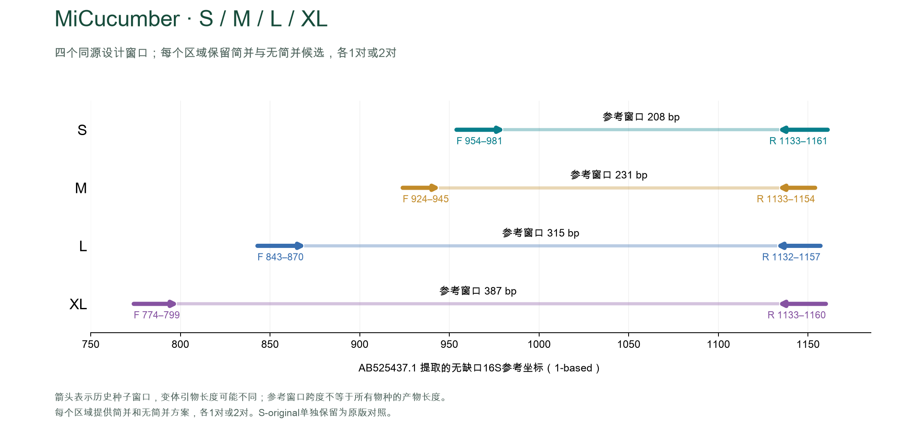

# MiCucumber

海参线粒体16S计算候选引物。当前四个区域统一命名为 **S、M、L、XL**，简并方案仅保留1对，无简并方案保留1对和2对；另保留 **S-original** 原版对照，共13套方案。[English](README.md)

## 方案选择

| 长度 | 简并单对 | 普通单对 | 普通两对 |
|---|---|---|---|
| S | SD | S | SA / SB |
| M | MD | M | MA / MB |
| L | LD | L | LA / LB |
| XL | XLD | XL | XLA / XLB |

- 两对表示两套独立PCR。四个区域为可比较的替代选择，不要求同一样本全部运行。
- **建议优先实验验证SD。** 无简并版的覆盖与完全匹配损失较大，保留为对照；S-original的非目标命中很多。
- 所有方案尚未完成湿实验验证，尚无经验证的单管混池配方。

命名：SD为简并；S为普通单对；SA、SB为普通两对。M、L、XL同理。

## 下载与文档

- **[全部配对序列 CSV](sequences/primer_pairs.csv)** · [FASTA](sequences/primers.fasta) · [S-original原版](sequences/MiCucumber-S-original.fasta)
- 分区域：[S](sequences/MiCucumber-S.csv) · [M](sequences/MiCucumber-M.csv) · [L](sequences/MiCucumber-L.csv) · [XL](sequences/MiCucumber-XL.csv)
- [双语结果报告](report.html)（下载后打开） · [共同/区域面板完整比较](results/comparison.csv)
- [方法](docs/METHODS.zh-CN.md) · [复现](docs/REPRODUCIBILITY.zh-CN.md) · [文件索引](docs/FILES.md)

## 简并方案

以下为共同面板的**非Apodida**指标。共同面板共151个分类名称标签、351个标签内单倍型，其中非Apodida为145个标签；标签等权，标签内单倍型等权。名称未统一同物异名。包含Apodida的全部目标指标及各区域面板见完整比较表。

| 方案 | 非Apodida覆盖率 | 完全匹配率 | WC≤3 | GT≤2 | WC≤4 |
|---|---:|---:|---:|---:|---:|
| SD | 87.45% | 27.48% | 2 | 0 | 742 |
| MD | 56.90% | 9.43% | 0 | 0 | 130 |
| LD | 70.26% | 33.63% | 4 | 0 | 109 |
| XLD | 48.34% | 9.71% | 0 | 0 | 486 |

## 无简并对照

| 方案 | 非Apodida覆盖率 | 完全匹配率 | WC≤3 | GT≤2 | WC≤4 |
|---|---:|---:|---:|---:|---:|
| S | 56.78% | 0.34% | 0 | 0 | 2 |
| SA+SB | 71.96% | 0.34% | 0 | 0 | 2 |
| M | 14.05% | 0.00% | 0 | 0 | 0 |
| MA+MB | 23.70% | 3.91% | 0 | 0 | 0 |
| L | 35.24% | 3.97% | 0 | 0 | 0 |
| LA+LB | 46.68% | 8.00% | 0 | 0 | 0 |
| XL | 22.88% | 2.93% | 0 | 0 | 0 |
| XLA+XLB | 28.86% | 5.23% | 0 | 0 | 1 |

## 原版对照

| 方案 | 非Apodida覆盖率 | 完全匹配率 | WC≤3 | GT≤2 | WC≤4 |
|---|---:|---:|---:|---:|---:|
| MiCucumber-S-original | 89.84% | 76.75% | 3248 | 3401 | 3923 |

覆盖要求每条引物≤2处错配且3′末端3 nt完全匹配；完全匹配要求正反引物均0错配。背景命中是5,600条记录的accession并集，不是物种数或reads比例。WC≤3与GT≤2是筛选模型，WC≤4用于展示宽松条件下的残余风险；不能据此直接预测实验扩增比例。

## 扩增区域

## 数据与复现

- 无简并方案：枚举2,644个具体配对候选；8套方案与原版对照有31,428项一致性检查，完整复现已通过。
- 当前参考包含1,848条目标、5,600条背景。Apodida不参与优化目标，但全部目标统计仍保留它；两条新增位点为同源推断并已核正方向，6条UNVERIFIED记录排除。
- 设计与评估共用冻结参考库，无独立留出验证。穷举最优性只适用于指定候选池与目标函数。
- 运行 `python scripts/check_release.py` 检查当前文件、映射及指纹；计算复现入口见[复现说明](docs/REPRODUCIBILITY.zh-CN.md)。

## 著作权

Copyright © 2026 Fei Xia (GUIBA-EX). All rights reserved. 公开访问不等于开源许可；未经许可不得转载或再分发受保护的原创内容，法定例外、GitHub平台权利及第三方数据权利除外。[完整声明](COPYRIGHT.md)
## 匹配可视化 / Matching profiles

每列为共同面板中的一个单倍型，按目与物种排列。蓝绿色为完全匹配，金黄色为允许错配命中，浅灰色为未命中。柱图采用标签及标签内单倍型等权。A+B为独立PCR结果并集。

Each column is one common-panel haplotype, ordered by order and species. Teal: exact; gold: mismatch-tolerant hit; light gray: missed. Bars use equal label and within-label haplotype weights. A+B is the union of separate PCRs.

[逐条匹配数据 / Per-reference results](results/matching/detection.csv) · [汇总 / Summary](results/matching/summary.csv)
