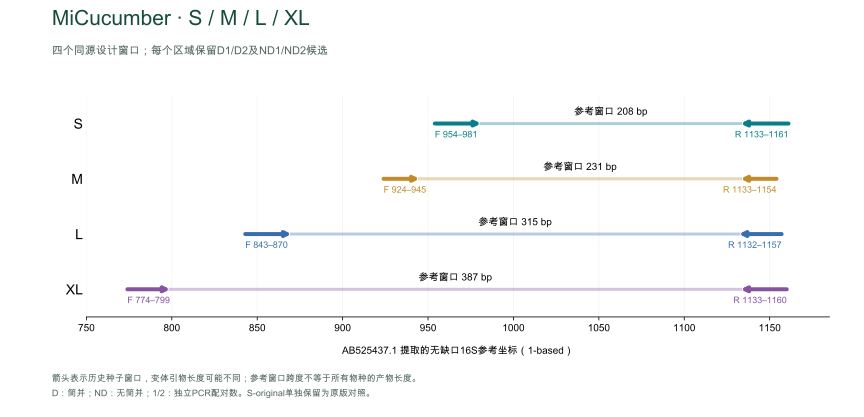
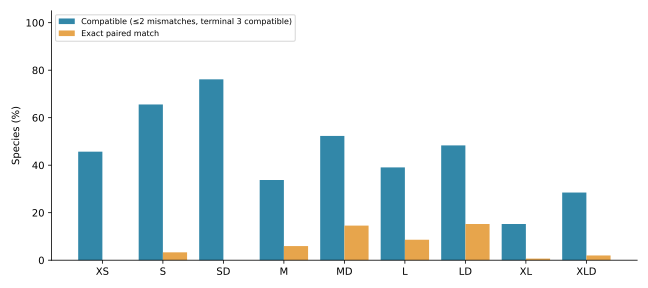
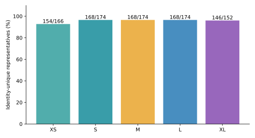
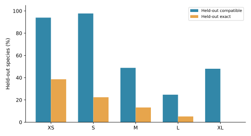

# MiCucumber

[English](README.md)

## 摘要

线粒体 16S rRNA 环境 DNA 候选引物，包含 XS、S、M、L、XL。S–XL 各保留普通单对及简并单对 D，同长度共享参考坐标；XS 为固定单对。
每个物种保留一条参考序列；主指标对可评价物种等权，各目单列。
海参面板有 174 个物种；XS、S–L、XL 分别可评价 166、174、152 个物种。

在清理后的面板中，SD 覆盖 130/174 个可评价物种，LD 覆盖 82/174 个，对应完全匹配数分别为 0 和 29。上述计算结果可用于后续实验评价。

五窗口共同面板包含151个物种。本轮增加统一分母比较、去引物条码唯一性与最近邻分析，以及属级条件性选配测试。正式引物序列保持不变。

## 引言

环境 DNA 宏条形码分析需要引物能够在目标类群中扩增具有分类信息的区域。MiCucumber 比较海参线粒体 16S 不同长度窗口的普通与简并引物，并结合参考序列代表性、引物匹配和非目标序列进行评价。 海洋环境 DNA 宏条形码研究显示，标记和参考数据库的选择会影响检测结果（Gold 等，2022）；MiFish 则提供了基于序列比对设计鱼类引物的实例（Miya 等，2015）。线粒体 16S 也曾用于分析海参组织样品的遗传变异（Hamamoto 等，2021）。

[参考面板 / Reference panel](results/species_qc/panel.csv) · [参考序列审核 / Reference curation](results/species_qc/README.md)

## 方法

### 参考数据与序列比对

目标数据库包含 1,848 条海参线粒体序列，非目标数据库包含 5,600 条参考记录。经序列质量和分类审核，每个可确认物种保留一条代表，共 174 个物种。代表序列依据结合窗口完整性、模糊碱基和参考位点覆盖情况选择，不以引物匹配结果为筛选依据。保留序列使用 MAFFT 7.526（Katoh & Standley，2013）重新比对，参考坐标采用去除空位的线粒体 16S rRNA 序列 AB525437.1，从 1 开始计数。清理后的物种面板中，正、反向窗口均需跨越参考区域，A/C/G/T 数量达到参考位点数的 90% 且无模糊碱基，允许比对空位；符合条件的物种才纳入该窗口的评价分母。可评价物种数为 XS 为 166 个、S–L 各为 174 个、XL 为 152 个。缺失窗口不计为漏检，筛选标准及 accession 记录见[参考序列审核](results/species_qc/README.md)。

### 引物设计与筛选

在固定的正、反向参考窗口内比较普通和简并候选。S–XL 每个长度的普通引物与 D 引物使用相同参考起止坐标。每条 D 引物最多包含 8 种具体序列，IUPAC 简并碱基限于 3′ 半段。末端筛查排除末端三连和超过 4 bp 的同聚物，要求末端 3 nt 至少含一个 G 或 C。Primer3（Untergasser 等，2012）计算采用单价盐 50 mM、Mg²⁺ 1.5 mM、dNTP 0.6 mM，分别评估每变体 50 nM 和每方向总浓度 200 nM 两种情景。S–XL 的结构筛查要求预测结构最高 Tm 低于 55 °C，正、反向双链 Tm 区间中点之差不超过 5 °C。XS 在同源短片段区域单独筛选，保留为一对引物。其目标扫描要求产物长 70–500 bp，双引物之间的内部长度至少 20 bp。

### 计算评价

预测覆盖要求每条引物最多 2 个错配，且末端 3 nt 与模板按 IUPAC 规则兼容；完全匹配要求两个结合位点均无错配。S–XL 目标双引物扫描要求产物长 150–500 bp、双引物之间的内部长度至少 50 bp；非目标扫描允许内部距离 0–1,000 bp。严格 Watson–Crick（WC）和 G–T 模型保留末端约束；WC≤3 和 GT≤2 为不施加末端约束的宽松筛查。覆盖率和完全匹配率对可评价物种等权，并分别汇总各目结果；非目标数字为参考记录数。使用 C++ 与 Python 对同一参考数据的目标及严格非目标命中集合进行独立算法复核。结果为计算兼容性预测。

### 共同面板、条码分辨率与属级留出测试

按accession对五个窗口取交集，得到151个共同物种，用于统一长度比较的分母；各窗口完整面板另报。条码提取自正反向结合窗口之间的同源比对列，去除空位并排除内部模糊碱基。唯一性相对于该窗口全部可用明确条码判断，包括共同面板以外的物种。单位代价Levenshtein编辑距离用于寻找最近的其他物种参考。这将引物兼容性与条码区分能力分开评价（Riaz等，2011）。

属级五折选配使用种子20261030；完整代表序列相同的跨属记录绑定成同一分组，避免重复序列泄漏。每折只用训练物种生成F/R，不以正式引物或全数据候选池为种子。确定性贪心搜索每端最多使用24个符合要求的高频普通序列种子，简并限于3′半段，每条≤8种变体，固定寡核苷酸长度，允许在既定结合区间附近±5个比对列内搜索。留出物种使用完整原始序列成对扫描，沿用各窗口的产物长度和错配规则。窗口发现早于划分，且折内候选未执行正式热力学/背景筛查，因此属于条件性序列选配测试，不是完整设计流程的外部独立验证；折内序列不纳入正式引物集。

[分析方法与复现](results/computational_evaluation/README.zh-CN.md)

[详细方法](docs/METHODS.zh-CN.md) · [验证](docs/VALIDATION.md)

## 结果

### 预测表现

| Name | Coverage | Exact | Strict WC / GT | WC≤3 / GT≤2 |
|---|---:|---:|---:|---:|
| XS | 75/166 (45.18%) | 0/166 (0.00%) | 0 / 0 | 33 / 2 |
| S | 110/174 (63.22%) | 5/174 (2.87%) | 1 / 3 | 4 / 3 |
| SD | 130/174 (74.71%) | 0/174 (0.00%) | 0 / 5 | 58 / 6 |
| M | 55/174 (31.61%) | 9/174 (5.17%) | 0 / 2 | 1 / 2 |
| MD | 89/174 (51.15%) | 24/174 (13.79%) | 0 / 15 | 3 / 15 |
| L | 65/174 (37.36%) | 13/174 (7.47%) | 0 / 0 | 0 / 0 |
| LD | 82/174 (47.13%) | 29/174 (16.67%) | 0 / 0 | 0 / 0 |
| XL | 23/152 (15.13%) | 1/152 (0.66%) | 0 / 0 | 1 / 1 |
| XLD | 43/152 (28.29%) | 3/152 (1.97%) | 0 / 10 | 1 / 13 |

覆盖要求每条引物最多 2 个错配且末端 3 nt 兼容；完全匹配要求两条引物均无错配。严格 WC/GT 含末端约束；WC≤3 / GT≤2 为宽松非目标筛查。

D 引物每条最多 8 个具体变体，简并位点限于 3′ 半段。XS 是固定命名的特殊单对。计算预测仍需实验验证。

SD 在当前面板上没有双引物完全匹配；LD 主要覆盖 Holothuriida（71/77），对 Dendrochirotida 为 8/36、Elasipodida 为 0/22。

### 共同物种面板比较

| Name | Coverage | Exact | Covered + identity-unique |
| --- | --- | --- | --- |
| XS | 69/151 | 0/151 | 63/151 |
| S | 99/151 | 5/151 | 95/151 |
| SD | 115/151 | 0/151 | 109/151 |
| M | 51/151 | 9/151 | 47/151 |
| MD | 79/151 | 22/151 | 73/151 |
| L | 59/151 | 13/151 | 59/151 |
| LD | 73/151 | 23/151 | 73/151 |
| XL | 23/151 | 1/151 | 23/151 |
| XLD | 43/151 | 3/151 | 43/151 |

此表全部引物使用相同151物种分母。末列为同时匹配引物且内部条码不与该窗口其他可用物种重复的物种数。缺失窗口不计为漏检。

### 去除引物后的条码分辨率

| Window | Unambiguous inserts | Identity-unique species | Insert length (bp) |
| --- | --- | --- | --- |
| XS | 166 | 154/166 | 148–165 |
| S | 174 | 168/174 | 148–191 |
| M | 174 | 168/174 | 175–218 |
| L | 174 | 168/174 | 230–274 |
| XL | 152 | 146/152 | 313–361 |

长度不含两端引物。唯一性描述每种一条代表的参考集合，不等同于种群范围的分辨率或实测鉴定准确率。跨物种同条码列为待核查参考冲突，需结合来源与分类解释。共同面板的唯一性仍对该窗口全部可用条码判断，因此共同子集内不重复的序列也可能在子集外有竞争条码。

[同条码冲突](results/computational_evaluation/results/barcode_collisions.csv) · [最近邻编辑距离](results/computational_evaluation/results/nearest_neighbors.csv) · [剔除冲突记录的敏感性结果](results/computational_evaluation/results/conflict_exclusion_sensitivity.csv)

### 属级条件性留出测试

| Window | Held-out coverage | Held-out exact |
| --- | --- | --- |
| XS | 156/166 (93.98%) | 64/166 (38.55%) |
| S | 170/174 (97.70%) | 39/174 (22.41%) |
| M | 85/174 (48.85%) | 23/174 (13.22%) |
| L | 43/174 (24.71%) | 9/174 (5.17%) |
| XL | 73/152 (48.03%) | 0/152 (0.00%) |

此表汇总25组逐折训练选配候选的预测，不是正式普通/D引物的性能表。每个窗口内每种物种仅测试一次。折内候选未执行热力学与背景门槛，不能仅凭兼容性分数替换正式方案。逐折规模和逐物种预测均公开，以显示属间采样不均衡。

[逐折候选](results/computational_evaluation/results/cv_folds.csv) · [逐物种留出预测](results/computational_evaluation/results/cv_predictions.csv) · [共同/各自面板完整结果](results/computational_evaluation/results/panel_comparison.csv)

### XS

| Name | F (5′→3′) | R (5′→3′) |
|---|---|---|
| XS | `AACTTTGGTTGGGGYAAC` | `TTTCCCCAATCCAACATCGA` |

[XS · 各目](results/current_primers/XS/XS_by_order.csv) · [各物种](results/current_primers/XS/XS_by_taxon.csv)

### S

| Name | F (5′→3′) | R (5′→3′) |
|---|---|---|
| S | `CCAGAAAGACGAGAAGACCCTGTC` | `GAGGAGATAACGCTGTTATCCCTG` |
| SD | `TAAGAAAGACGARAAGACCCTRTC` | `GAGAAGATGACGCTGTTATCCCTR` |

[S · 各目](results/current_primers/S/S_by_order.csv) · [各物种](results/current_primers/S/S_by_taxon.csv)

[SD · 各目](results/current_primers/S/SD_by_order.csv) · [各物种](results/current_primers/S/SD_by_taxon.csv)

### M

| Name | F (5′→3′) | R (5′→3′) |
|---|---|---|
| M | `AAACTTCTATTAACGTGAAGAA` | `GTTATCCCTGCGGTAACT` |
| MD | `AAACTTCTATTHAYGTGAAGAA` | `GTTATCCCTGCGGTAACT` |

[M · 各目](results/current_primers/M/M_by_order.csv) · [各物种](results/current_primers/M/M_by_taxon.csv)

[MD · 各目](results/current_primers/M/MD_by_order.csv) · [各物种](results/current_primers/M/MD_by_taxon.csv)

### L

| Name | F (5′→3′) | R (5′→3′) |
|---|---|---|
| L | `AGACTCGTATGAACGGCAAAACCT` | `CGCTGTTATCCCTGCGGT` |
| LD | `AGACTTGTATGAAYGGCRAAACMT` | `CGCTGTTATCCCTGCRGT` |

[L · 各目](results/current_primers/L/L_by_order.csv) · [各物种](results/current_primers/L/L_by_taxon.csv)

[LD · 各目](results/current_primers/L/LD_by_order.csv) · [各物种](results/current_primers/L/LD_by_taxon.csv)

### XL

| Name | F (5′→3′) | R (5′→3′) |
|---|---|---|
| XL | `GGTCACGCCTGCCCAGTGGA` | `AAGATAACGCTGTTATCCCTGCGGTAACTT` |
| XLD | `GGTAACGCCTGCCCARTGGA` | `GAGATTACGCTGTTATCCCTGCGGTAACTD` |

[XL · 各目](results/current_primers/XL/XL_by_order.csv) · [各物种](results/current_primers/XL/XL_by_taxon.csv)

[XLD · 各目](results/current_primers/XL/XLD_by_order.csv) · [各物种](results/current_primers/XL/XLD_by_taxon.csv)

## 讨论

不同长度和类群的预测表现存在差异。在当前参考面板中，SD 覆盖 130/174 个可评价物种，但没有完全匹配；LD 覆盖 82/174 个，其中 29 个完全匹配。XS 覆盖 75/166 个物种，选择短片段时仍需结合匹配情况判断。上述比较基于每物种一条代表序列，不能直接推断环境样品中的扩增效率或物种检出率。

[Copyright / 著作权](COPYRIGHT.md)

## 参考文献

1. Gold, Z., Wall, A. R., Schweizer, T. M., et al. (2022). A manager’s guide to using eDNA metabarcoding in marine ecosystems. *PeerJ*, 10, e14071. https://doi.org/10.7717/peerj.14071

2. Miya, M., Sato, Y., Fukunaga, T., et al. (2015). MiFish, a set of universal PCR primers for metabarcoding environmental DNA from fishes: detection of more than 230 subtropical marine species. *Royal Society Open Science*, 2, 150088. https://doi.org/10.1098/rsos.150088

3. Hamamoto, K., Soliman, T., Poliseno, A., Fernandez-Silva, I., & Reimer, J. D. (2021). Higher genetic diversity of the common sea cucumber *Holothuria (Halodeima) atra* in marine protected areas of the central and southern Ryukyu Islands. *Frontiers in Conservation Science*, 2, 736633. https://doi.org/10.3389/fcosc.2021.736633

4. Katoh, K., & Standley, D. M. (2013). MAFFT multiple sequence alignment software version 7: improvements in performance and usability. *Molecular Biology and Evolution*, 30, 772–780. https://doi.org/10.1093/molbev/mst010

5. Untergasser, A., Cutcutache, I., Koressaar, T., et al. (2012). Primer3—new capabilities and interfaces. *Nucleic Acids Research*, 40, e115. https://doi.org/10.1093/nar/gks596

6. Riaz, T., Shehzad, W., Viari, A., et al. (2011). ecoPrimers: inference of new DNA barcode markers from whole genome sequence analysis. *Nucleic Acids Research*, 39, e145. https://doi.org/10.1093/nar/gkr732
