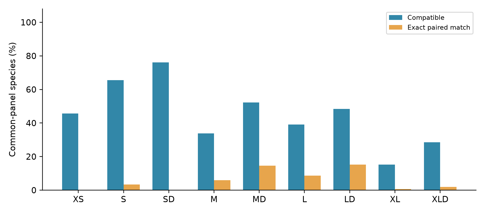
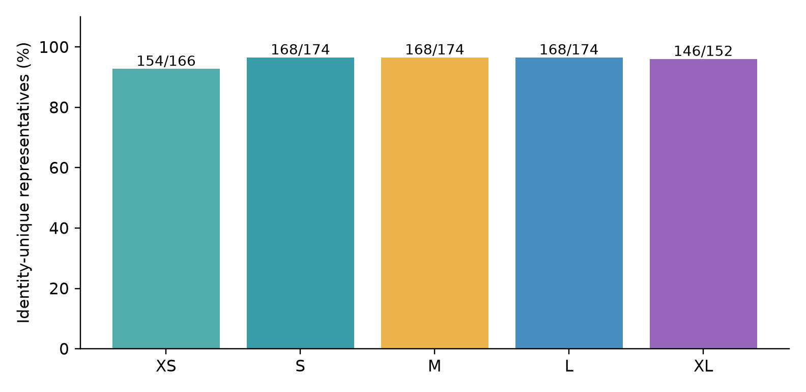
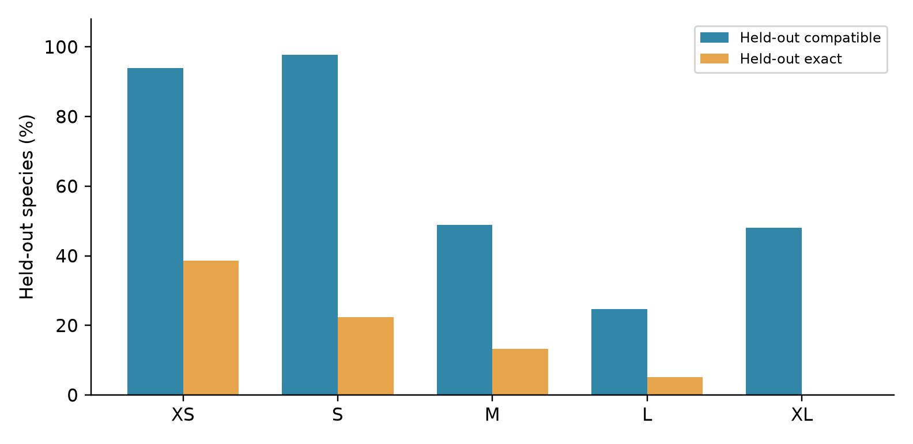

# MiCucumber: in silico design and evaluation of mitochondrial 16S rRNA primers for environmental DNA metabarcoding of sea cucumbers

Fei Xia

Computational preprint · 30 October 2026

## Abstract

Taxon-focused metabarcoding requires a balance between primer compatibility, marker discrimination and non-target susceptibility. We evaluated five mitochondrial 16S rRNA windows (XS, S, M, L and XL) for sea cucumbers using a curated frozen panel of 174 species. Each S–XL region contains an ordinary and low-degeneracy D pair at shared reference endpoints. XS is a retained single pair. On the common 151-species panel, the largest predicted coverage was 115/151 (SD), and the largest number of exact paired matches was 23/151 (LD). We extracted primer-free homologous inserts, recorded interspecific identity conflicts and nearest-neighbor edit distances, and performed five-fold genus-blocked sequence selection. Each fold used training species only, with identical complete representatives bound to the same genus block. Region discovery preceded splitting, so the test estimates sequence-selection generalization conditional on the chosen regions. Fold candidates were not screened against formal thermal and background gates and do not replace released assays. The resulting data resource separates coverage, exact compatibility and reference-barcode discrimination while exposing lineage and reference-data limitations.

Keywords: Holothuroidea; environmental DNA; mitochondrial 16S; primer degeneracy; barcode discrimination; grouped holdout

## 中文摘要

本研究对MiCucumber五个线粒体16S窗口进行纯计算评价，使用每个物种一条代表的冻结参考面板。共同面板包含151个物种，覆盖最多的方案为SD（115/151），双端完全匹配最多的方案为LD（23/151）。分析区分引物兼容性、去引物内部条码唯一性及属级条件性留出表现。折内候选不作为正式替换方案，跨物种相同条码保留来源待核查。

## 1. Introduction

Environmental DNA metabarcoding uses short markers to characterize biological assemblages from mixed DNA. Marker selection combines conserved primer-binding regions with informative variation between them. MiFish exemplifies this approach for fish 12S [1], while ecoPrimers formalizes the joint evaluation of taxonomic coverage and discrimination [2]. These principles motivate Holothuroidea 16S candidate comparison without transferring performance estimates from other taxa or loci. Anthozoan 28S work additionally illustrates how lineage-specific binding-site variation can motivate controlled primer degeneracy [3].

A primer matching many database records may primarily reflect redundant sampling. A region with a high percentage of matched species can also be supported by a smaller or taxonomically different panel than another region. We therefore ask how controlled ordinary/D alternatives differ in coverage and exact matching on the same species set, how much discrimination their internal markers provide, and whether sequence selection generalizes to genera omitted from its training fold.

## 2. Materials and methods

### 2.1 Reference data and coordinates

The frozen source project contains 1,848 target records and 5,600 non-target records. Taxonomic and quality curation retained one representative for each of 174 species, using sequence completeness and source classifications rather than primer-match success. The source repository provides accession-level audit and classification files. Alignments use MAFFT 7.526 [4]. Reference positions are 1-based and inclusive on ungapped mitochondrial 16S sequence AB525437.1; they refer to the extracted gene, not whole-mitogenome coordinates.

Binding-window evaluation requires that both windows span the reference interval, contain at least 90% of the corresponding reference-site count as concrete A/C/G/T, and contain no ambiguous nucleotide. Alignment gaps are allowed. Missing or uncertain binding windows are excluded from that region's denominator rather than scored as primer failures. The intersection of available accessions defines the common panel of 151 species. This is an available-data intersection, not a random sample of global diversity.

Table 1. Reference binding coordinates and evaluable species. Spans include both primer-binding regions; actual products vary among species.

| Window | F positions | R positions | Span bp | Available species |
| --- | --- | --- | --- | --- |
| XS | 1042–1059 | 1213–1232 | 191 | 166 |
| S | 954–977 | 1156–1179 | 226 | 174 |
| M | 921–942 | 1148–1165 | 245 | 174 |
| L | 868–891 | 1152–1169 | 302 | 174 |
| XL | 781–800 | 1147–1176 | 396 | 152 |

### 2.2 Released primer design and chemical screening

Within S–XL, ordinary and D sequences share reference start and end positions. Released D oligonucleotides have no more than eight concrete variants per primer and confine ambiguity to the 3′ half. The source design excludes homotriplet ends and homopolymers longer than four nucleotides and requires a G or C within the final three positions. Primer3 [5] evaluations use 50 mM monovalent salt, 1.5 mM Mg2+ and 0.6 mM dNTP, considering 50 nM per concrete variant and 200 nM total per direction. The S–XL gates require a maximum predicted hairpin/dimer structure Tm below 55 °C and a forward/reverse duplex-Tm range midpoint difference no greater than 5 °C. Existing chemical and background screens are inherited from the frozen release; no released sequence is changed in this study.

### 2.3 Paired compatibility and panel comparison

Coverage requires no more than two mismatches per primer and IUPAC compatibility in each terminal three nucleotides. Exact matching requires zero mismatches at both binding sites. S–XL paired target scans allow total products of 150–500 bp with at least 50 bp between primers. XS scans allow 70–500 bp products with at least 20 bp between primers. Both sequence orientations are considered. Species contribute equally; per-order counts accompany aggregate values.

Released background screens allow an internal spacing of 0–1,000 bp. Strict WC and G–T models retain the terminal constraint; permissive WC≤3 and GT≤2 screens omit it. These counts describe reference records, not experimental amplification frequencies. C++ and Python implementations were previously compared on the same frozen data to check target and strict-background hit sets. Such implementation agreement is distinct from held-out reference evaluation.

### 2.4 Primer-free barcode discrimination

For each available representative, we extract homologous alignment columns strictly between the forward-primer end and reverse-primer start, remove gaps, and exclude ambiguous internal inserts. These reference inserts exclude both primers and are not assumed to be observed PCR products. Inserts are grouped by exact sequence identity independently of the formal primer's matching result. Identity uniqueness is assessed against all available unambiguous inserts for that window, including species outside the common panel. The covered-and-unique count requires both a paired primer match and an identity-unique insert, with the full comparison-panel denominator retained.

Unit-cost Levenshtein distances are calculated between all pairs of unambiguous inserts. For each species we report its nearest other-species distance and all tied accessions. Distance implementation was cross-checked against an independent dynamic-programming algorithm in the initial workflow. One representative per species cannot estimate within-species diversity or a barcode gap. Identity uniqueness therefore describes the frozen reference collection rather than empirical taxonomic-assignment accuracy. Apparent identity conflicts are preserved for source review. A sensitivity table removes all members of each same-window identity conflict without changing the primary panel.

### 2.5 Genus-blocked sequence-selection test

For each window, genera are sorted and linked when they share an identical complete representative sequence. Blocks are shuffled using Python's random generator with seed 20261030 and assigned cyclically to five folds. Consequently, no genus or identical complete representative crosses training and test sets. Fold sizes can differ substantially where genera are unevenly sampled.

Within each training fold, observed local sequences within five alignment columns of the frozen binding intervals supply candidates of fixed oligonucleotide lengths. Up to 24 frequent admissible concrete seeds per side enter deterministic greedy growth with at most three ambiguity-expansion steps. Ambiguity is confined to the 3′ half, degeneracy is limited to eight variants per oligonucleotide, a concrete G/C is required within the final three positions, and literal five-nucleotide homopolymers are excluded. Training paired coverage is maximized, followed by exact matching and lower summed degeneracy, with lexical tie-breaking. Released primer sequences and global candidate pools do not seed this training step.

Held-out species are scored by full raw-sequence paired scans with the same target size, mismatch and terminal rules. Each available species is tested once per window. Fold candidate construction failure would yield zero detections for that fold and empty sequence fields. This diagnostic selector does not repeat the original thermal or background selection gates. Region discovery and source-panel curation preceded splitting; accordingly, the test is conditional on predetermined regions and does not externally validate complete window discovery. Its fold sequences are not replacement recommendations. 

### 2.6 Data integrity and reproducibility

The frozen computational bundle contains input hashes, source sequences, window panels, scripts, per-species predictions, fold candidates and aggregate tables. Numerical analysis uses Python's standard library; plotting uses matplotlib. Validation checks denominators, fold sizes, genus separation, identical-sequence grouping, input hashes and summary totals. Source audits remain available in the repository. The present manuscript was generated from the committed result tables, with input hashes recorded in its provenance file.

## 3. Results

### 3.1 Released assays on their available panels

Table 2. Frozen own-panel target results and inherited strict background counts. 

| Assay | Own-panel N | Covered | Exact | Strict WC / GT |
| --- | --- | --- | --- | --- |
| XS | 166 | 75 | 0 | 0 / 0 |
| S | 174 | 110 | 5 | 1 / 3 |
| SD | 174 | 130 | 0 | 0 / 5 |
| M | 174 | 55 | 9 | 0 / 2 |
| MD | 174 | 89 | 24 | 0 / 15 |
| L | 174 | 65 | 13 | 0 / 0 |
| LD | 174 | 82 | 29 | 0 / 0 |
| XL | 152 | 23 | 1 | 0 / 0 |
| XLD | 152 | 43 | 3 | 0 / 10 |

Own-panel proportions cannot by themselves establish a ranking across lengths because both denominator size and lineage composition differ. Strict and permissive background metrics remain distinct in the repository's released comparison table.

### 3.2 Equal-denominator comparison

Table 3. Released assay outcomes on 151 common species. Covered + unique means compatible paired primers and an identity-unique reference insert against the entire available same-window barcode set.

| Assay | Covered | Exact | Covered + unique |
| --- | --- | --- | --- |
| XS | 69/151 | 0/151 | 63/151 |
| S | 99/151 | 5/151 | 95/151 |
| SD | 115/151 | 0/151 | 109/151 |
| M | 51/151 | 9/151 | 47/151 |
| MD | 79/151 | 22/151 | 73/151 |
| L | 59/151 | 13/151 | 59/151 |
| LD | 73/151 | 23/151 | 73/151 |
| XL | 23/151 | 1/151 | 23/151 |
| XLD | 43/151 | 3/151 | 43/151 |

The common panel includes 151 species, compared with 166 evaluable XS species, 174 in S–L and 152 in XL. On the common panel, SD covers 115 species but has no exact paired matches; MD covers 79 with 22 exact, and LD covers 73 with 23 exact. The short XS covers 69 with no exact paired matches. These contrasts separate mismatch-tolerant breadth from exact template compatibility. In the own-window panel, LD covers 71/77 Holothuriida, 8/36 Dendrochirotida and 0/22 Elasipodida, demonstrating strong lineage dependence.

### 3.3 Reference-insert discrimination

Table 4. Unambiguous internal reference inserts. Nearest ≤1 is the number of representatives with a different species at edit distance zero or one. N can be smaller than the binding-window panel when an internal insert is ambiguous.

| Window | N | Unique | Insert bp | Median nearest edit | Nearest ≤1 |
| --- | --- | --- | --- | --- | --- |
| XS | 166 | 154 | 148–165 | 10.0 | 20 |
| S | 174 | 168 | 148–191 | 20.0 | 14 |
| M | 174 | 168 | 175–218 | 22.0 | 14 |
| L | 174 | 168 | 230–274 | 26.5 | 14 |
| XL | 152 | 146 | 313–361 | 31.5 | 10 |

The conflict inventory contains 18 same-window identity groups across all five regions. These are reference-set observations, not a determination of their biological cause. Taxonomic synonyms, source identification, sequence annotation and genuine marker sharing require distinct follow-up assessments. All accessions and sequences are retained in the supplemental conflict table. Reporting conflicts avoids counting every compatible template as a uniquely identifiable species. The conflict-exclusion sensitivity analysis is descriptive and does not assert that any source record is erroneous.

### 3.4 Conditional genus holdout

Table 5. Out-of-fold compatibility from training-selected diagnostic pairs. These are not the released assay scores in Tables 2–3.

| Window | Test N | Covered | Exact |
| --- | --- | --- | --- |
| XS | 166 | 156 (93.98%) | 64 (38.55%) |
| S | 174 | 170 (97.70%) | 39 (22.41%) |
| M | 174 | 85 (48.85%) | 23 (13.22%) |
| L | 174 | 43 (24.71%) | 9 (5.17%) |
| XL | 152 | 73 (48.03%) | 0 (0.00%) |

Each row pools five folds. Fold membership, genus counts, candidate sequences and training/test sizes are available in the computational bundle. A high compatible count can coexist with low exact matching. Because chemistry and background constraints were not applied to these diagnostic candidates, a larger test percentage is not evidence of a superior released assay. Conversely, a poor score can reflect the constrained heuristic rather than the absence of any useful primer in a region.

## 4. Discussion

The analysis separates three questions: whether a primer pair matches the target reference, whether the paired sites match exactly, and whether the internal sequence distinguishes that reference from other named species. On the common 151-species panel, the largest predicted coverage was 115/151 (SD), and the largest number of exact paired matches was 23/151 (LD). These properties need not favor the same design. Coverage improvements from controlled degeneracy should therefore be interpreted alongside exact matches, lineage changes and non-target susceptibility rather than a single aggregate percentage.

Reference availability is a substantive part of the result. Common-panel comparison removes changing denominators but limits the taxa represented. Own-panel analysis increases available taxonomic information while making raw percentages less directly comparable across regions. Order-level files expose which lineages contribute to each result, and nearest-neighbor distances show whether sequence uniqueness depends on very small differences. Identity conflicts should be reviewed against source records before being interpreted as biological limits of the marker.

The genus-blocked diagnostic prevents direct reuse of a genus across training and testing and binds identical full representatives together. It is nevertheless narrower than independent validation of the complete discovery pipeline: the windows and curated species collection were chosen before splitting. A fully nested region-discovery design or external accession set unused in any design stage would support broader generalization claims. Fold candidates also lack the original chemical/background selection and allow local alignment offsets; they cannot replace the fixed-coordinate formal assays on the basis of these tests.

One-reference-per-species scoring controls database redundancy but does not cover all haplotypes, populations or sequencing errors. Exact reference-insert uniqueness is not classifier accuracy, and compatibility models do not estimate competitive amplification in mixed DNA. Background libraries are finite and strongly shaped by available source data. Direct benchmarking against verified published taxon-compatible 16S primers, broader background sampling and repeated grouped splits remain additional computational analyses rather than completed results. These boundaries define the interpretation of this computational resource.

## 5. Conclusion

MiCucumber provides five controlled mitochondrial 16S windows for computational comparison in sea cucumbers. Common-panel results, internal-barcode identity and conditional genus holdout reveal complementary aspects of candidate performance. The release preserves the formal primer sequences and supplies auditable results for length and degeneracy choices within the available reference coverage.

## Data and code availability

All primer sequences, frozen reference inputs, analyses and this preprint are available at https://github.com/GUIBA-EX/MiCucumber. The computational evaluation bundle is under results/computational_evaluation; this manuscript's Markdown, PDF, build script and provenance are under publications. No new database retrieval is needed to reproduce the numerical analyses from the frozen inputs.

## Computational assistance

OpenAI Codex assisted with analysis code, manuscript organization and PDF production. Fei Xia is the sole named author. 

## Appendix. Released primer sequences

All sequences are written 5′ to 3′. Deg F/R gives the number of concrete variants per direction. Same-window ordinary and D sequences share the reference endpoints in Table 1. XS is a retained single pair.

| Assay | F, 5′–3′ | R, 5′–3′ | Deg F/R |
| --- | --- | --- | --- |
| XS | AACTTTGGTTGGGGYAAC | TTTCCCCAATCCAACATCGA | 2/1 |
| S | CCAGAAAGACGAGAAGACCCTGTC | GAGGAGATAACGCTGTTATCCCTG | 1/1 |
| SD | TAAGAAAGACGARAAGACCCTRTC | GAGAAGATGACGCTGTTATCCCTR | 4/2 |
| M | AAACTTCTATTAACGTGAAGAA | GTTATCCCTGCGGTAACT | 1/1 |
| MD | AAACTTCTATTHAYGTGAAGAA | GTTATCCCTGCGGTAACT | 6/1 |
| L | AGACTCGTATGAACGGCAAAACCT | CGCTGTTATCCCTGCGGT | 1/1 |
| LD | AGACTTGTATGAAYGGCRAAACMT | CGCTGTTATCCCTGCRGT | 8/2 |
| XL | GGTCACGCCTGCCCAGTGGA | AAGATAACGCTGTTATCCCTGCGGTAACTT | 1/1 |
| XLD | GGTAACGCCTGCCCARTGGA | GAGATTACGCTGTTATCCCTGCGGTAACTD | 2/3 |

## References

1. Miya M, et al. (2015). MiFish, a set of universal PCR primers for metabarcoding environmental DNA from fishes: detection of more than 230 subtropical marine species. Royal Society Open Science 2:150088. https://doi.org/10.1098/rsos.150088

2. Riaz T, et al. (2011). ecoPrimers: inference of new DNA barcode markers from whole genome sequence analysis. Nucleic Acids Research 39:e145. https://doi.org/10.1093/nar/gkr732

3. McCartin et al. (2024). Nuclear eDNA metabarcoding primers for anthozoan coral biodiversity assessment. PeerJ 12:e18607. https://doi.org/10.7717/peerj.18607

4. Katoh K, Standley DM (2013). MAFFT multiple sequence alignment software version 7: improvements in performance and usability. Molecular Biology and Evolution 30:772–780. https://doi.org/10.1093/molbev/mst010

5. Untergasser A, et al. (2012). Primer3—new capabilities and interfaces. Nucleic Acids Research 40:e115. https://doi.org/10.1093/nar/gks596

Copyright © 2026 Fei Xia. Existing project copyright and third-party source conditions apply; see COPYRIGHT.md at the repository root.
