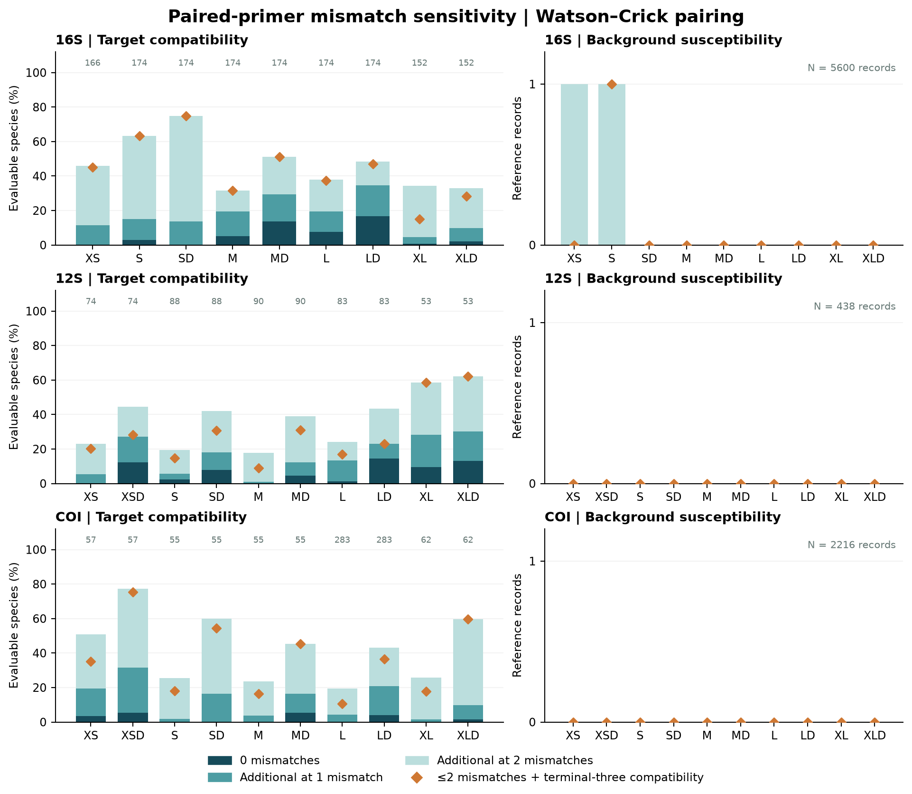
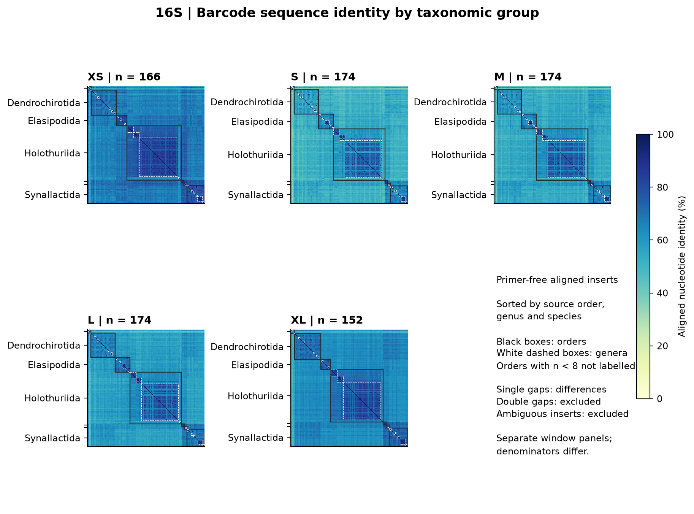
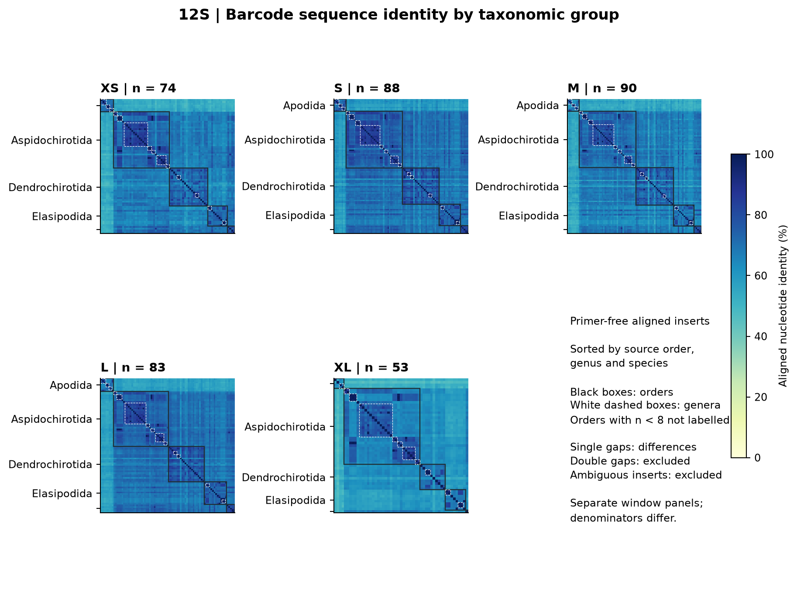
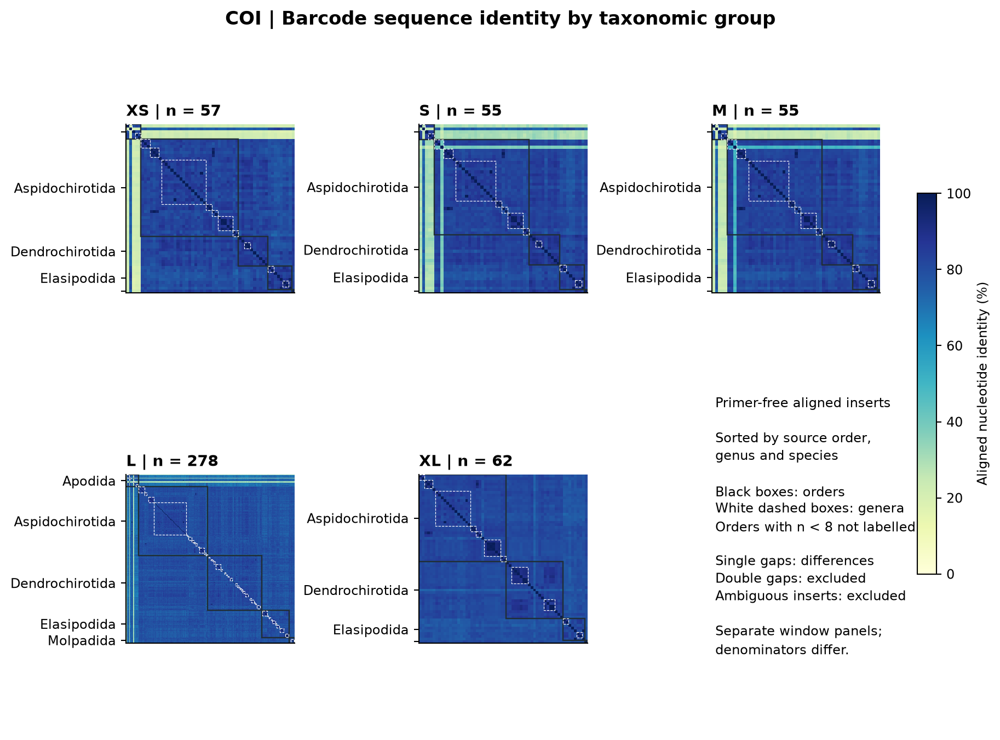
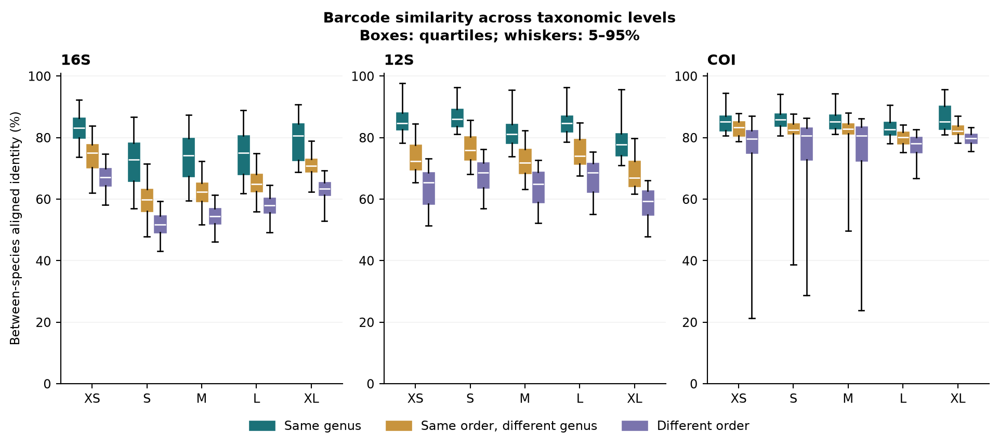
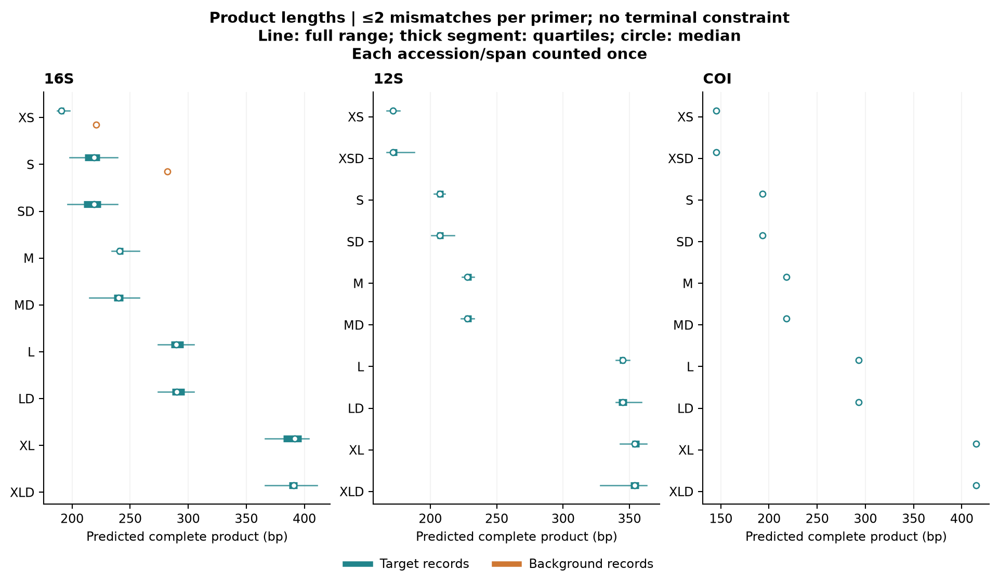
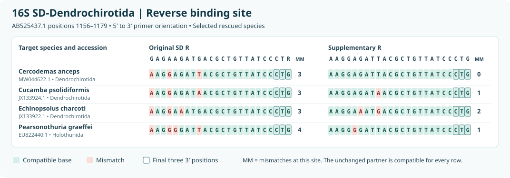
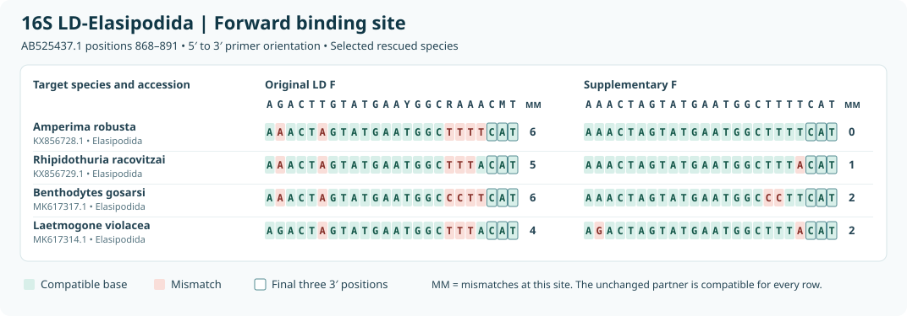

# MiCucumber: in silico design and evaluation of mitochondrial primers for sea cucumber (Holothuroidea) eDNA metabarcoding

**Fei Xia**

Preprint v1.6 · 10 November 2026 · Not peer reviewed

**Working revision · 11 November 2026**

## Abstract

Environmental DNA metabarcoding of sea cucumbers requires markers that combine broad primer compatibility with informative internal sequence variation. We evaluated five mitochondrial 16S windows on a curated panel of 174 species and independently screened mitochondrial 12S and COI. Each retained ordinary/D alternative shares reference endpoints, with at most eight concrete variants per D oligonucleotide. Among baseline pairs on the common 151-species 16S panel, SD covered the most species (115) and LD gave the most exact paired matches (23). Performance varied by lineage: LD covered 71/77 evaluable Holothuriida but 0/22 Elasipodida and 0/5 Apodida on its own panel. A reverse supplement at the S window increased compatible species from 130 to 155 of 174, and a forward supplement at the L window added 15 of 22 Elasipodida species. Neither addition increased strict background hits. Primer-free inserts contained six distinct interspecific identity-conflict pairs. Genus-blocked sequence selection quantified compatibility conditional on the predefined 16S windows. Among retained 12S D assays, XLD covered 33/53 species with seven exact matches. The refined 145 bp COI XS and XSD covered 20/57 and 43/57 species, with two and three exact matches and no strict background hits among 2,216 reference records. COI LD covered 103/283 species. Mismatch-gradient analysis of all 29 pairs showed that 16S SD matched 0, 24 and 130/174 species at zero, one and two mismatches per primer. Fifteen taxonomically ordered internal-barcode matrices comprised 130,599 within-window species comparisons. The resulting sequence collection and reproducible analyses support marker choice by length, lineage and binding properties. On external references, supplemented 16S S and L assays covered 23/28 and 16/28 evaluable species, respectively. COI LD covered 13/15 species, and external 12S target coverage was unevaluable. Limited near-terminal mismatch tolerance added one target each to three assays without adding a predicted Watson–Crick background match.

**Keywords:** Holothuroidea; environmental DNA; mitochondrial 16S; primer degeneracy; barcode discrimination; grouped holdout

## Introduction

Sea-cucumber molecular identification has an established basis in mitochondrial reference libraries. Uthicke et al. (2010) evaluated COI barcodes for commercially harvested species, while Byrne et al. (2010) used COI and 16S to clarify relationships and taxonomic assignments within Stichopodidae. For processed products, Wen et al. (2010, 2011) developed PCR–RFLP and forensically informative nucleotide sequencing (FINS) approaches based on mitochondrial 16S. These applications support retaining explicit species identities and source accessions when designing broadly compatible primers.

Xing et al. (2021) developed a 257 bp COI mini-barcode and combined it with next-generation sequencing to authenticate processed sea-cucumber products. Their study provides a sea-cucumber precedent for shortening a barcode and recovering multiple ingredients by sequencing. Environmental samples add a different template mixture and sampling context, so MiCucumber evaluates target compatibility, background matching and reference-insert discrimination on its own frozen panels.

Environmental DNA metabarcoding uses short markers to characterize biological assemblages from mixed DNA. Marker selection combines conserved primer-binding regions with informative variation between them. MiFish exemplifies this approach for fish 12S (Miya et al., 2015), while ecoPrimers formalizes the joint evaluation of taxonomic coverage and discrimination (Riaz et al., 2011). Licuanan and Matias (2022) identified short 16S and 12S candidate markers for echinoderms by comparing predicted coverage and discrimination. Their work establishes a basis for evaluating short Holothuroidea 16S windows. Anthozoan 28S work additionally illustrates how lineage-specific binding-site variation can motivate controlled primer degeneracy (McCartin et al., 2024).

A primer matching many database records may primarily reflect redundant sampling. A region with a high percentage of matched species can also be supported by a smaller or taxonomically different panel than another region. We therefore ask how controlled ordinary/D alternatives differ in coverage and exact matching on the same species set, how much discrimination their internal markers provide, and whether sequence selection generalizes to genera omitted from its training fold.

## Materials and methods

### Data acquisition and reference curation

The frozen source project contains 1,848 target records and 5,600 non-target records. Taxonomic and quality curation retained one representative for each of 174 species, using sequence completeness and source classifications rather than primer-match success. The source repository provides accession-level audit and classification files. Alignments use MAFFT 7.526 (Katoh and Standley, 2013).

### Alignment and reference coordinates

Reference positions are 1-based and inclusive on ungapped mitochondrial 16S sequence AB525437.1; they refer to the extracted gene, not whole-mitogenome coordinates.

Binding-window evaluation requires that both windows span the reference interval, contain at least 90% of the corresponding reference-site count as concrete A/C/G/T, and contain no ambiguous nucleotide. Alignment gaps are allowed. Missing or uncertain binding windows are excluded from that region's denominator rather than scored as primer failures. The intersection of available accessions defines the common panel of 151 species. This is an available-data intersection, not a random sample of global diversity.

The numerical results are reported in Table 1.

The reference accession AB525437.1 belongs to Apostichopus japonicus. Coordinates for 16S, 12S and COI are one-based positions within the separately extracted gene sequences.

### Candidate generation and chemical screening

Within S–XL, ordinary and D sequences are selected independently at shared reference start and end positions. The D sequence can differ from the ordinary sequence at concrete as well as ambiguous positions. Released D oligonucleotides have no more than eight concrete variants per primer and confine ambiguity to the 3′ half. The source design excludes homotriplet ends and homopolymers longer than four nucleotides and requires a G or C within the final three positions. Primer3 (Untergasser et al., 2012) evaluations use 50 mM monovalent salt, 1.5 mM Mg2+ and 0.6 mM dNTP, under two separate concentration scenarios: 50 nM per concrete variant, and 200 nM total per primer direction divided equally among its concrete variants. The S–XL gates require a maximum predicted hairpin/dimer structure Tm below 55 °C and a forward/reverse duplex-Tm range midpoint difference no greater than 5 °C. The 16S sequences were selected on the curated design panel through target, terminal, chemical and background screening. Their own-panel and common-panel scores therefore describe performance on references that participated in design.

### Matching models and common panels

Coverage requires no more than two mismatches per primer and IUPAC compatibility in each terminal three nucleotides. Exact matching requires zero mismatches at both binding sites. S–XL paired target scans allow total products of 150–500 bp with at least 50 bp between primers. XS scans allow 70–500 bp products with at least 20 bp between primers. Both sequence orientations are considered. Species contribute equally; per-order counts accompany aggregate values.

Released background screens allow an internal spacing of 0–1,000 bp. Strict screens retain the terminal constraint for both models. Permissive screens allow up to three mismatches per primer with Watson–Crick pairing alone and up to two when guanine–thymine pairing is also allowed. These counts describe reference records, not experimental amplification frequencies. C++ and Python implementations were previously compared on the same frozen data to check target and strict-background hit sets. Such implementation agreement is distinct from held-out reference evaluation.

### Primer-free barcode discrimination

For each available representative, we extract homologous alignment columns strictly between the forward-primer end and reverse-primer start, remove gaps, and exclude ambiguous internal inserts. These reference inserts exclude both primers and are not assumed to be observed PCR products. Inserts are grouped by exact sequence identity independently of the formal primer's matching result. Identity uniqueness is assessed against all available unambiguous inserts for that window, including species outside the common panel. The covered-and-unique count requires both a paired primer match and an identity-unique insert, with the full comparison-panel denominator retained.

Unit-cost Levenshtein distances are calculated between all pairs of unambiguous inserts. For each species we report its nearest other-species distance and all tied accessions. Distance implementation was cross-checked against an independent dynamic-programming algorithm in the initial workflow. One representative per species cannot estimate within-species diversity or a barcode gap. Identity uniqueness therefore describes the frozen reference collection rather than empirical taxonomic-assignment accuracy. Apparent identity conflicts are preserved for source review. A sensitivity table removes all members of each same-window identity conflict without changing the primary panel.

### Genus-blocked sequence-selection test

For each window, genera are sorted and linked when they share an identical complete representative sequence. Blocks are shuffled using Python's random generator with seed 20261030 and assigned cyclically to five folds. Consequently, no genus or identical complete representative crosses training and test sets. Fold sizes can differ substantially where genera are unevenly sampled.

Within each training fold, observed local sequences within five alignment columns of the frozen binding intervals supply candidates of fixed oligonucleotide lengths. Up to 24 frequent admissible concrete seeds per side enter deterministic greedy growth with at most three ambiguity-expansion steps. Ambiguity is confined to the 3′ half, degeneracy is limited to eight variants per oligonucleotide, a concrete G/C is required within the final three positions, and literal five-nucleotide homopolymers are excluded. Training paired coverage is maximized, followed by exact matching and lower summed degeneracy, with lexical tie-breaking. Released primer sequences and global candidate pools do not seed this training step.

Held-out species are scored by full raw-sequence paired scans with the same target size, mismatch and terminal rules. Each available species is tested once per window. Fold candidate construction failure would yield zero detections for that fold and empty sequence fields. This diagnostic selector does not repeat the original thermal or background selection gates. Region discovery and source-panel curation preceded splitting; accordingly, the test is conditional on predetermined regions and does not externally validate complete window discovery. Its fold sequences are not replacement recommendations.

### Independent 12S and COI candidate generation

The search of NCBI Nucleotide retrieved 6,168 distinct accessions across both loci. Annotated features were extracted in strand orientation and screened for length, ambiguity and nuclear or pseudogene annotations. Independent design panels contained 90 named species for 12S and 357 for COI. Candidate binding windows were evaluated on each gene's own alignment. Ordinary primers were chosen from the concrete variants of each retained D pair at the same reference endpoints. Each oligonucleotide has degeneracy ≤8. Within each size class, 12S prioritized exact matches among candidates covering at least 80% of the best eligible coverage count. COI maximized coverage among candidates retaining at least 95% of the largest evaluable panel. Raw paired scans allowed 100–500 bp target products with an internal insert of at least 50 bp. The frozen backgrounds contain 438 reference records for 12S and 2,216 for COI. Thresholds were ≤10 strict hits per model and ≤50 relaxed hits per model. The COI XS window was subsequently refined by shifting binding positions and jointly selecting ordinary and D sequences at fixed shared endpoints. The adopted window spans gene-relative positions 779–923, with F 779–798 and R 907–923. Independent seed-and-extend matching verified 57,550 record/model comparisons across the 20 released 12S and COI primer pairs.

### Evaluation of 16S lineage supplements

We compared each supplemented scheme with its SD or LD baseline at the same reference binding coordinates. We counted species added under the paired compatibility and exact rules and tabulated changes by order on both the 174-species S/L panel and the 151-species five-window intersection. Barcode uniqueness and nearest-neighbor edit distance use the full set of usable same-window inserts. Motivated by the position-specific analysis of Ficetola et al. (2024), we show mismatches in primer orientation and highlight the final three bases. Each example was newly compatible in the paired scan and had an unchanged partner compatible at the homologous site. Following Yang et al. (2023), we also counted concrete oligo variants observed at the homologous target site. We used accession-set differences for all five background screens.

### Independent implementation checks

The frozen computational bundle contains input hashes, source sequences, window panels, scripts, per-species predictions, fold candidates and aggregate tables. Numerical analysis uses Python's standard library; plotting uses matplotlib. Validation checks denominators, fold sizes, genus separation, identical-sequence grouping, input hashes and summary totals. Source audits remain available in the repository. The present manuscript was generated from the committed result tables, with input hashes recorded in its provenance file.

### Mismatch sensitivity, product lengths and taxonomic sequence identity

Following the diagnostic approach of McCartin et al. (2024, pp. 6 and 11–13; Fig. 3), all 29 released primer pairs were rescanned on both strands of their frozen target and background sequences. Mismatch thresholds of zero, one and two apply separately to each primer, with IUPAC compatibility treated as a match under Watson–Crick pairing. Each threshold was evaluated with and without requiring compatibility at the final three 3′ bases of both primers. Ambiguous binding sites were excluded. Target product-length limits reproduce the released rules: 70–500 bp with an insert ≥20 bp for 16S XS, 150–500 bp with an insert ≥50 bp for the remaining 16S assays, and 100–500 bp with an insert ≥50 bp for 12S/COI. Background inserts were allowed from 0 to 1,000 bp. Target denominators contain one representative per evaluable species per window; background denominators are 5,600, 438 and 2,216 accession records for 16S, 12S and COI. Counts therefore describe different units and are not amplification proportions in a mixed sample. The released guanine–thymine and more permissive background models remain separately reported.

For sequence-identity matrices, primer-free inserts were extracted between the aligned reference endpoints from each window's evaluable panel. Inserts containing ambiguous nucleotides were excluded; the existing curated gene alignments were retained. Identity equals the number of equal A/C/G/T columns divided by the number of columns containing at least one base. A base opposite a gap is a difference, and double-gap columns are ignored. Matrices were sorted by the source order assignment, genus and species. Ordinary/D alternatives share the same internal region, so one matrix represents each length. Exact ungapped insert identity was also counted independently. Between-species similarities were stratified into same genus, same order/different genus, and different orders. These available-panel summaries do not provide within-species variation, a barcoding-gap test, or matched cross-gene performance estimates. Product distributions count each unique accession/product-span combination once at each threshold; target products are restricted to the evaluable window panel.

The new C++ exhaustive scan was compared with the released exact and strict Watson–Crick summaries in 87 checks. An independent Python regex-seed matcher verified 1,578 threshold/terminal flags on deterministic hit and non-hit subsets spanning every assay and both target/background roles. A further 465 sampled pairwise identities were recalculated independently.

### External reference evaluation

We queried NCBI Nucleotide for additional mitochondrial records and froze the candidate accession list on 11 November 2026. We excluded accession stems from the archived and available earlier design and screening inputs, as well as strand-normalized exact sequence duplicates and identical contained fragments covering at least 85% of the longer sequence. We required mitochondrial annotation and a species name, with a complete marker feature in a mitochondrial record at least 12 kb long for background. One accession per species and marker was selected by feature completeness, length, ambiguity and accession order before any assay was scored. This was an accession-level evaluation, and external records could represent species already present in the design panels.

Target fragments were added to the frozen alignments with MAFFT 7.526. Assay denominators required both homologous binding intervals to be evaluable. We scanned the 29 retained pairs and four 16S lineage schemes using the original product geometry and strict Watson–Crick model. The limited model allowed one mismatch in total at the second or third base from a 3′ end while retaining the two-mismatch ceiling per oligo and compatibility at each ultimate 3′ base. Exact matches required full compatibility at both sites. Strict background scanning with guanine–thymine pairing was also reported separately. The C++ and Python implementations agreed on exact and strict Watson–Crick matches in all 5,119 assay–accession comparisons.

## Results

### Released assays on their available panels

On their available 16S panels, SD covers 130/174 species, MD covers 89/174 with 24 exact matches, and LD covers 82/174 with 29 exact matches (Table 2).

Own-panel proportions cannot by themselves establish a ranking across lengths because both denominator size and lineage composition differ. Strict and permissive background metrics remain distinct in the repository's released comparison table.

### Equal-denominator comparison

The common panel includes 151 species, compared with 166 evaluable XS species, 174 in S–L and 152 in XL. On the common panel, SD covers 115 species but has no exact paired matches; MD covers 79 with 22 exact, and LD covers 73 with 23 exact. The short XS covers 69 with no exact paired matches. These contrasts separate mismatch-tolerant breadth from exact template compatibility. In the own-window panel, LD covers 71/77 Holothuriida, 8/36 Dendrochirotida and 0/22 Elasipodida, demonstrating strong lineage dependence.

**Figure 1.** Compatibility and exact paired matching on the common species panel. All bars use the same denominator.

### Supplemental 16S oligo pools

The supplemental oligos retain the original binding coordinates. An exhaustive scan and an independent regex seed scan agreed for all six S/L schemes across 170,088 accession-by-criterion comparisons. Tables 10 and 11 report gains, background changes and order-level results. The [order-level results](../results/lineage_evaluation/by_order.csv) give coverage, paired exact matching and insert resolution on both panels.

SD-Dendrochirotida increased coverage from 130 to 155 of 174 species, including an increase from 21 to 35 of 36 Dendrochirotida. Its exact count increased from zero to one. The two strict screens and relaxed WC3 added no records. Relaxed GT2 and WC4 added 1 and 20 records, respectively. LD-Elasipodida increased coverage from 82 to 97 of 174, including 15 of 22 Elasipodida compared with zero for LD. Exact matching stayed at 29 of 174. All five background hit sets stayed the same as for LD, which had 1,015 hits under the most permissive WC4 model.

The two supplements used as separate assays covered 165/174 species in union, or 142/151 on the five-window common panel. Adding F-Synallactida to the L assay raised the full-panel exact-match union from 30 to 37 of 174 while leaving the covered-species union at 165. The numbers describe separate reference scans. Figures 11–12 show how one changed oligo can rescue the paired match at the original site.

One of the two concrete SD reverse variants and four of the eight LD forward variants exactly matched an observed binding motif. The supplementary reverse and forward oligos exactly matched their own binding sites in seven and five reference species, respectively. Single-site observations and exact paired matches are reported separately.

### Reference-insert discrimination

Identity-unique reference inserts range from 154/166 species in XS to 146/152 in XL; the common-panel covered-and-unique counts further require compatible primers (Tables 3–4).

The conflict inventory contains six distinct interspecific pairs, corresponding to 18 same-window identity groups across the five regions. Three pairs recur in every window: Astichopus multifidus–Isostichopus macroparentheses, Scotoplanes clarki–Protelpidia murrayi and Stichopus ocellatus–Stichopus hermanni. These are reference-set observations, not a determination of their biological cause. Taxonomic synonyms, source identification, sequence annotation and genuine marker sharing require distinct follow-up assessments. All accessions and sequences are retained in the supplemental conflict table. Reporting conflicts avoids counting every compatible template as a uniquely identifiable species. The conflict-exclusion sensitivity analysis is descriptive and does not assert that any source record is erroneous.

**Figure 2.** Identity-unique species among all available unambiguous reference inserts in each window. Labels show numerator and denominator.

### Conditional genus holdout

Across the five held-out folds, diagnostic sequence selection covers 156/166 XS species and 170/174 S species, with 64 and 39 exact matches, respectively (Table 5).

Each row pools five folds. Fold membership, genus counts, candidate sequences and training/test sizes are available in the computational bundle. A high compatible count can coexist with low exact matching. Because chemistry and background constraints were not applied to these diagnostic candidates, a larger test percentage is not evidence of a superior released assay. Conversely, a poor score can reflect the constrained heuristic rather than the absence of any useful primer in a region.

**Figure 3.** Conditional genus-blocked test predictions. Fold-specific training sequences differ from the released ordinary/D assays.

### Independent 12S and COI screens

Among retained 12S D pairs, XLD has the largest covered-species count and coverage proportion on its available panel: 33/53 species, with seven exact paired matches (Table 6). MD covers 28/90 species, with four exact matches. Because the windows have different evaluable species, these values describe their available panels.

The adopted COI XS and XSD share a 145 bp reference window and 108 bp primer-free reference insert. XS covers 20/57 species with two exact matches; XSD covers 43/57 with three. Both have zero strict hits in either background model. On this background, their permissive Watson–Crick/guanine–thymine counts are 12/1 and 32/1. Relative to the preceding XS sequence, the adopted ordinary pair loses five previously covered species and gains fourteen; XSD loses five and gains seven. These changes in species membership are listed in the current README.

The COI L window has 283 evaluable species compared with 55–57 for XS through M. Its ordinary and D pairs cover 30 and 103 species, with zero and eleven exact matches. Reference-window availability and compatibility therefore both influence the covered-species count. The common-panel discrimination and genus-blocked sequence-selection analyses apply to 16S.

**Figure 4a.** Ordinary and degenerate primer windows on the 12S reference.

**Figure 4b.** Ordinary and degenerate primer windows on the COI reference.

### Marker complementarity and limited mismatch sensitivity

Of the nine species missed by both 16S supplements, five were compatible with existing 12S assays. XLD added *Protankyra bidentata*, *P. verrilli* and *Ocnus glacialis*. SD added *Gephyrothuria alcocki* and *Paroriza prouhoi*. COI XS/XSD also covered *O. glacialis*. The cross-marker coverage audit matched accepted species names and recorded accession identity separately. *Chiridota heheva* was reconciled to *C. hydrothermica* using WoRMS (AphiaID 242132). Order assignments follow the curated 16S panel.

We also tested a limited mismatch scenario while retaining the strict model as the primary result. Both models allow up to two Watson–Crick mismatches per oligonucleotide. The sensitivity analysis requires compatibility at the last 3′ base and allows one mismatch across the pair at the second or third base from a 3′ end. LD-Elasipodida and COI XSD each gained one species (97 to 98 of 174 and 43 to 44 of 57, respectively). SD-Dendrochirotida and 12S XLD retained their strict counts. The four frozen background panels returned no additional hits under this scenario. None of the original nine misses was newly recovered by the limited rule for these four schemes. The analysis is a sequence-compatibility scenario for a planned KOD One workflow with at least 500,000 reads. Sequencing depth is not used to predict amplification of mismatched templates.

Among the six distinct pairs of species with identical 16S inserts, one pair had comparable alternate-marker inserts for both species on the same accessions used for 16S. *Scotoplanes clarki* and *Protelpidia murrayi* had different reference inserts and both were compatible with 12S XLD and COI XSD. The other five exact-collision pairs and the eight one-edit nearest-neighbor pairs lacked such an alternate-marker comparison. The [species, mismatch and paired-barcode tables](../results/marker_complementarity/README.md) give the underlying accession-level results.

### External reference performance

From 511 candidate accessions, curation retained 31 sea cucumber species for 16S and 17 for COI. Of the external targets, 21–30 were evaluable per 16S window and 15 for COI L/LD. No 12S target passed curation, and no retained COI target spanned both sites of the XS, S, M or XL window. Among 28 external species evaluable at each of S and L, SD-Dendrochirotida covered 23 (82.1%) versus 21 for SD, and LD-Elasipodida covered 16 (57.1%) versus 12 for LD. Exact counts were unchanged at zero for the S schemes and two for the L schemes. Separate S and L assays together covered 25 of 27 species with both windows evaluable, with two exact matches.

The limited mismatch rule added one covered species each to 16S M, 16S MD and COI L. Under both Watson–Crick coverage rules, none of the 142 16S, 143 12S or 127 COI background accessions matched any assay. The separate strict model with guanine–thymine pairing gave three background hits for 16S S and one each for 16S XLD and COI XSD. Other echinoderm classes were absent from the curated external background, so the external results leave specificity against these classes unresolved. Table 12 summarizes selected assays, and the [external panel tables](../results/external_panel/README.md) report all 33 schemes.

### Anth-28S-inspired diagnostic results

The mismatch series separates exact compatibility from tolerance-dependent coverage. On their own available panels, 16S SD matched 0, 24 and 130 of 174 species at zero, one and two mismatches per primer; requiring terminal-three compatibility at the two-mismatch threshold retained all 130. In contrast, LD matched 29, 60 and 84 species, decreasing to 82 after the terminal constraint. For 12S XLD, the series was 7, 16 and 33 of 53 species, with 33 retained by the terminal rule. COI XSD matched 3, 18 and 44 of 57 species, decreasing to 43; COI LD decreased from 122 to 103 of 283 species when terminal compatibility was required at the two-mismatch threshold. These differences show why relaxed mismatch totals cannot replace the released strict coverage measure.

At up to two Watson–Crick mismatches without the terminal constraint, the frozen background scan predicted one record for each of 16S XS and S and none for the other 27 pairs. This restricted model does not replace the reported guanine–thymine or higher-mismatch screens. The product-length plot presents these finite-panel predictions without assuming size selection will separate target and background products.

The 15 identity matrices contain 130,599 distinct within-window species comparisons. Exact insert uniqueness was 154/166 species for 16S XS and 168/174 for S, M and L; the XL panel contained 146/152 unique representatives. For 12S XL, 53/53 available inserts were unique; COI XL contained 62/62 unique inserts. The COI L identity analysis retained 278 of 283 evaluable species after excluding five ambiguous internal inserts, of which 272 had unique inserts. Complete sequences can therefore differ in primer evaluability and usable internal-barcode status. Neither smaller-panel uniqueness nor higher average divergence alone establishes a better assay.

Table 8 reports the mismatch-gradient counts for all 29 assays; Table 9 summarizes the internal-barcode panels.

**Figure 5.** Mismatch sensitivity for the 29 released assays. Stacked bars show cumulative zero-, one- and two-mismatch matches, with thresholds applied to each primer separately. Orange symbols require terminal-three compatibility at the two-mismatch threshold. Target annotations give evaluable species denominators; backgrounds count accession records. Only Watson–Crick pairing is shown.

**Figure 6.** 16S primer-free aligned sequence identities, sorted by source order, genus and species. Black boxes delimit orders and white dashed boxes delimit genera. All available unambiguous inserts are included regardless of released-primer compatibility. Single gaps count as differences and double gaps are excluded.

**Figure 7.** 12S primer-free aligned sequence identities, using the same definition as Figure 6. Each window uses its own available panel and species order.

**Figure 8.** COI primer-free aligned sequence identities, using the same definition as Figure 6. Five ambiguous internal inserts were excluded from the L window; its identity denominator is 278 rather than the binding-evaluable 283.

**Figure 9.** Between-species aligned identity by taxonomic relationship. Boxes span quartiles; whiskers show the fifth and ninety-fifth percentiles. Pairwise observations share species and are descriptive, not independent statistical replicates. One representative per species precludes assessment of a within-/between-species barcoding gap.

**Figure 10.** Predicted complete product lengths at up to two mismatches per primer, without a terminal constraint. Lines show full ranges, thick segments show quartiles and circles show medians of unique accession/span combinations. Background matches occur only for 16S XS and S in this restricted model. Product-length separation is not assumed.

**Figure 11.** Base matching at the S reverse site for four newly compatible references. The original and supplementary oligos are compared with each template in 5′ to 3′ primer orientation. Outlined cells mark the final three bases. In these examples, the supplementary oligo reduces mismatches outside the terminal three bases.

**Figure 12.** Base matching at the L forward site for four newly compatible Elasipodida references. The same reverse oligo is compatible at the homologous site in all four examples.

## Discussion

The mismatch-gradient analysis further shows that high two-mismatch compatibility can coexist with very few exact or one-mismatch matches. For example, 16S SD has no exact matches but 130/174 two-mismatch matches on its available panel. These are complementary diagnostics, and should not be collapsed into a single assay ranking. Taxonomically sorted identity matrices expose shared and divergent internal sequences, while the separate ambiguity filter keeps primer-site evaluability distinct from barcode usability.

The analysis separates three questions: whether a primer pair matches the target reference, whether the paired sites match exactly, and whether the internal sequence distinguishes that reference from other named species. Among baseline pairs on the 151-species common panel, SD had the broadest predicted coverage (115/151) and LD had the most exact paired matches (23/151). These properties need not favor the same design. Coverage improvements from controlled degeneracy should therefore be interpreted alongside exact matches, lineage changes and non-target susceptibility rather than a single aggregate percentage.

Reference availability is a substantive part of the result. Common-panel comparison removes changing denominators but limits the taxa represented. Own-panel analysis increases available taxonomic information while making raw percentages less directly comparable across regions. As in the multi-marker comparison of Lorusso et al. (2024), order-level profiles and species-set differences expose gains and losses hidden by aggregate counts. Nearest-neighbor distances show whether sequence uniqueness depends on very small differences. Ruiz et al. (2026) distinguished merges between taxonomic units from splits within them using matched mitogenomes. The one-representative panel here describes between-species collisions and their nearest neighbors. Identity conflicts should be reviewed against source records before being interpreted as biological limits of the marker.

The genus-blocked diagnostic prevents direct reuse of a genus across training and testing and binds identical full representatives together. It is nevertheless narrower than independent validation of the complete discovery pipeline: the windows and curated species collection were chosen before splitting. A fully nested region-discovery design or external accession set unused in any design stage would support broader generalization claims. Fold candidates also lack the original chemical/background selection and allow local alignment offsets; they cannot replace the fixed-coordinate formal assays on the basis of these tests.

One-reference-per-species scoring controls database redundancy but does not cover all haplotypes, populations or sequencing errors. Exact reference-insert uniqueness is not classifier accuracy, and compatibility models do not estimate competitive amplification in mixed DNA. Background libraries are finite and strongly shaped by available source data. Published Holothuroidea 16S candidates provide a taxonomic and marker-design precedent (Licuanan and Matias, 2022). The present estimates describe MiCucumber assays on the frozen target and background panels.

Published barcoding results help interpret the reference identity conflicts. Uthicke et al. (2010) reported conspecific COI variation of 1.3% and congeneric divergence of 16.9%, with a small overlap and some morphologically disparate specimens sharing a barcode. Their observations motivate source and taxonomic review of shared sequences, including the 16S conflicts documented here. Byrne et al. (2010) further showed how combined COI and 16S evidence can clarify specimen assignments in Stichopodidae. A fixed short-window collision therefore warrants evaluation together with specimen identity and independent sequence evidence.

Low degeneracy also has an echinoderm-specific methodological precedent. Hoareau and Boissin (2010) designed hybrid COI primers using 310 species, reporting fourfold degeneracy compared with at least 48-fold for their standard degenerate designs, and amplification in all 123 tested species. Their assays targeted more than 500 bp. MiCucumber applies a low-degeneracy constraint to shorter candidate windows and evaluates every retained pair against its own target and background references. The primer architecture, amplicon length and tested material determine the scope of each performance estimate.

### Priorities for assay evaluation

| Intended use | Computational priority | Evidence |
| --- | --- | --- |
| Broad 16S compatibility | SD | 115/151 common-panel species covered |
| Exact 16S matching | LD | 23/151 common-panel species matched exactly |
| Additional 12S compatibility | XLD | 33/53 covered and 7 exact on its available panel |
| Short COI window | XS / XSD | 145 bp; 20/57 and 43/57 covered |
| Longer COI coverage | LD | 103/283 covered on its available panel |

The broad-compatibility priority for 16S SD uses the mismatch-tolerant model; its common-panel exact-match count is 0/151. Priorities within 12S and COI use each window’s available panel, so they do not establish an equal-denominator ranking across lengths.

## Conclusions

MiCucumber provides five controlled mitochondrial 16S windows for computational comparison in sea cucumbers. Common-panel results, internal-barcode identity and conditional genus holdout reveal complementary aspects of candidate performance. The S and L supplements recovered different lineages at the original sites and together covered 165 of 174 species in separate predicted assays. The 145 bp COI XS/XSD window adds a short-marker choice with 20/57 and 43/57 compatible species and no strict background hits on the frozen panel. Apodida remains a coverage gap on the 16S panel, and some Elasipodida references remain unmatched. The released sequences and source-linked tables support length and degeneracy choices within the available reference coverage.

## Data availability and reproducibility

All primer sequences, frozen reference inputs, analyses and this preprint are available at https://github.com/GUIBA-EX/MiCucumber. The common-panel evaluation bundle is under results/computational_evaluation and the mismatch/identity diagnostic bundle is under results/anth28s_evaluation; the [S/L lineage tables, figures and verification](../results/lineage_evaluation/README.md) accompany this manuscript. The manuscript Markdown, PDF, build script and provenance are under publications. The [marker complementarity and sensitivity analysis](../results/marker_complementarity/README.md) uses the same frozen inputs. The [external reference audit and scoring replay](../results/external_panel/README.md) use separate reference FASTAs.

## References

Miya M, et al. (2015). MiFish, a set of universal PCR primers for metabarcoding environmental DNA from fishes: detection of more than 230 subtropical marine species. Royal Society Open Science 2:150088. https://doi.org/10.1098/rsos.150088

Riaz T, et al. (2011). ecoPrimers: inference of new DNA barcode markers from whole genome sequence analysis. Nucleic Acids Research 39:e145. https://doi.org/10.1093/nar/gkr732

McCartin et al. (2024). Nuclear eDNA metabarcoding primers for anthozoan coral biodiversity assessment. PeerJ 12:e18607. https://doi.org/10.7717/peerj.18607

Katoh K, Standley DM (2013). MAFFT multiple sequence alignment software version 7: improvements in performance and usability. Molecular Biology and Evolution 30:772–780. https://doi.org/10.1093/molbev/mst010

Untergasser A, et al. (2012). Primer3—new capabilities and interfaces. Nucleic Acids Research 40:e115. https://doi.org/10.1093/nar/gks596

Uthicke S, Byrne M, Conand C (2010). Genetic barcoding of commercial Bêche-de-mer species (Echinodermata: Holothuroidea). Molecular Ecology Resources 10:634–646. https://doi.org/10.1111/j.1755-0998.2009.02826.x

Hoareau TB, Boissin E (2010). Design of phylum-specific hybrid primers for DNA barcoding: addressing the need for efficient COI amplification in the Echinodermata. Molecular Ecology Resources 10:960–967. https://doi.org/10.1111/j.1755-0998.2010.02848.x

Byrne M, Rowe F, Uthicke S (2010). Molecular taxonomy, phylogeny and evolution in the family Stichopodidae (Aspidochirotida: Holothuroidea) based on COI and 16S mitochondrial DNA. Molecular Phylogenetics and Evolution 56:1068–1081. https://doi.org/10.1016/j.ympev.2010.04.013

Wen J, Hu C, Zhang L, Luo P, Zhao Z, Fan S, Su T (2010). The application of PCR–RFLP and FINS for species identification used in sea cucumbers (Aspidochirotida: Stichopodidae) products from the market. Food Control 21:403–407. https://doi.org/10.1016/j.foodcont.2009.06.014

Wen J, Hu C, Zhang L, Fan S (2011). Genetic identification of global commercial sea cucumber species on the basis of mitochondrial DNA sequences. Food Control 22:72–77. https://doi.org/10.1016/j.foodcont.2010.06.010

Xing RR, Hu RR, Wang N, Zhang JK, Ge YQ, Chen Y (2021). Authentication of sea cucumber products using NGS-based DNA mini-barcoding. Food Control 129:108199. https://doi.org/10.1016/j.foodcont.2021.108199

Licuanan AM, Matias AMA (2022). In silico evaluation of the taxonomic resolution and coverage of the COI region and alternative barcode markers for echinoderms. Philippine Journal of Science 151:955–968. https://doi.org/10.56899/151.03.14

Ficetola GF, Guerrieri A, Cantera I, Bonin A (2024). In silico assessment of 18S rDNA metabarcoding markers for the characterization of nematode communities. PLOS ONE 19:e0298905. https://doi.org/10.1371/journal.pone.0298905

Yang L, et al. (2023). A tool to automatically design multiplex PCR primer pairs for specific targets using diverse templates. Scientific Reports 13:16451. https://doi.org/10.1038/s41598-023-43825-0

Lorusso L, et al. (2024). Authentication of seafood species on the ASFIS list (FAO) by in-silico evaluation of primers for metabarcoding. Food Control 165:110663. https://doi.org/10.1016/j.foodcont.2024.110663

Ruiz E, Lamy T, Mouillot D, Durand JD (2026). Benchmarking the taxonomic resolution of fish eDNA metabarcodes against COI barcodes. Molecular Ecology Resources 26:e70069. https://doi.org/10.1111/1755-0998.70069

Copyright © 2026 Fei Xia. Existing project copyright and third-party source conditions apply; see COPYRIGHT.md at the repository root.

Versioned preprint and associated sequence files: https://github.com/GUIBA-EX/MiCucumber/releases/tag/preprint-v1.6

## Table 1. Reference binding coordinates and evaluable species.

Spans include both primer-binding regions; actual products vary among species.

| Window | F positions | R positions | Span bp | Available species |
| --- | --- | --- | --- | --- |
| XS | 1042–1059 | 1213–1232 | 191 | 166 |
| S | 954–977 | 1156–1179 | 226 | 174 |
| M | 921–942 | 1148–1165 | 245 | 174 |
| L | 868–891 | 1152–1169 | 302 | 174 |
| XL | 781–800 | 1147–1176 | 396 | 152 |

## Table 2. Released 16S own-panel target results and strict background-record counts.

¹ Counts give Watson–Crick pairing alone first, followed by the model that also allows guanine–thymine pairing.

| Assay | Own-panel N | Covered | Exact | Strict background hits¹ |
| --- | --- | --- | --- | --- |
| XS | 166 | 75 | 0 | 0 / 0 |
| S | 174 | 110 | 5 | 1 / 3 |
| SD | 174 | 130 | 0 | 0 / 5 |
| M | 174 | 55 | 9 | 0 / 2 |
| MD | 174 | 89 | 24 | 0 / 15 |
| L | 174 | 65 | 13 | 0 / 0 |
| LD | 174 | 82 | 29 | 0 / 0 |
| XL | 152 | 23 | 1 | 0 / 0 |
| XLD | 152 | 43 | 3 | 0 / 10 |

## Table 3. Released assay outcomes on 151 common species.

Covered + unique means compatible paired primers and an identity-unique reference insert against the entire available same-window barcode set.

| Assay | Covered | Exact | Covered + unique |
| --- | --- | --- | --- |
| XS | 69/151 | 0/151 | 63/151 |
| S | 99/151 | 5/151 | 95/151 |
| SD | 115/151 | 0/151 | 109/151 |
| M | 51/151 | 9/151 | 47/151 |
| MD | 79/151 | 22/151 | 73/151 |
| L | 59/151 | 13/151 | 59/151 |
| LD | 73/151 | 23/151 | 73/151 |
| XL | 23/151 | 1/151 | 23/151 |
| XLD | 43/151 | 3/151 | 43/151 |

## Table 4. Unambiguous internal reference inserts.

Nearest ≤1 is the number of representatives with a different species at edit distance zero or one. N can be smaller than the binding-window panel when an internal insert is ambiguous.

| Window | N | Unique | Insert bp | Median nearest edit | Nearest ≤1 |
| --- | --- | --- | --- | --- | --- |
| XS | 166 | 154 | 148–165 | 10.0 | 20 |
| S | 174 | 168 | 148–191 | 20.0 | 14 |
| M | 174 | 168 | 175–218 | 22.0 | 14 |
| L | 174 | 168 | 230–274 | 26.5 | 14 |
| XL | 152 | 146 | 313–361 | 31.5 | 10 |

## Table 5. Out-of-fold compatibility from training-selected diagnostic pairs.

These are not the released assay scores in Tables 2–3.

| Window | Test N | Covered | Exact |
| --- | --- | --- | --- |
| XS | 166 | 156 (93.98%) | 64 (38.55%) |
| S | 174 | 170 (97.70%) | 39 (22.41%) |
| M | 174 | 85 (48.85%) | 23 (13.22%) |
| L | 174 | 43 (24.71%) | 9 (5.17%) |
| XL | 152 | 73 (48.03%) | 0 (0.00%) |

## Table 6. Predicted compatibility and strict background-record counts (¹ Watson–Crick pairing alone / also allowing guanine–thymine pairing) in the independent 12S and COI panels.

| Gene | Assay | Span bp | Covered/N | Exact/N | Strict background hits¹ |
| --- | --- | --- | --- | --- | --- |
| 12S | XS | 176 | 15/74 | 0/74 | 0/0 |
| 12S | XSD | 176 | 21/74 | 9/74 | 0/0 |
| 12S | S | 207 | 13/88 | 2/88 | 0/0 |
| 12S | SD | 207 | 27/88 | 7/88 | 0/0 |
| 12S | M | 228 | 8/90 | 0/90 | 0/0 |
| 12S | MD | 228 | 28/90 | 4/90 | 0/5 |
| 12S | L | 346 | 14/83 | 1/83 | 0/0 |
| 12S | LD | 346 | 19/83 | 12/83 | 0/0 |
| 12S | XL | 354 | 31/53 | 5/53 | 0/1 |
| 12S | XLD | 354 | 33/53 | 7/53 | 0/1 |
| COI | XS | 145 | 20/57 | 2/57 | 0/0 |
| COI | XSD | 145 | 43/57 | 3/57 | 0/0 |
| COI | S | 193 | 10/55 | 0/55 | 0/0 |
| COI | SD | 193 | 30/55 | 0/55 | 0/0 |
| COI | M | 218 | 9/55 | 0/55 | 0/0 |
| COI | MD | 218 | 25/55 | 3/55 | 0/0 |
| COI | L | 293 | 30/283 | 0/283 | 0/0 |
| COI | LD | 293 | 103/283 | 11/283 | 0/2 |
| COI | XL | 415 | 11/62 | 0/62 | 0/0 |
| COI | XLD | 415 | 37/62 | 1/62 | 0/2 |

## Table 7. Released primer sequences

All sequences are written 5′ to 3′. Additional-marker endpoints and spans are given in the released per-gene pairs.csv files.

Deg F/R gives the number of concrete variants per direction. The 16S ordinary and D sequences share the reference endpoints in Table 1 and are independently selected at those positions. The single 16S XS pair is retained.

| Assay | F, 5′–3′ | R, 5′–3′ | Deg F/R |
| --- | --- | --- | --- |
| XS | AACTTTGGTTGGGGYAAC | TTTCCCCAATCCAACATCGA | 2/1 |
| S | CCAGAAAGACGAGAAGACCCTGTC | GAGGAGATAACGCTGTTATCCCTG | 1/1 |
| SD | TAAGAAAGACGARAAGACCCTRTC | GAGAAGATGACGCTGTTATCCCTR | 4/2 |
| M | AAACTTCTATTAACGTGAAGAA | GTTATCCCTGCGGTAACT | 1/1 |
| MD | AAACTTCTATTHAYGTGAAGAA | GTTATCCCTGCGGTAACT | 6/1 |
| L | AGACTCGTATGAACGGCAAAACCT | CGCTGTTATCCCTGCGGT | 1/1 |
| LD | AGACTTGTATGAAYGGCRAAACMT | CGCTGTTATCCCTGCRGT | 8/2 |
| XL | GGTCACGCCTGCCCAGTGGA | AAGATAACGCTGTTATCCCTGCGGTAACTT | 1/1 |
| XLD | GGTAACGCCTGCCCARTGGA | GAGATTACGCTGTTATCCCTGCGGTAACTD | 2/3 |

### Additional mitochondrial primer sequences

| Assay | F, 5′–3′ | R, 5′–3′ | Deg F/R |
| --- | --- | --- | --- |
| 12S XS | AGATACCCTACTATACCCTTC | CGACGATGGTATACAAACTG | 1/1 |
| 12S XSD | AGATACCCTACTATACYYTTC | CGACGATGGTATACWRRCTG | 4/8 |
| 12S S | AACACCAGAGCAGTACAGCT | CTGCACCTTGATCTGACGT | 1/1 |
| 12S SD | AACACCAGAGYAGTACARCY | CTGCACCTTGATCTGRHGT | 8/6 |
| 12S M | AGGAGCTTGTCATTAAATTGAT | TTACTATCGAATCCTCTTTCAT | 1/1 |
| 12S MD | AGGAGCTTGTCATYRAATYGAT | TTACTATCGAATCCTCTTTCWD | 8/6 |
| 12S L | AACACCAGAGCAGTACGGCT | GCGATGTGTGCGCATTCTAGAG | 1/1 |
| 12S LD | AACACCAGAGYAGTACRGYT | GCGATGTGTGCRYATTYTAGAG | 8/8 |
| 12S XL | GGTGGTTAATAACGTGCCAG | CGACGATGGTATACAGGCTG | 1/1 |
| 12S XLD | GGTGGTTAATAACGTGCCAG | CGACGATGGTATACWRRCTG | 1/8 |
| COI XS | ACTATAGAGGAAAGCAAGAA | GCTGCTGTGAAGTAGGC | 1/1 |
| COI XSD | ACTATAGAGGRAAGCMAGAR | GCTGCTGTRAAGTADGC | 8/6 |
| COI S | GAATGGTATACGCTATGGT | GTTTCTCAGACTAGCTTTG | 1/1 |
| COI SD | GAATGGTATAYGCWATGRT | GTTTCTCAGAYTARCTTKG | 8/8 |
| COI M | CACTATAGAGGAAAGCAAGAACC | AACTTTGATCCTTGTAGGGT | 1/1 |
| COI MD | CACTATAGAGGWAAGMAAGARCC | AACTTTGATCCTTGTARNGT | 8/8 |
| COI L | AAAATGCGAACCCCAGGAGTAAC | GGTTCTTGCTTTCCTCTGTAGTG | 1/1 |
| COI LD | AAAATGCGAACYCCAGGARTWAC | GGTTCTTGCTTWCCTCTRTARTG | 8/8 |
| COI XL | ATGAACCTAAACCGCTGAT | CGTGGGCTATATTTCTTGA | 1/1 |
| COI XLD | ATGAACCTAAAMCGYTGAY | CGTGGGCTATRTTTCTNGA | 8/8 |

## Table 8. Paired-primer mismatch sensitivity on the available species panels.

Mismatch ceilings apply to each primer separately. Target counts are species; background counts are accession records under Watson–Crick pairing. The terminal-three column uses the released target compatibility rule. Background ≤2 does not require terminal compatibility and does not replace the broader background models in Tables 2 and 6.

| Gene | Assay | Species N | ≤0 | ≤1 | ≤2 | ≤2 + terminal 3 | Background ≤2 |
| --- | --- | --- | --- | --- | --- | --- | --- |
| 16S | XS | 166 | 0 | 19 | 76 | 75 | 1 |
| 16S | S | 174 | 5 | 26 | 110 | 110 | 1 |
| 16S | SD | 174 | 0 | 24 | 130 | 130 | 0 |
| 16S | M | 174 | 9 | 34 | 55 | 55 | 0 |
| 16S | MD | 174 | 24 | 51 | 89 | 89 | 0 |
| 16S | L | 174 | 13 | 34 | 66 | 65 | 0 |
| 16S | LD | 174 | 29 | 60 | 84 | 82 | 0 |
| 16S | XL | 152 | 1 | 7 | 52 | 23 | 0 |
| 16S | XLD | 152 | 3 | 15 | 50 | 43 | 0 |
| 12S | XS | 74 | 0 | 4 | 17 | 15 | 0 |
| 12S | XSD | 74 | 9 | 20 | 33 | 21 | 0 |
| 12S | S | 88 | 2 | 5 | 17 | 13 | 0 |
| 12S | SD | 88 | 7 | 16 | 37 | 27 | 0 |
| 12S | M | 90 | 0 | 1 | 16 | 8 | 0 |
| 12S | MD | 90 | 4 | 11 | 35 | 28 | 0 |
| 12S | L | 83 | 1 | 11 | 20 | 14 | 0 |
| 12S | LD | 83 | 12 | 19 | 36 | 19 | 0 |
| 12S | XL | 53 | 5 | 15 | 31 | 31 | 0 |
| 12S | XLD | 53 | 7 | 16 | 33 | 33 | 0 |
| COI | XS | 57 | 2 | 11 | 29 | 20 | 0 |
| COI | XSD | 57 | 3 | 18 | 44 | 43 | 0 |
| COI | S | 55 | 0 | 1 | 14 | 10 | 0 |
| COI | SD | 55 | 0 | 9 | 33 | 30 | 0 |
| COI | M | 55 | 0 | 2 | 13 | 9 | 0 |
| COI | MD | 55 | 3 | 9 | 25 | 25 | 0 |
| COI | L | 283 | 0 | 12 | 55 | 30 | 0 |
| COI | LD | 283 | 11 | 59 | 122 | 103 | 0 |
| COI | XL | 62 | 0 | 1 | 16 | 11 | 0 |
| COI | XLD | 62 | 1 | 6 | 37 | 37 | 0 |

## Table 9. Primer-free barcode identity on the available window panels.

Unique denotes a species whose ungapped insert differs from every other retained species in the same window. Ambiguous internal inserts are excluded independently of binding-site evaluability. Identical pairs count distinct species pairs within each window.

| Gene | Window | Unambiguous N | Unique species | Identical pairs | Insert bp |
| --- | --- | --- | --- | --- | --- |
| 16S | XS | 166 | 154 | 6 | 148–165 |
| 16S | S | 174 | 168 | 3 | 148–191 |
| 16S | M | 174 | 168 | 3 | 175–218 |
| 16S | L | 174 | 168 | 3 | 230–274 |
| 16S | XL | 152 | 146 | 3 | 313–361 |
| 12S | XS | 74 | 70 | 2 | 125–147 |
| 12S | S | 88 | 86 | 1 | 159–172 |
| 12S | M | 90 | 88 | 1 | 177–190 |
| 12S | L | 83 | 81 | 1 | 294–310 |
| 12S | XL | 53 | 53 | 0 | 287–323 |
| COI | XS | 57 | 55 | 1 | 104–184 |
| COI | S | 55 | 53 | 1 | 69–155 |
| COI | M | 55 | 53 | 1 | 102–233 |
| COI | L | 278 | 272 | 3 | 247–311 |
| COI | XL | 62 | 62 | 0 | 377–377 |

## Table 10. Marginal gains of the S and L lineage supplements on the 174-species panel.

Background changes are added accessions on the 5,600-record panel. The five counts give strict Watson–Crick only, strict also allowing guanine–thymine pairing, and relaxed WC3, GT2 and WC4, in that order.

| Assay | Added oligos | Covered | Exact | Added background |
| --- | --- | --- | --- | --- |
| SD-Dendrochirotida | 1 | 130 → 155 | 0 → 1 | 0 / 0 / 0 / 1 / 20 |
| LD-Synallactida | 1 | 82 → 104 | 29 → 36 | 0 / 0 / 0 / 0 / 0 |
| LD-Synallactida-Elasipodida | 2 | 82 → 119 | 29 → 36 | 0 / 0 / 0 / 0 / 0 |
| LD-Elasipodida | 1 | 82 → 97 | 29 → 29 | 0 / 0 / 0 / 0 / 0 |

## Table 11. Order-level 16S outcomes before and after the selected S and L supplements.

Entries give SD → SD-Dendrochirotida and LD → LD-Elasipodida. Covered + unique requires a compatible pair and an insert unique among all usable inserts for that window.

| Order | N | S covered | S exact | S covered + unique | L covered | L exact | L covered + unique |
| --- | --- | --- | --- | --- | --- | --- | --- |
| Apodida | 5 | 0 → 0 | 0 → 0 | 0 → 0 | 0 → 0 | 0 → 0 | 0 → 0 |
| Dendrochirotida | 36 | 21 → 35 | 0 → 1 | 21 → 35 | 8 → 8 | 0 → 0 | 8 → 8 |
| Elasipodida | 22 | 14 → 14 | 0 → 0 | 12 → 12 | 0 → 15 | 0 → 0 | 0 → 13 |
| Holothuriida | 77 | 64 → 75 | 0 → 0 | 64 → 75 | 71 → 71 | 29 → 29 | 71 → 71 |
| Molpadida | 4 | 4 → 4 | 0 → 0 | 4 → 4 | 0 → 0 | 0 → 0 | 0 → 0 |
| Persiculida | 4 | 2 → 2 | 0 → 0 | 2 → 2 | 0 → 0 | 0 → 0 | 0 → 0 |
| Synallactida | 26 | 25 → 25 | 0 → 0 | 21 → 21 | 3 → 3 | 0 → 0 | 3 → 3 |

## Table 12. External reference matches for selected assays.

Target entries are matching species / evaluable species. NA indicates that no reference covered both binding sites. ¹ Background accession hits are given as strict Watson–Crick / limited Watson–Crick / strict with guanine–thymine pairing.

| Gene | Assay | Exact | Strict | Limited | Background N | Background hits¹ |
| --- | --- | --- | --- | --- | --- | --- |
| 16S | SD | 0/28 | 21/28 | 21/28 | 142 | 0 / 0 / 0 |
| 16S | SD-Dendrochirotida | 0/28 | 23/28 | 23/28 | 142 | 0 / 0 / 0 |
| 16S | LD | 2/28 | 12/28 | 12/28 | 142 | 0 / 0 / 0 |
| 16S | LD-Elasipodida | 2/28 | 16/28 | 16/28 | 142 | 0 / 0 / 0 |
| 12S | XLD | NA | NA | NA | 143 | 0 / 0 / 0 |
| COI | XSD | NA | NA | NA | 127 | 0 / 0 / 1 |
| COI | L | 0/15 | 2/15 | 3/15 | 127 | 0 / 0 / 0 |
| COI | LD | 1/15 | 13/15 | 13/15 | 127 | 0 / 0 / 0 |
