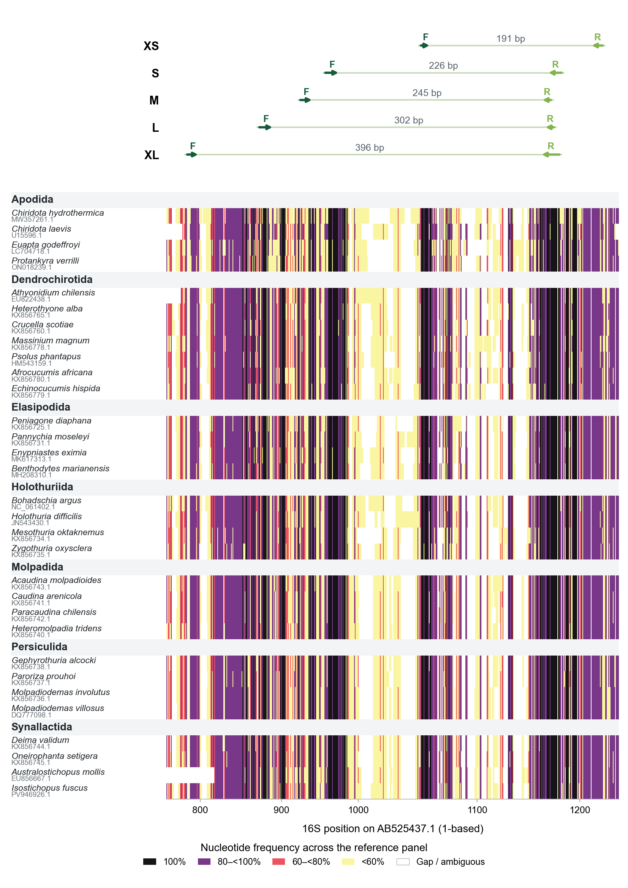
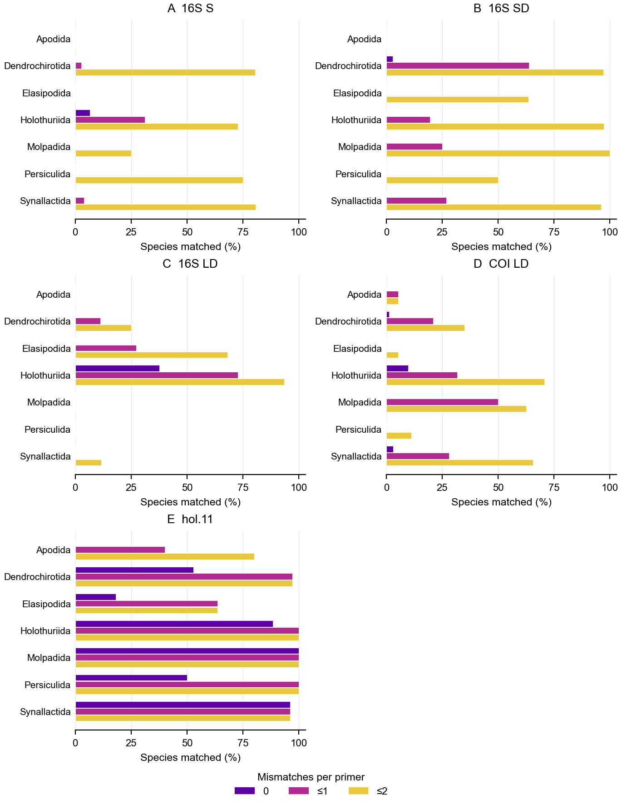
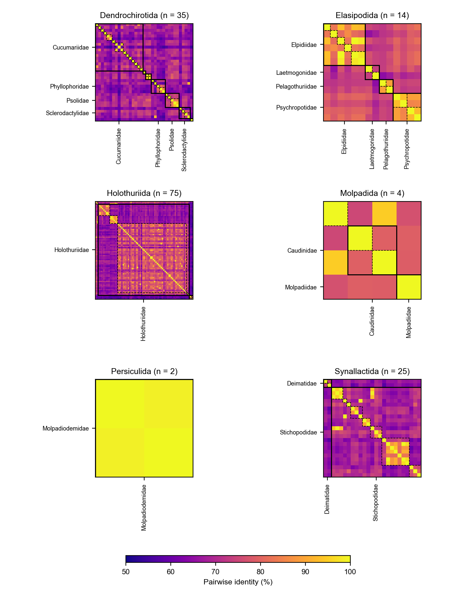

Word count: 2,960 · Methods and Resource Article

# MiCucumber — in silico design and evaluation of mitochondrial primers for sea cucumber eDNA metabarcoding

Fei Xia

Department of Integrated Bioscience, Graduate School of Frontier Sciences, The University of Tokyo, Kashiwa 277-8561, Chiba, Japan

*Correspondence: Fei Xia, xf@g.ecc.u-tokyo.ac.jp*

## Abstract

Sea cucumber monitoring can be difficult when species are cryptic, locally depleted or poorly represented in surveys. MiCucumber provides 29 mitochondrial primer pairs spanning the 16S and 12S ribosomal ribonucleic acid genes and cytochrome c oxidase subunit I (COI), together with three lineage-specific supplementary oligonucleotides. We evaluated two 16S assays and one COI assay for reference-sequence matching, non-target matching and taxonomic resolution of primer-free inserts, using a published primer pair as a benchmark for the 16S assays. At up to two mismatches per oligonucleotide, the 226- and 302-base-pair 16S assays matched 155 and 99 of 174 reference species, respectively. The 293-base-pair COI assay matched 118 of 274 species. In a mitochondrial screen retaining one sequence per species label, the three assays matched seven, 45 and zero non-target species, respectively, and the published comparator matched 49,352. Neither 16S assay matched the five Apodida representatives, and the COI assay matched one of 19. The complete sequence catalogue and benchmark data support selection of primer sets for experimental comparisons with tissue, mock-community and environmental samples.

**Keywords** Marine biodiversity · Holothuroidea · Environmental DNA · In silico primer evaluation · Metabarcoding

## Introduction

Sea cucumbers contribute to sediment processing and are harvested for food and other products. International trade in several teatfish species, including *Holothuria fuscogilva*, *H. nobilis* and *H. whitmaei*, is regulated under Appendix II of the Convention on International Trade in Endangered Species of Wild Fauna and Flora (CITES 2026). Reference-based primer evaluation can guide the development of surveys of harvested populations and their associated sea cucumber assemblages. Genetic methods support identification in a group with cryptic morphology, variable appearance and difficult-to-observe habitats. Mitochondrial sequences have been used to identify commercial species and investigate the taxonomy of Stichopodidae (Uthicke et al. 2010; Byrne et al. 2010; Wen et al. 2011). Xing et al. (2021) developed a short COI barcode for identifying sea cucumber products.

Environmental DNA can provide a complementary way to characterize assemblages without collecting every organism. A COI TaqMan assay has been applied to monitoring the sea cucumber *Holothuria scabra* in coastal waters (E et al. 2023). Short regions can be useful when template DNA is fragmented, but the chosen primer-binding sites and reference library constrain which taxa can be detected and identified. The MiFish fish 12S primers and Anth-28S anthozoan primers illustrate taxon-focused marker development (Miya et al. 2015; McCartin et al. 2024).

An in silico assessment should distinguish primer compatibility, non-target matching and information within the intervening barcode (Ficetola et al. 2010, 2024). Licuanan and Matias (2022) proposed short mitochondrial candidates for echinoderm classes, including the sea cucumber 16S pair hol.11. We used it as a comparator on the same target references and mismatch rules.

We assessed three MiCucumber assays in detail using three questions. The full catalogue of 29 baseline pairs and three supplementary 16S oligonucleotides is provided for testing (Online Resources 1 and 2). The original window comparisons (Figs. S1–S3), 16S SD position screening (Fig. S4) and additional primer identity matrices (Fig. S5) are provided in Online Resource 3. First, how many reference species and orders are matched across a mismatch gradient? Second, which other eukaryotic mitochondrial references match? Third, how often is an extracted reference insert unique to one species, genus or family?

## Materials and methods

### Reference sequences and taxonomy

The frozen 16S input contained 1,848 sea cucumber records. A curated panel retained one representative of each of 174 named species. The audit classified 1,332 records as additional records from represented species, 253 as unidentified to species, 83 as lacking an evaluable window and six as having unresolved taxonomy. These categories describe the repository audit. Sequence-window completeness influenced selection and favors references that span the evaluated region. The input included records inherited from an earlier MiStar project. Its original 16S search date and full query could not be recovered from the frozen record.

The COI collection contained 5,681 eligible sequence records and a 357-record representative panel. For the COI L window, the existing alignment identified 283 representatives spanning both sites. Matching against the World Register of Marine Species (WoRMS) on 12 November 2026 reconciled accepted names and removed redundant representatives. Four names could not be matched exactly and were retained in the audit rather than assigned a new name. The resulting panel contained 274 species. For 16S, the original accepted-name panel and order assignments were retained. Classification followed the revised sea cucumber framework of Miller et al. (2017) and WoRMS records accessed on 12 November 2026 (WoRMS Editorial Board 2026). The COI window-evaluability assessment uses the existing alignment and remains conditional on it.

Reference records collected after primer design were assessed separately. Their source records were selected by accession and sequence comparison before scoring. They can represent species already present in the design set. The S and L 16S windows each had 28 evaluable external species, and the COI L window had 15.

### Primer design

The three detailed assays targeted two 16S windows and one COI window (Table 1). The ordinary 16S S pair was additionally evaluated for target matching and insert similarity. Fig. 1 shows conservation across the 16S binding regions. Length classes are designated XS, S, M, L and XL. A D suffix identifies a degenerate pair in the catalogue nomenclature. Each included standard bases and International Union of Pure and Applied Chemistry (IUPAC) ambiguity codes, with at most eight concrete variants per oligonucleotide. The detailed 16S SD and LD assays each included one additional lineage-focused oligonucleotide at the same site. Homologous reference coordinates were taken from *Apostichopus japonicus* AB525437.1 and are gene-relative, one-based coordinates. The 16S 3′ end had been constrained during candidate design. Primer3 was used to calculate melting-temperature ranges for all concrete oligonucleotide variants at 50 nM per variant, with 50 mM monovalent cations, 1.5 mM divalent cations and 0.6 mM dNTPs (Untergasser et al. 2012). These concentrations define a calculation scenario.

**Table 1. Primer sequences and calculated melting temperatures.** Sequences are 5′–3′. Reference spans include primers. Tm denotes calculated melting temperature. F and R denote forward and reverse oligonucleotides. The 16S pools comprise the named forward and reverse oligonucleotides plus the indicated supplement.

| Assay | Primer | Sequence | Variants | Tm range (°C) | Reference span |
|---|---|---|---:|---:|---:|
| 16S SD | F | TAAGAAAGACGARAAGACCCTRTC | 4 | 56.23–59.78 | 226 bp |
| 16S SD | R | GAGAAGATGACGCTGTTATCCCTR | 2 | 59.72–61.03 | 226 bp |
| 16S SD | R supplement | AAGGAGATTACGCTGTTATCCCTG | 1 | 60.20 | 226 bp |
| 16S LD | F | AGACTTGTATGAAYGGCRAAACMT | 8 | 57.41–62.60 | 302 bp |
| 16S LD | F supplement | AAACTAGTATGAATGGCTTTTCAT | 1 | 54.82 | 302 bp |
| 16S LD | R | CGCTGTTATCCCTGCRGT | 2 | 57.06–59.81 | 302 bp |
| COI LD | F | AAAATGCGAACYCCAGGARTWAC | 8 | 57.69–61.37 | 293 bp |
| COI LD | R | GGTTCTTGCTTWCCTCTRTARTG | 8 | 54.61–59.25 | 293 bp |
| hol.11 | F | AGACGAGAAGACCCTGTC | 1 | 55.21 | Published comparator |
| hol.11 | R | CAATCCAACATCGAGGTC | 1 | 52.80 | Published comparator |

{width=174mm}

**Fig. 1** Conservation across the 16S alignment and the XS, S, M, L and XL primer-binding regions, following the visual approach of McCartin et al. (2024). Representatives are selected within each order to include every family present in the reference panel, with a minimum target of four species per order where available. Additional selections favour different genera and are balanced across families. Within each selection tier, sequences with more unambiguous bases in the original representative-selection window (reference positions 830–1200) are preferred; species name and accession resolve ties. Rows are grouped by order and sorted by family, genus and species. Accession numbers appear beneath the species names. For each displayed nucleotide, colour indicates its frequency among all 174 panel sequences at that aligned position, including gaps in the denominator. White denotes gaps or ambiguous bases. Grey header rows separate orders. Dark and light green arrows labelled F and R indicate forward and reverse binding regions, respectively. Lengths denote reference spans including both primer sites. Coordinates are relative to AB525437.1. The representative list and accession numbers accompany the figure

### Matching and classification coverage

Cutadapt 5.0 searched raw reference sequences in both orientations using required, full-length linked forward and reverse-complemented reverse primers (Martin 2011). Each oligonucleotide was allowed zero, at most one or at most two mismatches. IUPAC-compatible bases were counted as matches and insertions and deletions were disabled. Separate searches for supplementary oligonucleotides were combined by accession. The accepted reference product range was 150–500 bp for 16S and 100–500 bp for COI, with an internal insert of at least 50 bp. Species counts refer to the selected evaluable panels. Primer matching was predicted using the same procedure for the candidate assays and hol.11.

### MIDORI2 non-target screening

We downloaded the MIDORI2 GB273 SINTAX unique-sequence 16S (lrRNA) and COI archives on 12 November 2026 (Leray et al. 2022). Checksums matched the release manifest. We retained the longest available sequence for each labelled species in each marker and scanned both target and non-target records with the same Cutadapt settings and product-length limits. Taxonomic labels followed MIDORI2. Results report the number of labelled species with a matched reference, together with the fraction assigned to Holothuroidea among all matched species. The database includes 119,214 16S and 242,979 COI species labels. It comprises eukaryotic mitochondrial references and does not evaluate bacterial ribosomal sequences.

### Reference-insert resolution

All 1,848 frozen 16S records and 5,681 eligible COI records were searched at up to two mismatches per primer. We retained unambiguous primer-free inserts from records with an assignable species name. COI names were reconciled against WoRMS when an exact species-level match was available. Identical inserts were grouped, then classified as unique at species, genus or family rank if all contributing named records had the same label at that rank. Groups with missing labels for a rank were excluded from that rank's denominator. Thus the percentages describe distinct recovered reference inserts, and depend on the sampled species and within-species variation (Ficetola et al. 2024). For visualization, one matched representative per species was aligned with MAFFT 7.525 and pairwise identity was calculated over jointly non-gap columns (Katoh and Standley 2013).

## Results

### Primer matching

The ordinary 16S S pair (F, CCAGAAAGACGAGAAGACCCTGTC; R, GAGGAGATAACGCTGTTATCCCTG; sequences 5′–3′) matched 5, 26 and 110 of 174 species at zero, at most one and at most two mismatches per primer, respectively. Fig. 2 includes this additional comparison.

On the 174-species 16S panel, 16S SD matched 1, 46 and 155 species at zero, at most one and at most two mismatches per primer. The corresponding numbers for 16S LD were 29, 66 and 99. Their union at two mismatches contained 165 species. The two assays matched 23/28 and 16/28 evaluable external references, respectively. For COI LD, 10, 58 and 118 of 274 reconciled species matched, as did 13/15 evaluable external species at the two-mismatch threshold. Table 2 and Fig. 2 show coverage by order.

The published hol.11 comparator matched 122, 161 and 163 of the 174 16S panel species at the three thresholds. It matched four of five Apodida species at the two-mismatch threshold. In contrast, the 16S candidates matched none, while COI LD matched one of 19 evaluable Apodida species.

**Table 2.** Reference species matched under each mismatch threshold. The detailed 16S SD and LD assays and hol.11 use 174 species. COI LD uses 274 WoRMS-reconciled species. Ordinary 16S S is shown separately in Fig. 2.

| Order | N, 16S | 16S SD 0/1/2 | 16S LD 0/1/2 | hol.11 0/1/2 | N, COI | COI LD 0/1/2 |
|---|---:|---:|---:|---:|---:|---:|
| Apodida | 5 | 0/0/0 | 0/0/0 | 0/2/4 | 19 | 0/1/1 |
| Dendrochirotida | 36 | 1/23/35 | 0/4/9 | 19/35/35 | 86 | 1/18/30 |
| Elasipodida | 22 | 0/0/14 | 0/6/15 | 4/14/14 | 38 | 0/0/2 |
| Holothuriida | 77 | 0/15/75 | 29/56/72 | 68/77/77 | 82 | 8/26/58 |
| Molpadida | 4 | 0/1/4 | 0/0/0 | 4/4/4 | 8 | 0/4/5 |
| Persiculida | 4 | 0/0/2 | 0/0/0 | 2/4/4 | 9 | 0/0/1 |
| Synallactida | 26 | 0/7/25 | 0/0/3 | 25/25/25 | 32 | 1/9/21 |
| Total | 174 | 1/46/155 | 29/66/99 | 122/161/163 | 274 | 10/58/118 |
| External | 28 | 0/5/23 | 2/5/16 | —^a^ | 15 | 1/5/13 |

^a^ The external comparison did not evaluate hol.11.

{width=174mm}

**Fig. 2** Percentage of evaluable species matched by order at zero, at most one and at most two mismatches per primer. The two genes use different reference panels. Purple, magenta and yellow bars indicate zero, at most one and at most two mismatches

### Non-target matching

At two mismatches per primer, 16S SD matched seven non-target species in MIDORI2 and 16S LD matched 45. COI LD matched no non-target species in its MIDORI2 marker file. The 16S comparator hol.11 matched 49,352 non-target species at this threshold. Table 3 reports the full mismatch gradient. The marked increase for hol.11 occurred despite high target coverage on the design panel.

**Table 3.** MIDORI2 matched species at zero, at most one and at most two mismatches per primer. The final column gives Holothuroidea matches over all matched species. The reference sets differ between markers.

| Assay | Mismatches | Target species | Non-target species | Target / total |
|---|---:|---:|---:|---:|
| 16S SD | 0 / ≤1 / ≤2 | 1 / 49 / 177 | 0 / 0 / 7 | 1/1 · 49/49 · 177/184 |
| 16S LD | 0 / ≤1 / ≤2 | 30 / 70 / 115 | 0 / 0 / 45 | 30/30 · 70/70 · 115/160 |
| COI LD | 0 / ≤1 / ≤2 | 10 / 55 / 121 | 0 / 0 / 0 | 10/10 · 55/55 · 121/121 |
| hol.11 | 0 / ≤1 / ≤2 | 140 / 190 / 193 | 1 / 1,267 / 49,352 | 140/141 · 190/1,457 · 193/49,545 |

### Reference-insert resolution

At the species, genus and family levels, respectively, 473/483, 480/483 and 483/483 distinct 16S SD inserts carried one taxonomic label. For 16S LD the corresponding numbers were 338/346, 345/346 and 346/346. COI LD yielded 666/683, 681/683 and 682/683. For hol.11, they were 516/525, 522/525 and 525/525. These inserts came from 1,343, 564, 2,614 and 1,351 matched records, respectively. Matching-reference identities for 16S SD are shown by order in Fig. 3. Matrices for 16S S, 16S LD and COI LD are provided in Online Resource 3, Fig. S5.

Shared inserts included records labelled *Protelpidia murrayi* and *Scotoplanes clarki*, and records labelled *Astichopus multifidus* and *Isostichopus macroparentheses*. The complete collision table records all contributing labels.

{width=174mm}

**Fig. 3** Pairwise identity of primer-free 16S SD inserts, shown separately for each represented order. Species are ordered by family, genus and species. Solid black boxes delineate families and dashed boxes delineate genera, following McCartin et al. (2024). Families represented by at least two species and 8% of a panel are labelled; all families are labelled in panels with four or fewer species. Only unambiguous inserts are included and gap-containing sites are excluded pairwise. All panels share a 50–100% identity scale. Apodida is absent because no representative matched this assay. Other primer matrices are provided in Online Resource 3, Fig. S5

## Discussion

The candidate assays offer different reference-level choices. 16S SD provided the broadest target coverage of the three on its design panel, while 16S LD matched more references exactly and was concentrated in Holothuriida. COI LD provides a protein-coding comparison and had no non-target matches in this MIDORI2 screen. The 16S SD pool had a single exact paired match and its broader coverage depended substantially on allowing mismatches.

The published hol.11 pair had higher target coverage and exact matching on the shared 16S panel. Its non-target match count rose sharply as mismatches were allowed. Because this comparison uses the same database and computational rules, it identifies a specificity–coverage trade-off to investigate in relevant samples. The low-degeneracy approach also has an echinoderm COI precedent (Hoareau and Boissin 2010).

Reference inserts shared by named species may reflect taxonomic changes, misidentification or genuine sharing. Additional material and taxonomic review are needed to distinguish these explanations. The calculated proportions depend on the available records and should be interpreted as reference-library discrimination, with species-rich and densely sampled lineages contributing different numbers of inserts. One representative per species also cannot describe all target variation in the coverage assessment.

Neither 16S assay matched the five Apodida representatives, and COI LD matched one of 19. The reference panels were also used during candidate development, so these estimates are not independent evidence of amplification efficiency. MIDORI2 does not cover bacterial rRNA or every possible environmental background. The 16S LD forward oligonucleotide variants differ in calculated Tm, and the supplementary oligonucleotide has a lower calculated Tm than the upper end of the main forward range. Mismatch position, template abundance and primer interactions can influence PCR. These candidates require tissue-DNA PCR, mock-community comparisons and environmental-sample testing before biological use.

## Conclusions

The MiCucumber catalogue provides mitochondrial candidate assays for computational assessment of sea cucumber diversity, including the three assays compared in detail here. Their predicted coverage, identity-based discrimination and non-target matching differ among assays and mismatch thresholds. Apodida remains poorly represented by the candidates. Experimental assessment and expanded reference sampling will determine their practical applicability.

## Data availability and declarations

Online Resources 1–3 provide primer sequences, panel summaries and supporting analyses. The project repository is available at https://github.com/GUIBA-EX/MiCucumber. MIDORI2 GB273 files and checksums are available at https://doi.org/10.5281/zenodo.22685701. This working revision retains the project copyright terms in COPYRIGHT.md.

Generative AI assisted with analysis scripting and manuscript drafting. The author is responsible for verifying the analysis, interpretation and manuscript content.

## References

Byrne M, Rowe F, Uthicke S (2010) Molecular taxonomy, phylogeny and evolution in the family Stichopodidae based on COI and 16S mitochondrial DNA. Molecular Phylogenetics and Evolution 56:1068–1081. https://doi.org/10.1016/j.ympev.2010.04.013

CITES (2026) Appendices I, II and III. Convention on International Trade in Endangered Species of Wild Fauna and Flora. https://cites.org/eng/app/appendices.php. Accessed 14 Nov 2026

E Z, Luo P, Ren C, Cheng C, Pan W, Jiang X, Jiang F, Ma B, Yu S, Zhang X, Chen T, Hu C (2023) Applications of environmental DNA (eDNA) in monitoring the endangered status and evaluating the stock enhancement effect of tropical sea cucumber *Holothuria scabra*. Marine Biotechnology 25:778–789. https://doi.org/10.1007/s10126-023-10239-y

Ficetola GF, Coissac E, Zundel S, Riaz T, Shehzad W, Bessière J, Taberlet P, Pompanon F (2010) An in silico approach for the evaluation of DNA barcodes. BMC Genomics 11:434. https://doi.org/10.1186/1471-2164-11-434

Ficetola GF, Guerrieri A, Cantera I, Bonin A (2024) In silico assessment of 18S rDNA metabarcoding markers for the characterization of nematode communities. PLOS ONE 19:e0298905. https://doi.org/10.1371/journal.pone.0298905

Hoareau TB, Boissin E (2010) Design of phylum-specific hybrid primers for DNA barcoding: addressing the need for efficient COI amplification in the Echinodermata. Molecular Ecology Resources 10:960–967. https://doi.org/10.1111/j.1755-0998.2010.02848.x

Katoh K, Standley DM (2013) MAFFT multiple sequence alignment software version 7: improvements in performance and usability. Molecular Biology and Evolution 30:772–780. https://doi.org/10.1093/molbev/mst010

Leray M, Knowlton N, Machida RJ (2022) MIDORI2: a collection of quality controlled, preformatted, and regularly updated reference databases for taxonomic assignment of eukaryotic mitochondrial sequences. Environmental DNA 4:894–907. https://doi.org/10.1002/edn3.303

Licuanan AM, Matias AMA (2022) In silico evaluation of the taxonomic resolution and coverage of the COI region and alternative barcode markers for echinoderms. Philippine Journal of Science 151:955–968. https://doi.org/10.56899/151.03.14

Martin M (2011) Cutadapt removes adapter sequences from high-throughput sequencing reads. EMBnet.journal 17:10–12. https://doi.org/10.14806/ej.17.1.200

McCartin L, Saso E, Vohsen SA, Pittoors N, Demetriades P, McFadden CS, Quattrini AM, Herrera S (2024) Nuclear eDNA metabarcoding primers for anthozoan coral biodiversity assessment. PeerJ 12:e18607. https://doi.org/10.7717/peerj.18607

Miller AK, Kerr AM, Paulay G, Reich M, Wilson NG, Carvajal JI, Rouse GW (2017) Molecular phylogeny of extant Holothuroidea (Echinodermata). Molecular Phylogenetics and Evolution 111:110–131. https://doi.org/10.1016/j.ympev.2017.02.014

Miya M, Sato Y, Fukunaga T, Sado T, Poulsen JY, Sato K, Minamoto T, Yamamoto S, Yamanaka H, Araki H, Kondoh M, Iwasaki W (2015) MiFish, a set of universal PCR primers for metabarcoding environmental DNA from fishes. Royal Society Open Science 2:150088. https://doi.org/10.1098/rsos.150088

Untergasser A, Cutcutache I, Koressaar T, Ye J, Faircloth BC, Remm M, Rozen SG (2012) Primer3—new capabilities and interfaces. Nucleic Acids Research 40:e115. https://doi.org/10.1093/nar/gks596

Uthicke S, Byrne M, Conand C (2010) Genetic barcoding of commercial Bêche-de-mer species (Echinodermata: Holothuroidea). Molecular Ecology Resources 10:634–646. https://doi.org/10.1111/j.1755-0998.2009.02826.x

Wen J, Hu C, Zhang L, Fan S (2011) Genetic identification of global commercial sea cucumber species on the basis of mitochondrial DNA sequences. Food Control 22:72–77. https://doi.org/10.1016/j.foodcont.2010.06.010

WoRMS Editorial Board (2026) World Register of Marine Species. https://www.marinespecies.org. Accessed 12 Nov 2026

Xing RR, Hu RR, Wang N, Zhang JK, Ge YQ, Chen Y (2021) Authentication of sea cucumber products using NGS-based DNA mini-barcoding. Food Control 129:108199. https://doi.org/10.1016/j.foodcont.2021.108199

## Statements and Declarations

**Ethics approval** Not applicable. The study used publicly available sequence records.
