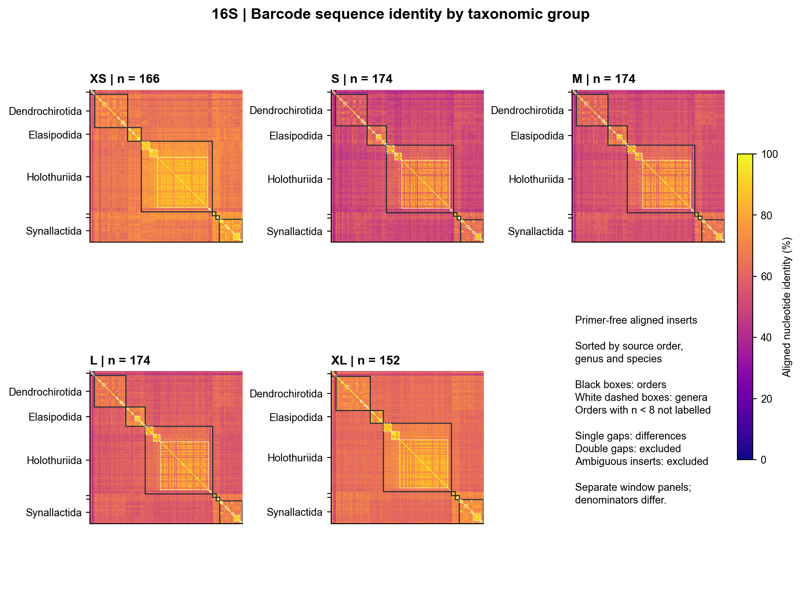
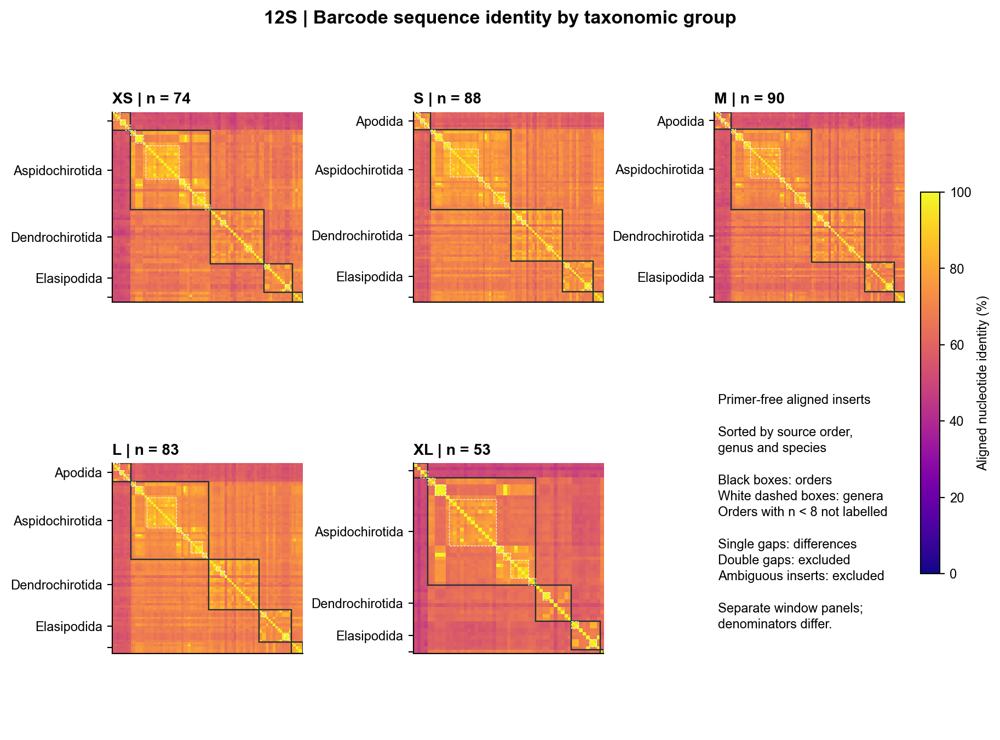
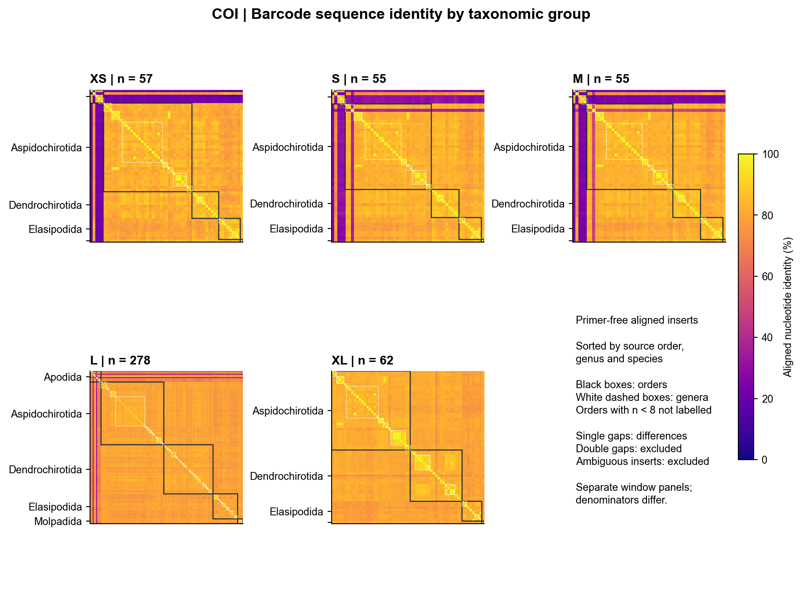
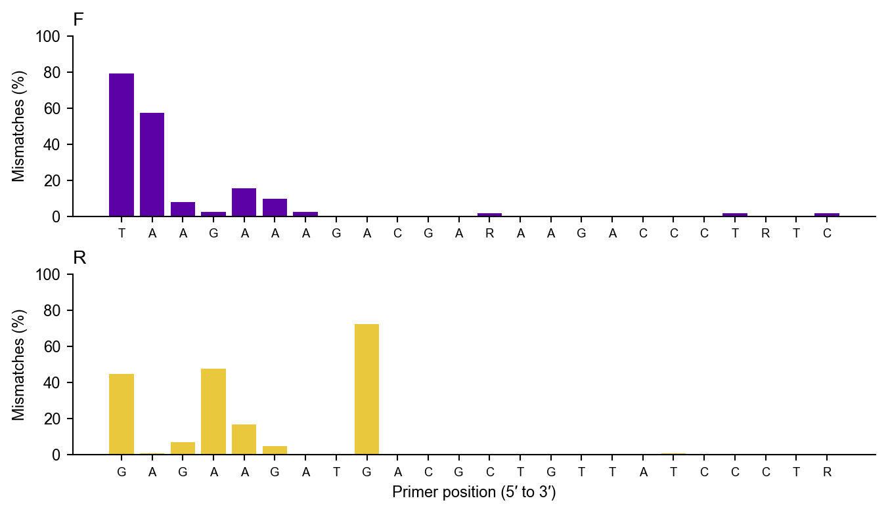
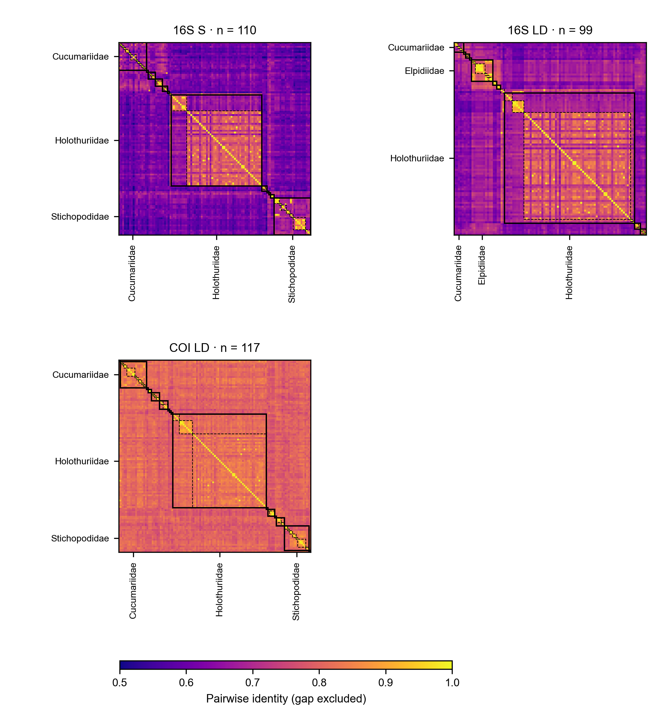

# Online Resource 3 Supplementary analyses

MiCucumber — in silico design and evaluation of mitochondrial primers for sea cucumber eDNA metabarcoding

Fei Xia

*Conservation Genetics Resources*

Correspondence: Fei Xia, Department of Integrated Bioscience, Graduate School of Frontier Sciences, The University of Tokyo, Kashiwa 277-8561, Chiba, Japan, xf@g.ecc.u-tokyo.ac.jp

The previously released 29 baseline pairs and their earlier reference-panel mismatch gradients are listed in Online Resource 1. These historical baseline results used the original scanner and original window panels. The detailed 16S SD, 16S LD and COI LD assays and hol.11 were evaluated with Cutadapt and are described in the main manuscript. Ordinary 16S S was additionally assessed for target matching and insert similarity. All 29 baseline pairs and the additional lineage oligonucleotides are available for testing. The complete oligonucleotide catalogue, including the three lineage supplements, is available in Online Resource 2.

The original 12S panel comprises 53–90 evaluable species by window. Its XLD pair matched 33 of 53 under the previously reported terminal-compatible model. The existing 12S complementarity analysis found five species matched by 12S XLD or SD among nine missed by both 16S supplements.

All remaining reference-insert matrices and mismatch-gradient figures from the earlier project analysis are available in the frozen repository results.

## Earlier reference-insert matrices

Figs. S1–S3 show the original 16S, 12S and COI window comparisons, respectively.

**Fig. S1** Earlier 16S window comparisons from the original reference panels. These matrices use the original alignment-based analysis and include all five windows

**Fig. S2** Earlier 12S window comparisons from the original reference panels. These matrices use the original alignment-based analysis and include all five windows

**Fig. S3** Earlier COI window comparisons from the original reference panels. These matrices use the original alignment-based analysis and include all five windows

## 16S SD position screening

Fig. S4 summarizes mismatch frequency by primer position. The principal forward and reverse oligonucleotides were compared with their best full-length ungapped sites in a 15-base flanking window around the reference binding sites.

**Fig. S4** Position-specific mismatches of the principal 16S SD oligonucleotides. For each reference, the best ungapped match in the homologous binding window and 15-base flanks was used

## Additional primer identity matrices

Fig. S5 compares 16S S, 16S LD and COI LD using their matched reference inserts.

{width=174mm}

**Fig. S5** Pairwise identity of primer-free inserts for 16S S, 16S LD and COI LD. Species are ordered by order, family, genus and species. Solid boxes delineate families and dashed boxes delineate genera. Only unambiguous inserts are included; gaps are excluded pairwise. The panels retain their own matched species and share the same colour scale. Families with at least three species and at least 5% of a panel are labelled
