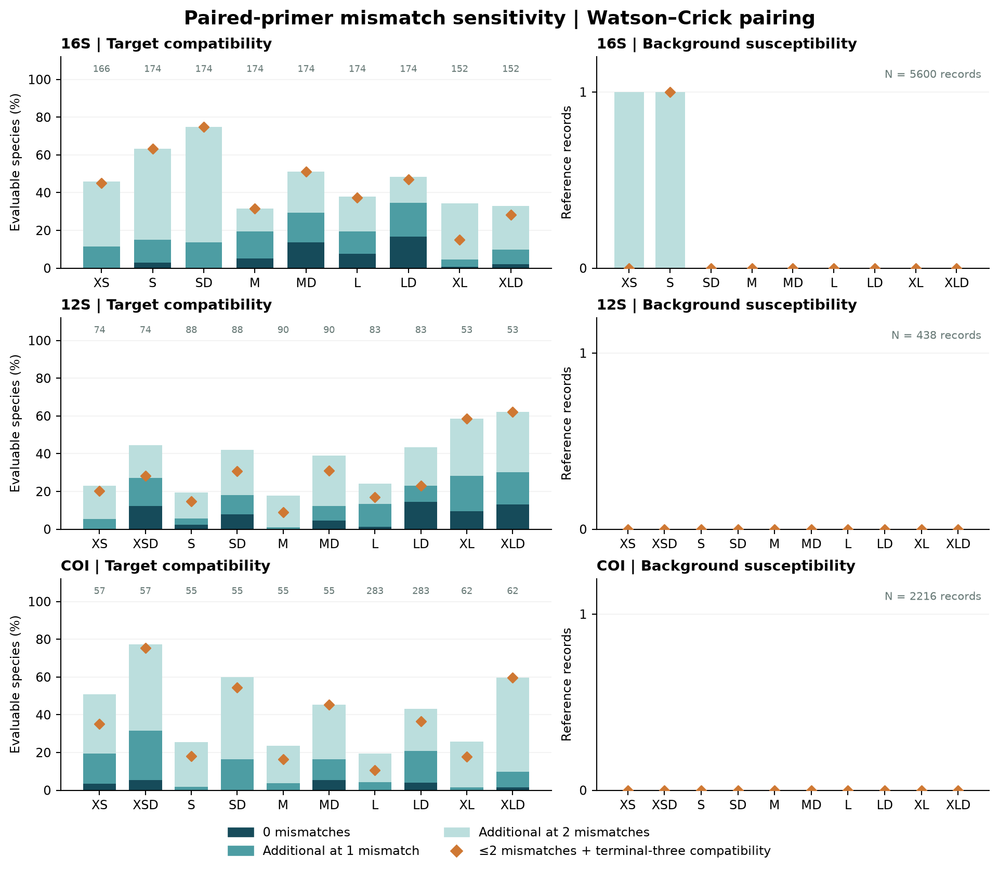
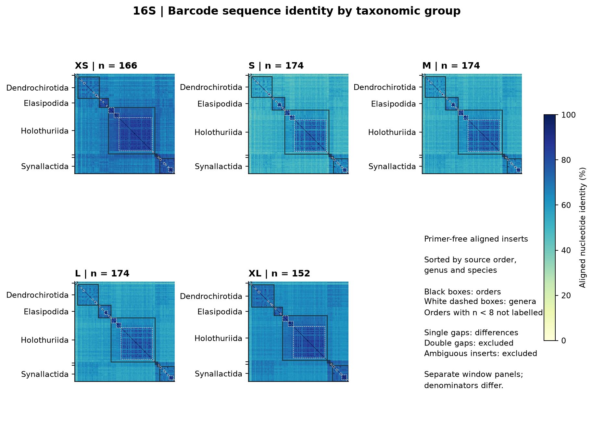
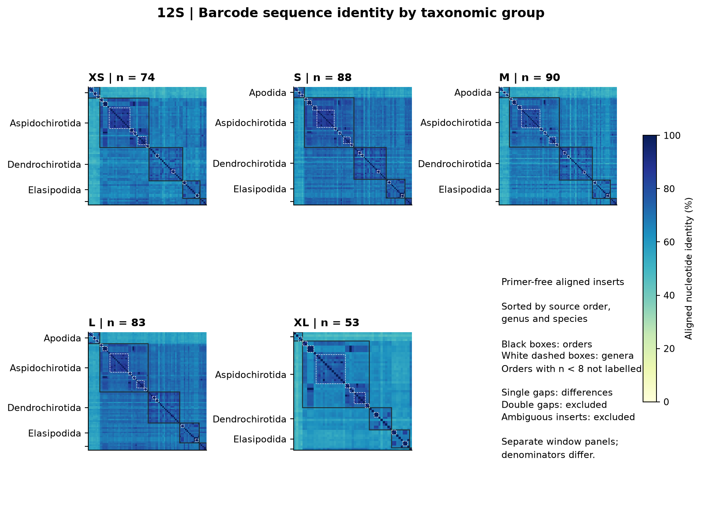
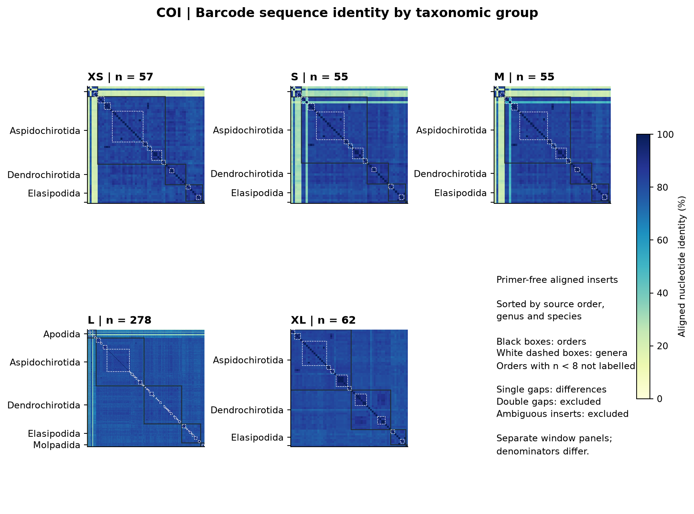
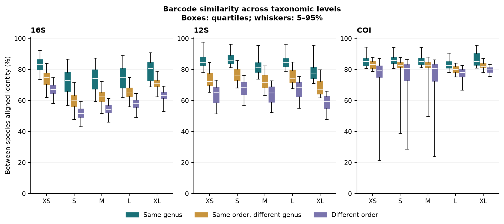
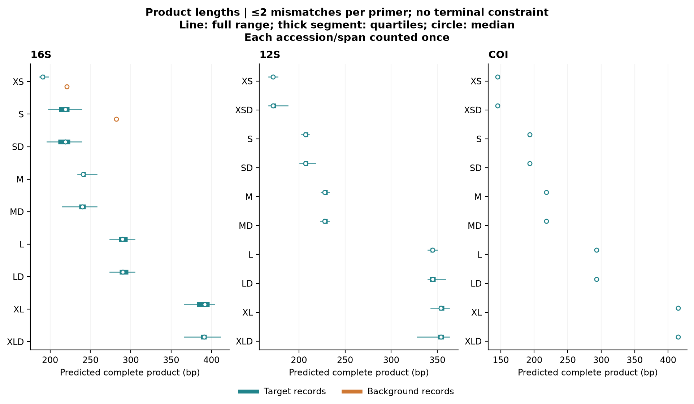

# Anth-28S-inspired computational diagnostics

Computational diagnostics integrated into the MiCucumber preprint; released primer sequences are unchanged.

## Methods

Following the diagnostic approach of McCartin et al. (2024, pp. 6 and 11–13; Fig. 3), all 29 released primer pairs were rescanned on both strands of their frozen target and background sequences. Mismatch thresholds of zero, one and two apply separately to each primer, with IUPAC compatibility treated as a match under Watson–Crick pairing. Each threshold was evaluated with and without requiring compatibility at the final three 3′ bases of both primers. Ambiguous binding sites were excluded. Target product-length limits reproduce the released rules: 70–500 bp with an insert ≥20 bp for 16S XS, 150–500 bp with an insert ≥50 bp for the remaining 16S assays, and 100–500 bp with an insert ≥50 bp for 12S/COI. Background inserts were allowed from 0 to 1,000 bp. Target denominators contain one representative per evaluable species per window; background denominators are 5,600, 438 and 2,216 accession records for 16S, 12S and COI. Counts therefore describe different units and are not amplification proportions in a mixed sample. The released guanine–thymine and more permissive background models remain separately reported.

For sequence-identity matrices, primer-free inserts were extracted between the aligned reference endpoints from each window's evaluable panel. Inserts containing ambiguous nucleotides were excluded; the existing curated gene alignments were retained. Identity equals the number of equal A/C/G/T columns divided by the number of columns containing at least one base. A base opposite a gap is a difference, and double-gap columns are ignored. Matrices were sorted by the source order assignment, genus and species. Ordinary/D alternatives share the same internal region, so one matrix represents each length. Exact ungapped insert identity was also counted independently. Between-species similarities were stratified into same genus, same order/different genus, and different orders. These available-panel summaries do not provide within-species variation, a barcoding-gap test, or matched cross-gene performance estimates. Product distributions count each unique accession/product-span combination once at each threshold; target products are restricted to the evaluable window panel.

The new C++ exhaustive scan was compared with the released exact and strict Watson–Crick summaries in 87 checks. An independent Python regex-seed matcher verified 1,578 threshold/terminal flags on deterministic hit and non-hit subsets spanning every assay and both target/background roles. A further 465 sampled pairwise identities were recalculated independently.

## Results

The mismatch series separates exact compatibility from tolerance-dependent coverage. On their own available panels, 16S SD matched 0, 24 and 130 of 174 species at zero, one and two mismatches per primer; requiring terminal-three compatibility at the two-mismatch threshold retained all 130. In contrast, LD matched 29, 60 and 84 species, decreasing to 82 after the terminal constraint. For 12S XLD, the series was 7, 16 and 33 of 53 species, with 33 retained by the terminal rule. COI XSD matched 3, 18 and 44 of 57 species, decreasing to 43; COI LD decreased from 122 to 103 of 283 species when terminal compatibility was required at the two-mismatch threshold. These differences show why relaxed mismatch totals cannot replace the released strict coverage measure.

At up to two Watson–Crick mismatches without the terminal constraint, the frozen background scan predicted one record for each of 16S XS and S and none for the other 27 pairs. This restricted model does not replace the reported guanine–thymine or higher-mismatch screens. The product-length plot presents these finite-panel predictions without assuming size selection will separate target and background products.

The 15 identity matrices contain 130,599 distinct within-window species comparisons. Exact insert uniqueness was 154/166 species for 16S XS and 168/174 for S, M and L; the XL panel contained 146/152 unique representatives. For 12S XL, 53/53 available inserts were unique; COI XL contained 62/62 unique inserts. The COI L identity analysis retained 278 of 283 evaluable species after excluding five ambiguous internal inserts, of which 272 had unique inserts. Complete sequences can therefore differ in primer evaluability and usable internal-barcode status. Neither smaller-panel uniqueness nor higher average divergence alone establishes a better assay.

Counts below are species for targets and accession records for backgrounds; ≤0/1/2 are per-primer mismatch ceilings. The final background column has no terminal constraint.

| Gene | Assay | Species N | ≤0 | ≤1 | ≤2 | ≤2 + terminal 3 | Background ≤2 |
| --- | --- | --- | --- | --- | --- | --- | --- |
| 16S | XS | 166 | 0 | 19 | 76 | 75 | 1 |
| 16S | S | 174 | 5 | 26 | 110 | 110 | 1 |
| 16S | SD | 174 | 0 | 24 | 130 | 130 | 0 |
| 16S | M | 174 | 9 | 34 | 55 | 55 | 0 |
| 16S | MD | 174 | 24 | 51 | 89 | 89 | 0 |
| 16S | L | 174 | 13 | 34 | 66 | 65 | 0 |
| 16S | LD | 174 | 29 | 60 | 84 | 82 | 0 |
| 16S | XL | 152 | 1 | 7 | 52 | 23 | 0 |
| 16S | XLD | 152 | 3 | 15 | 50 | 43 | 0 |
| 12S | XS | 74 | 0 | 4 | 17 | 15 | 0 |
| 12S | XSD | 74 | 9 | 20 | 33 | 21 | 0 |
| 12S | S | 88 | 2 | 5 | 17 | 13 | 0 |
| 12S | SD | 88 | 7 | 16 | 37 | 27 | 0 |
| 12S | M | 90 | 0 | 1 | 16 | 8 | 0 |
| 12S | MD | 90 | 4 | 11 | 35 | 28 | 0 |
| 12S | L | 83 | 1 | 11 | 20 | 14 | 0 |
| 12S | LD | 83 | 12 | 19 | 36 | 19 | 0 |
| 12S | XL | 53 | 5 | 15 | 31 | 31 | 0 |
| 12S | XLD | 53 | 7 | 16 | 33 | 33 | 0 |
| COI | XS | 57 | 2 | 11 | 29 | 20 | 0 |
| COI | XSD | 57 | 3 | 18 | 44 | 43 | 0 |
| COI | S | 55 | 0 | 1 | 14 | 10 | 0 |
| COI | SD | 55 | 0 | 9 | 33 | 30 | 0 |
| COI | M | 55 | 0 | 2 | 13 | 9 | 0 |
| COI | MD | 55 | 3 | 9 | 25 | 25 | 0 |
| COI | L | 283 | 0 | 12 | 55 | 30 | 0 |
| COI | LD | 283 | 11 | 59 | 122 | 103 | 0 |
| COI | XL | 62 | 0 | 1 | 16 | 11 | 0 |
| COI | XLD | 62 | 1 | 6 | 37 | 37 | 0 |

| Gene | Window | Unambiguous species | Unique inserts | Identical species pairs |
| --- | --- | --- | --- | --- |
| 16S | XS | 166 | 154 | 6 |
| 16S | S | 174 | 168 | 3 |
| 16S | M | 174 | 168 | 3 |
| 16S | L | 174 | 168 | 3 |
| 16S | XL | 152 | 146 | 3 |
| 12S | XS | 74 | 70 | 2 |
| 12S | S | 88 | 86 | 1 |
| 12S | M | 90 | 88 | 1 |
| 12S | L | 83 | 81 | 1 |
| 12S | XL | 53 | 53 | 0 |
| COI | XS | 57 | 55 | 1 |
| COI | S | 55 | 53 | 1 |
| COI | M | 55 | 53 | 1 |
| COI | L | 278 | 272 | 3 |
| COI | XL | 62 | 62 | 0 |













## Reproduction

```sh
python3 results/anth28s_evaluation/run.py
python3 results/anth28s_evaluation/verify.py
python3 results/anth28s_evaluation/plot.py
python3 results/anth28s_evaluation/report.py
```

C++17 compiler; Python 3.10+; matplotlib and numpy for figures. Run from the repository root. Raw hits, product spans, per-order summaries, full identity matrices, source hashes and independent validation are in [results](results). Exact insert uniqueness uses every retained reference insert, independently of whether a released primer matches it.

McCartin, L., et al. (2024). Nuclear eDNA metabarcoding primers for anthozoan coral biodiversity assessment. *PeerJ*, 12, e18607. https://doi.org/10.7717/peerj.18607
