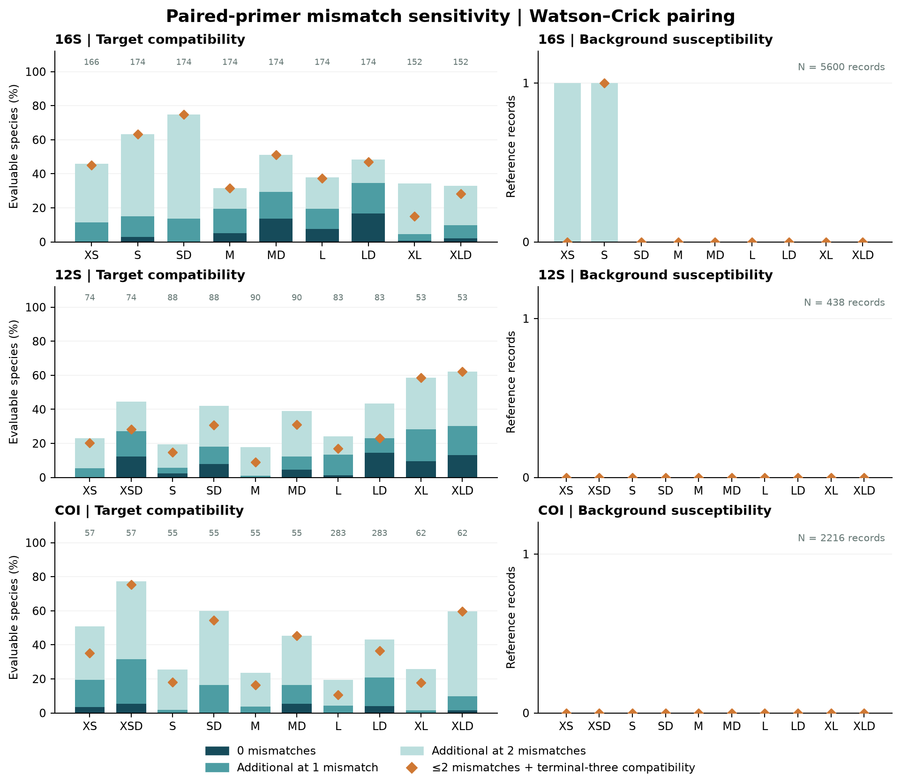
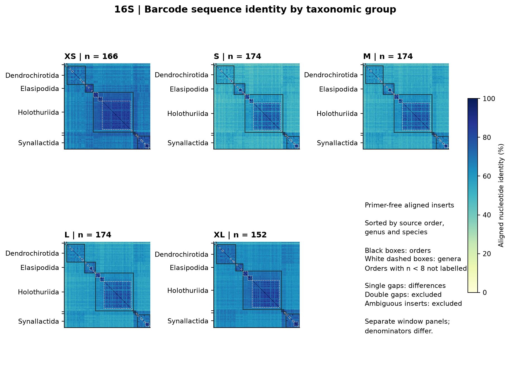
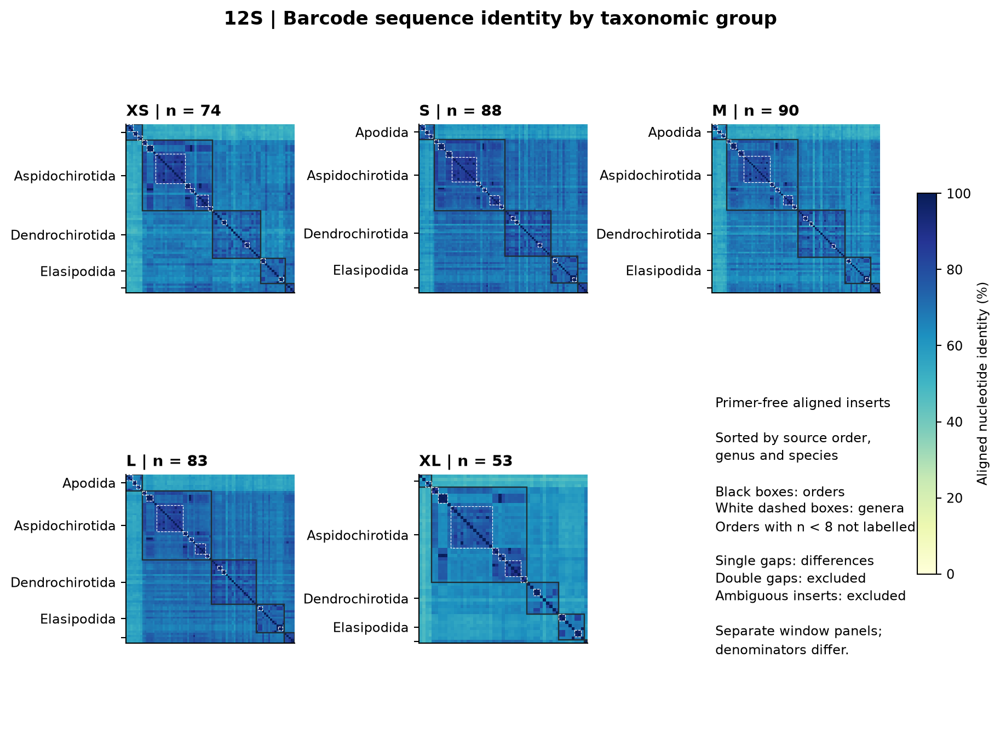
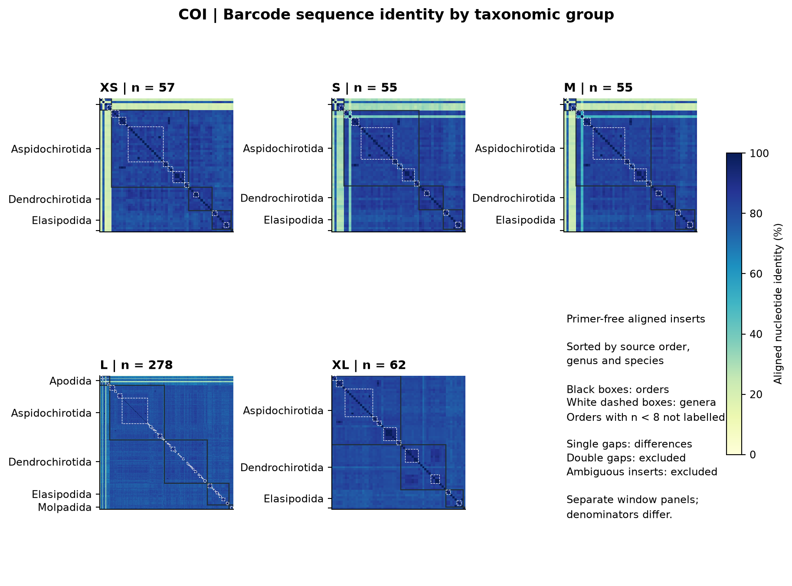
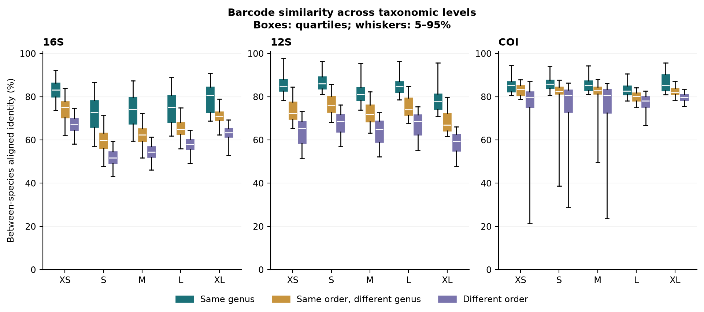
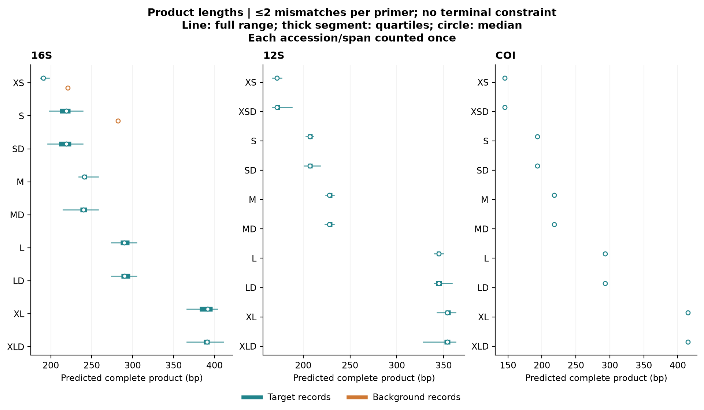

# 参考 Anth-28S 的计算诊断

已整合进 MiCucumber 预印本的计算诊断；保留当前引物序列。

## 方法

参考 McCartin 等（2024，第 6、11–13 页及图 3），对当前 29 对引物和冻结的目标、背景参考序列进行双链配对扫描。0、1、2 个错配均指每条引物各自允许的上限；在沃森–克里克配对下，模板碱基落入 IUPAC 兼容范围即记为匹配。每一档同时比较是否要求两条引物 3′ 末三位兼容。结合区有模糊碱基的命中被排除。产物长度沿用正式规则：16S XS 为 70–500 bp、内部区段至少 20 bp；其余 16S 为 150–500 bp、内部至少 50 bp；12S/COI 为 100–500 bp、内部至少 50 bp。背景扫描允许内部区段 0–1,000 bp。目标按每个可评价物种一条代表计数，三个基因的背景分别为 5,600、438、2,216 条 accession；两类计数单位不同，不能解释为混合样品中的扩增比例。正式报告中允许鸟嘌呤–胸腺嘧啶配对及更宽松错配的背景结果仍单独保留。

序列相似度分析从各长度可评价面板中提取引物之间的内部区段，排除含模糊碱基的区段，沿用现有整理后的基因比对。相似度＝相同 A/C/G/T 列数／至少一端有碱基的列数；碱基对缺口计为差异，双缺口列不计。矩阵按来源目分类、属和物种排序。普通与 D 同坐标，因而每个长度只绘制一个内部序列矩阵；另行统计去缺口后完全相同的跨物种序列。种间相似度分为同属、同目异属、异目三类。各窗口面板不同，这些结果不代表跨基因同面板比较；每物种一条参考也无法估计种内变异或条形码间隙。产物长度图在每个阈值下将唯一 accession／产物长度组合各计一次，目标限于该长度的可评价物种。

新增 C++ 穷举扫描通过 87 项正式完全匹配及严格沃森–克里克结果核对；独立 Python 种子匹配对每个方案的目标与背景命中、未命中子集完成 1,578 项阈值／末端标志检查，并独立重算 465 项序列相似度。

## 结果

错配梯度将完全匹配与依赖容错的覆盖分开呈现。在各自可评价面板上，16S SD 在每端允许 0、1、2 个错配时分别匹配 0、24、130/174 个物种；加入末三位约束仍保留 130。LD 对应为 29、60、84/174，末端约束后为 82。12S XLD 为 7、16、33/53，末端约束后仍为 33。COI XSD 为 3、18、44/57，末端约束后为 43；COI LD 在两处错配下从 122/283 降至末端受约束后的 103/283。这说明宽松匹配总数不能直接代替正式覆盖率。

在每端最多两处沃森–克里克错配、不要求末三位兼容的模型中，16S XS 和 S 各预测命中一条背景记录，其余 27 对为零；这不替代已报告的鸟嘌呤–胸腺嘧啶及更宽松背景模型。长度图展示实际预测范围，不据此假定产物筛选能分离目标与背景。

15 个序列相似度矩阵共包含 130,599 个窗口内跨物种比较。16S XS 为 154/166 个内部序列唯一的物种，S、M、L 各为 168/174，XL 为 146/152。12S XL 为 53/53，COI XL 为 62/62；COI L 的 283 个位点可评价物种中，5 个内部区段含模糊碱基被排除，余下 278 个中有 272 个内部序列唯一。引物位点可评价与内部区段可用于比较应分别计数；小面板上的唯一率或平均差异程度不能单独作为最佳方案依据。

目标计物种、背景计 accession；≤0/1/2 为每端错配上限，最后一列背景不加末三位约束。

| 基因 | 方案 | 物种 N | ≤0 | ≤1 | ≤2 | ≤2＋末三位 | 背景 ≤2 |
| --- | --- | --- | --- | --- | --- | --- | --- |
| 16S | XS | 166 | 0 | 19 | 76 | 75 | 1 |
| 16S | S | 174 | 5 | 26 | 110 | 110 | 1 |
| 16S | SD | 174 | 0 | 24 | 130 | 130 | 0 |
| 16S | M | 174 | 9 | 34 | 55 | 55 | 0 |
| 16S | MD | 174 | 24 | 51 | 89 | 89 | 0 |
| 16S | L | 174 | 13 | 34 | 66 | 65 | 0 |
| 16S | LD | 174 | 29 | 60 | 84 | 82 | 0 |
| 16S | XL | 152 | 1 | 7 | 52 | 23 | 0 |
| 16S | XLD | 152 | 3 | 15 | 50 | 43 | 0 |
| 12S | XS | 74 | 0 | 4 | 17 | 15 | 0 |
| 12S | XSD | 74 | 9 | 20 | 33 | 21 | 0 |
| 12S | S | 88 | 2 | 5 | 17 | 13 | 0 |
| 12S | SD | 88 | 7 | 16 | 37 | 27 | 0 |
| 12S | M | 90 | 0 | 1 | 16 | 8 | 0 |
| 12S | MD | 90 | 4 | 11 | 35 | 28 | 0 |
| 12S | L | 83 | 1 | 11 | 20 | 14 | 0 |
| 12S | LD | 83 | 12 | 19 | 36 | 19 | 0 |
| 12S | XL | 53 | 5 | 15 | 31 | 31 | 0 |
| 12S | XLD | 53 | 7 | 16 | 33 | 33 | 0 |
| COI | XS | 57 | 2 | 11 | 29 | 20 | 0 |
| COI | XSD | 57 | 3 | 18 | 44 | 43 | 0 |
| COI | S | 55 | 0 | 1 | 14 | 10 | 0 |
| COI | SD | 55 | 0 | 9 | 33 | 30 | 0 |
| COI | M | 55 | 0 | 2 | 13 | 9 | 0 |
| COI | MD | 55 | 3 | 9 | 25 | 25 | 0 |
| COI | L | 283 | 0 | 12 | 55 | 30 | 0 |
| COI | LD | 283 | 11 | 59 | 122 | 103 | 0 |
| COI | XL | 62 | 0 | 1 | 16 | 11 | 0 |
| COI | XLD | 62 | 1 | 6 | 37 | 37 | 0 |

| 基因 | 长度 | 无模糊物种 | 序列唯一物种 | 相同序列物种对 |
| --- | --- | --- | --- | --- |
| 16S | XS | 166 | 154 | 6 |
| 16S | S | 174 | 168 | 3 |
| 16S | M | 174 | 168 | 3 |
| 16S | L | 174 | 168 | 3 |
| 16S | XL | 152 | 146 | 3 |
| 12S | XS | 74 | 70 | 2 |
| 12S | S | 88 | 86 | 1 |
| 12S | M | 90 | 88 | 1 |
| 12S | L | 83 | 81 | 1 |
| 12S | XL | 53 | 53 | 0 |
| COI | XS | 57 | 55 | 1 |
| COI | S | 55 | 53 | 1 |
| COI | M | 55 | 53 | 1 |
| COI | L | 278 | 272 | 3 |
| COI | XL | 62 | 62 | 0 |













## 复现

```sh
python3 results/anth28s_evaluation/run.py
python3 results/anth28s_evaluation/verify.py
python3 results/anth28s_evaluation/plot.py
python3 results/anth28s_evaluation/report.py
```

需要 C++17 编译器及 Python 3.10+；绘图另需 matplotlib、numpy。从仓库根目录依次运行。原始命中、产物长度、分目汇总、完整相似度矩阵、输入哈希及独立验证见[结果目录](results)。内部序列唯一性纳入全部保留的参考区段，不以正式引物是否匹配作为前提。

McCartin, L., et al. (2024). Nuclear eDNA metabarcoding primers for anthozoan coral biodiversity assessment. *PeerJ*, 12, e18607. https://doi.org/10.7717/peerj.18607
