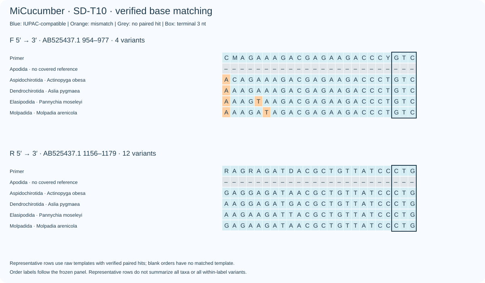
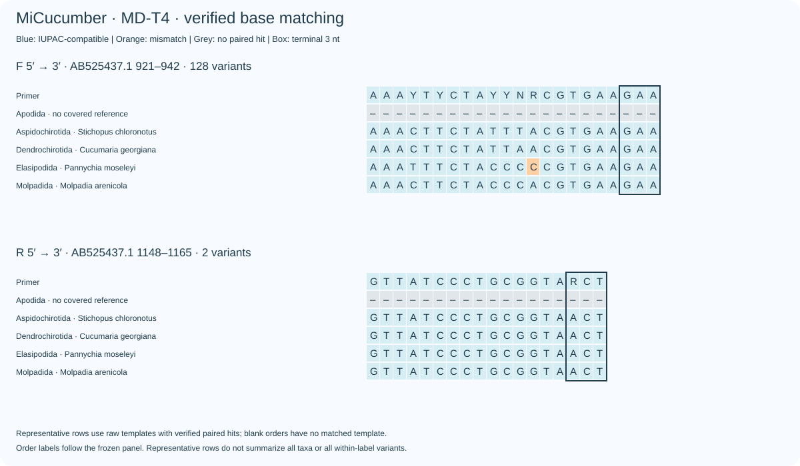
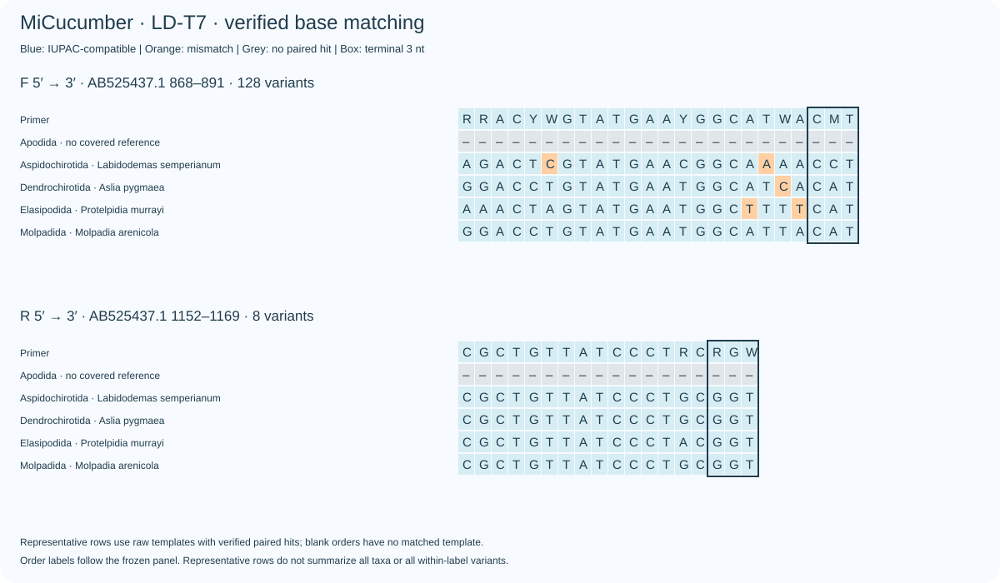
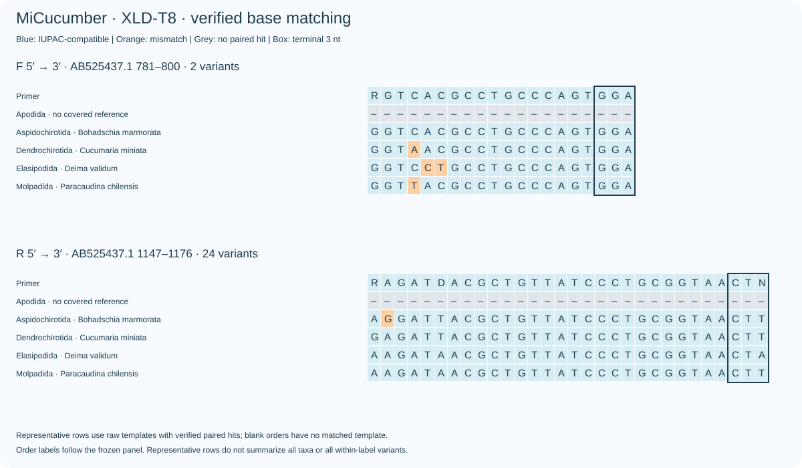

# MiCucumber：目间等权的D引物优化 / Order-balanced D optimization

本轮固定S、M、L、XL的当前F/R起止坐标，仅重新搜索简并方案。普通、A、B、XS和原版对照不变。主指标为：每目内至少一条参考命中的分类名称标签比例，再对5个冻结目标签等权平均，包含Apodida。完全匹配也采用相同的目间等权方式。冻结分类含旧目名Aspidochirotida，不等同于现生七目的覆盖评估。

This round fixes the current S–XL F/R endpoints and searches degenerate assays. Ordinary/A/B, XS and the original control are unchanged. Coverage averages taxon detection equally over five frozen order labels, including Apodida. Exact matching uses the same hierarchy. The frozen taxonomy includes the legacy Aspidochirotida and is not an assessment of all seven extant orders.

## 优先实验候选 / Priority experimental candidates

每个长度仅列一对优先候选。它们是独立PCR方案，不是多重PCR配方。编号用于追踪候选；最终选定的SD-T10、MD-T4、LD-T7、XLD-T8已分别更新为SD、MD、LD、XLD。所有百分比均来自原始序列复核，非局部比对预测。

One priority pair is listed per length, as separate assays rather than a multiplex recipe. The selected SD-T10, MD-T4, LD-T7 and XLD-T8 now correspond to current SD, MD, LD and XLD. Percentages below use verified raw-sequence hits rather than local-alignment predictions.

| Region / candidate | Order coverage: current → candidate | Order exact: current → candidate | F/R degeneracy | Strict WC / GT | Broad WC≤3 / GT≤2 |
|---|---:|---:|---:|---:|---:|
| S / SD-T10 | 46.07 → 66.03% | 3.26 → 4.95% | 4/12 | 3 / 6 | 71 / 7 |
| M / MD-T4 | 61.77 → 73.18% | 28.88 → 29.72% | 128/2 | 2 / 9 | 58 / 9 |
| L / LD-T7 | 47.47 → 61.63% | 7.55 → 15.99% | 128/8 | 0 / 0 | 21 / 21 |
| XL / XLD-T8 | 30.95 → 35.95% | 4.00 → 4.00% | 2/24 | 0 / 7 | 13 / 10 |

严格背景：每条≤2错配、末端3 nt兼容。宽松背景：不强制末端兼容。两者均为5,600条非目标库中的记录数，不能当作实验扩增比例。/ Strict background requires ≤2 mismatches per primer and compatible terminal 3 nt. Broad background omits the terminal rule. Both count records in the 5,600-record background library, not experimental amplification fractions.

- **S：补充合并后同时改善覆盖与完全匹配。** SD-T10将当前SD与覆盖优先候选的IUPAC碱基集合取并集，F/R简并度4/12；目间覆盖46.07→66.03%、完全匹配3.26→4.95%。Elasipodida从0/16到5/16、Molpadida从2/5到5/5；严格背景3/6条，宽松背景71/7条。较早的T1/T2覆盖候选确有完全匹配损失，保留作比较，不再优先推荐。
- **M：覆盖优先与完全匹配优先均有候选。** MD-T4覆盖73.18%、完全匹配29.72%，适合当前覆盖优先目标；MD-T3覆盖68.99%、完全匹配38.94%，宽松背景11/16，更适合作为完全匹配与背景控制的比较方案。MD-T5覆盖75.33%，但WC≤3为252条，只保留为放宽限制的比较。
- **L：收益较清楚。** LD-T7覆盖47.47→61.63%、完全匹配7.55→15.99%，Elasipodida从3/16到11/16，Dendrochirotida从20/32到27/32；宽松背景从20/16到21/21。代价是F/R简并度32/1→128/8，200 nM/方向时每种F变体为1.5625 nM、R变体25 nM。
- **XL：仍属有限改善。** XLD-T8覆盖30.95→35.95%，完全匹配保持4.00%；R简并度1→24。XLD-T9达到相同覆盖、完全匹配4.65%，但R简并度48且严格GT背景20条，因此不优先于较精简的T8。普通A/B组合是否仍更合适，需要放在新的分类群指标下一起判断，不能仅凭D的覆盖增量决定。
- **Apodida仍为0/6。** 主指标未将该缺口排除。当前同坐标、末端与热力学约束下，本次入围候选均未补齐它；不能据此证明不存在其他可行解。

The final S union candidate improves both breadth and exact matching; earlier S breadth-only candidates remain comparisons. M offers a coverage-oriented T4 and an exact-oriented T3. L gains both metrics at a considerable degeneracy/concentration cost. XL improves modestly; T8 is preferred over T9 for lower complexity. Apodida remains 0/6 and stays in the denominator. Candidate enumeration is bounded, not a proof of global optimality.

## 每目检出标签 / Detected labels by frozen order

| Assay | Apodida | Aspidochirotida | Dendrochirotida | Elasipodida | Molpadida |
|---|---:|---:|---:|---:|---:|
| SD | 0/6 | 86/92 | 31/32 | 0/16 | 2/5 |
| SD-T10 | 0/6 | 91/92 | 32/32 | 5/16 | 5/5 |
| MD | 0/6 | 57/92 | 29/32 | 9/16 | 5/5 |
| MD-T4 | 0/6 | 75/92 | 29/32 | 15/16 | 5/5 |
| LD | 0/6 | 70/92 | 20/32 | 3/16 | 4/5 |
| LD-T7 | 0/6 | 69/92 | 27/32 | 11/16 | 4/5 |
| XLD | 0/6 | 13/92 | 11/32 | 1/16 | 5/5 |
| XLD-T8 | 0/6 | 13/92 | 17/32 | 2/16 | 5/5 |

逐标签新增/丢失见[taxon_changes.csv](taxon_changes.csv)，种内全/部分覆盖见[by_taxon.csv](by_taxon.csv)。新增标签不等于原有标签全部保留。/ Label gains/losses and full/partial within-label coverage are reported separately; a net gain does not imply that every previously detected label is retained.

## 搜索与独立复核 / Search and verification

纳入旧候选，同时以目间平衡的碱基支持重新生成候选；保留各目代表种子与低简并备选，而非仅按旧种内平均指标排序。固定种子20261025；每方向简并上限8/32/128，允许3′端简并，参考支持阈值0.2%。初始从337条保留引物穷举6,796个F/R组合，另增加1个当前SD与覆盖候选的同坐标IUPAC并集合并方案，比较宽松背景上限20、100、500条，两种严格背景均≤50条。这些是探索分档，不是实验可接受比例。

The search includes earlier candidates plus order-balanced base-support expansion, order-specific seeds and low-degeneracy alternatives. Seed 20261025; per-direction degeneracy caps 8/32/128; terminal degeneracy allowed; minimum balanced support 0.2%. The initial retained pool contains 337 oligos and 6,796 pairs; one additional fixed-coordinate IUPAC-union rescue combines the current SD with a breadth-oriented candidate. Broad background tiers are 20/100/500, with both strict background counts ≤50. These are exploratory screening tiers, not experimental acceptance fractions.

逐实际变体检查末端规则及两种Primer3浓度情景（50 nM/变体、200 nM/方向）；最高发卡/二聚体Tm<55°C，F/R区间中点温差≤5°C。10个不同候选通过检查。原始目标扫描要求产物150–500 bp、内部≥50 bp；背景内部距离0–1000 bp。C++无预筛穷举与独立Python位并行扫描，核对7,020项目标判断与40组严格/完全背景集合，全部一致；50项宽松/严格背景计数与位点组合扫描也一致。背景集合复核并未独立覆盖每个宽松WC≤4位点；此范围不作扩大表述。

Every concrete variant is checked for terminal constraints and Primer3 thermodynamics at 50 nM/variant and 200 nM/direction: maximum structure Tm<55°C and F/R midpoint difference≤5°C. Ten unique candidates pass. Raw targets require 150–500 bp products and ≥50 bp internal sequence; background internal spacing is 0–1000 bp. Independent exhaustive C++ and bit-parallel Python scans agree on 7,020 target decisions and 40 strict/exact background sets. Fifty background counts also agree with the site-combination scan. Independent Python background validation is limited to strict/exact sets rather than every broad WC≤4 site.

设计与评估共用参考库，未做独立样本或湿实验验证。普通、A、B、D坐标已逐一核对，但实验阶段仍需处理高简并变体浓度、错配扩增效率与混合背景竞争。/ Design and evaluation reuse the reference library; there is no held-out or wet-lab validation. Endpoints agree with ordinary/A/B/D within each region. Variant dilution, mismatch-dependent amplification and mixed-background competition remain experimental questions.

## 序列与图件 / Sequences and plots

[All verified candidates](verified_comparison.csv) · [Primer pairs and coordinates](primer_pairs.csv) · [FASTA](primers.fasta) · [Thermodynamics](thermal.csv) · [Verification](verification.json) · [Raw hits](independent_hits.tsv) · [Frozen reproduction](reproduction_sources.zip)

### SD-T10

### MD-T4

### LD-T7

### XLD-T8

## 与普通A/B的同口径比较 / Comparison with ordinary A/B

| Region | Current ordinary A/B order coverage | Priority D candidate order coverage |
|---|---:|---:|
| S | 41.86% | 66.03% |
| M | 31.37% | 73.18% |
| L | 13.70% | 61.63% |
| XL | 30.82% | 35.95% |

每个D候选为一对；A/B为分别PCR的并集。D的变体浓度及实验效率仍需验证。/ Each D candidate is one pair; A/B values are separate-PCR unions. Variant concentrations and experimental efficiency still need validation.

Copyright © 2026 Fei Xia (GUIBA-EX). All rights reserved.

[Final selection and current sequences](../../docs/D_OPTIMIZATION.md).
